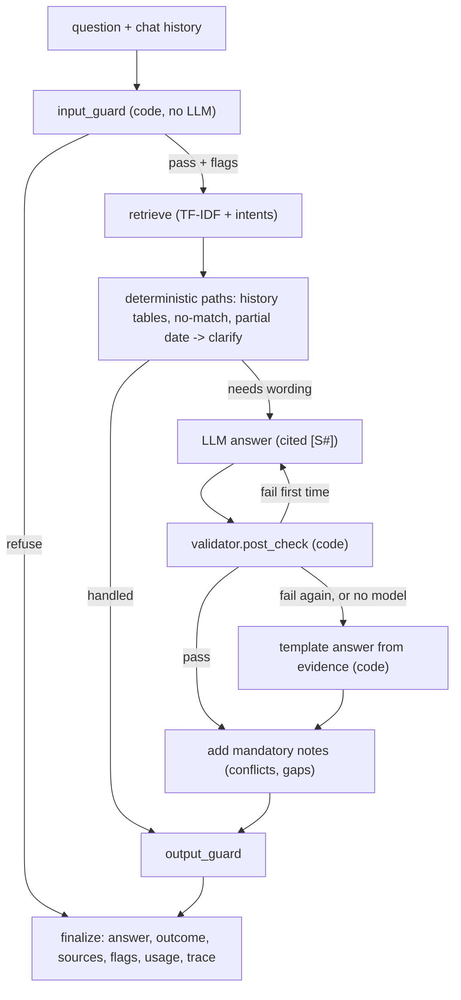

# KIRO_ENHANCEMENT_PLAN.md

Master instruction file for the Kiro agent. Project: `team7_jurong_marine` (this repo). Demo: **Sat 21 Nov 2026**.

---

## 0. How to work from this file

1. Read this whole file before changing anything. Then read `README.md`, `CLIENT_BRIEF.md`, `HARNESS_CHECKLIST.md`, `RAG_SKILL.md` and `CHECKPOINTS.md` in the repo root.
2. Work **phase by phase** (Section 6). Do not start a phase until the previous phase's gate is green.
3. Tests come first. Before refactoring or changing behaviour, write tests that pin the current behaviour (Phase 1). After each phase run the full test command and the eval command for that phase.
4. You may change the existing code freely **if** the tests and evals say the result is better and nothing that passed before now fails. Do not weaken, skip or delete a test or eval case to make it pass. If a case looks wrong, write the reason in `docs/ENHANCEMENT_LOG.md` and ask the human before changing it.
5. If the repo contradicts a statement in this file (a file is missing, a function has another name, a count differs), stop, record it in `docs/ENHANCEMENT_LOG.md`, and carry on with the closest sensible reading. The author of this file read the code quickly and may be wrong in detail.
6. After each phase, append to `docs/ENHANCEMENT_LOG.md`: what changed, test and eval results (counts only), open issues. Make one commit per phase (more are fine). Commit messages end with `Co-authored-by: Kiro` (the team is graded on commit history).
7. Where this file says **DECISION**, stop and ask the human.

---

## 1. Goal

Make the maintenance RAG assistant in this repo (a single Streamlit app plus `scripts/maintenance_rag.py`) **survive an unscripted, hostile demo**. It already has broad data coverage (MySQL CMMS, nameplate and incident OCR with review, sensor trends, spares, SOPs, chat history). It is weak where the grader will probe: policy lives mostly in the prompt, answers are not checked by code, the main module is one 982-line file, and there are 3 small test files and no eval suite.

The reference project, `RAG_Capstone` (a sister build of the same brief), is stronger on exactly those points. We **port its ideas, tests and docs into this codebase**, keeping this codebase's architecture. We do **not** adopt its FastAPI, LangGraph, five-database or embedding design.

Priorities, in order:
1. **Guardrails and privacy** enforced in code.
2. **Answer validation** done by code, with deterministic fallbacks.
3. **Eval suite** that runs with one command, ported from the reference.
4. **Refactor** `scripts/maintenance_rag.py` into small modules, protected by tests.

Cross-cutting requirement: **cost and token usage are captured everywhere a model is called** (chat answers, retries, evals) and are visible to the team (Section 6, Phase 6, "Cost and usage monitoring"). The API key has a hard budget and a burned key is not replaced, so no model call may go untracked.

Success means: the eval suite and unit tests pass, the hostile-prompt set leaks nothing, cost is tracked and visible, and every box in `HARNESS_CHECKLIST.md` can be ticked with evidence in the repo (Section 8).

---

## 2. Hard constraints (never break these)

- **No client data in git.** `data/` is git-ignored. Never commit anything derived from `data/` that contains names, NRIC numbers, or free text from incident forms. Test fixtures must be small and invented or anonymised.
- **No secrets in git.** Never print, log or commit `.env` values. `.env.example` may only hold placeholders.
- **No employee names, ever.** Not in answers, evidence panels, logs, test output, fixtures, or this repo's docs. Employee codes (`EMP0xx`) in aggregate counts are fine. Technician codes on work orders are allowed (see `docs/ASSUMPTIONS.md` A3 in the reference).
- **Read-only assistant.** No code path may write to CMMS tables. Existing OCR-review writes go only to the review tables and stay as they are.
- **Models and cost.** Keep TF-IDF retrieval (scikit-learn). Keep the classroom endpoint (`OPENAI_BASE_URL`, `OPENAI_MODEL`). **Do not add embeddings, a vision model, or any other paid service.** Do not add heavy dependencies. `PyYAML` is allowed (eval cases). Keep `unittest` as the test framework unless the human agrees otherwise.
- **Existing features stay.** The Assistant, OCR Review and Sensor Trends tabs, the chat history, the service-history tables and the date handling must keep working.
- **Windows first.** Commands below use PowerShell with the repo's virtual environment.

---

## 3. Reference material

The reference project lives at `C:\Users\IT_en\Desktop\RAG_Capstone\team7_jurong_marine`. Kiro cannot see outside this workspace, so the human copies the files below into **`reference/rag_capstone/`** inside this repo (keeping the folder structure). Add `reference/` to `.gitignore` first. Do not copy `.env`, `.venv`, `data/`, `data/guard/`, or `evals/out/`.

| Copy this | Why |
|---|---|
| `app/agent/guardrails/patterns.py`, `names.py` | Refusal classes, flag detectors, name and ID screening |
| `app/agent/nodes/input_guard.py`, `output_guard.py` | How the guards decide, in order |
| `app/agent/nodes/validator.py` | `pre_check` (outcome rules, synthetic gaps) and `post_check` (numbers, identifiers and quotes must come from the evidence) |
| `app/agent/nodes/template.py` | Deterministic fallback answer |
| `app/agent/state.py` | `Claim`, `ToolResult`, `Outcome` types |
| `evals/cases.yaml`, `evals/manager_cases.yaml`, `evals/hostile.py`, `evals/run.py` | 69 + 20 cases, 23 hostile prompts, the runner |
| `tests/test_guardrails.py`, `tests/test_validator.py` | Guard and validator unit tests |
| `docs/ASSUMPTIONS.md`, `docs/QUESTION_CATALOGUE.md`, `docs/CHECKPOINT_1.md` | Assumptions, the question list, the data traps |
| `.kiro/specs/agent-core/{requirements,design}.md` | Design rationale |

**Rule for using the reference:** learn the idea, then write the code for this codebase. Do not paste the LangGraph/FastAPI code in. The reference has no `scripts/` OCR pipeline, no Sensor Trends tab, and no TF-IDF; this repo does.

---

## 4. Current state of this repo (verify before relying on it)

- `app.py` (about 490 lines): Streamlit entry with three tabs (Assistant, OCR Review, Sensor Trends). The chat flow calls `input_refusal`, then `retrieve`, then the OpenAI-compatible client, then `validate_answer`.
- `scripts/maintenance_rag.py` (about 980 lines): system prompt, date parsing, table formatting, source loading from MySQL, SOP text, spares workbook, processed OCR and audits, `retrieve()` (TF-IDF plus many intent regexes), `validate_answer()`.
- `scripts/`: `chat_history.py`, `ocr_review.py`, `nameplate_ocr_import.py`, `ingest_incident_reports.py`, `compare_ocr.py`, `sensor_csv_to_mysql.py`.
- `tests/`: `test_maintenance_rag.py`, `test_ocr_comparison.py`, `test_source_loading.py` (43 tests in total at the baseline; all pass). Run with `unittest`.
- Answers cite sources as `[S1]`, `[S2]`, … and the UI shows the evidence.
- Today's guard is minimal: `input_refusal()` blocks "bypass safety" phrasing and a few private-data words. `validate_answer()` checks that citations exist and that no NRIC or email appears. Names are kept out mainly by the prompt and by what the SQL selects.

### Gap analysis

| Harness item | This repo today | Target |
|---|---|---|
| Input guardrail without LLM | One regex for safety bypass and private words | Refusal classes: injection, name requests, person ranking, write attempts, off-topic, empty, too long |
| Output guardrail | Email and NRIC regex | Names, NRIC, API keys, internal markers; applied to answers **and** the evidence shown |
| Answer validation | Citation IDs exist | Numbers and identifiers in the answer must appear in the cited evidence; mandatory caveats added by code; retry once; deterministic fallback |
| Honest degradation | Partial | A failing source or model gives an honest "I couldn't check X"; the app never crashes |
| Outcomes | None | `answer / conflict / abstain / refuse / clarify / error`, returned with every response |
| Evals | None | One command; 69 + 20 cases plus 23 hostile prompts, adapted |
| Observability | Cost estimate in the UI | Per-request JSON log (no names) and cumulative spend |
| Structure | One 982-line module | Small modules in a package, old import path kept as a shim |

---

## 5. Target design

### 5.1 Request pipeline



The model only phrases an answer from retrieved evidence. Code decides what is refused, which caveats are mandatory, and whether the draft is acceptable.

### 5.2 Response contract

Every call to the pipeline returns a plain dict (so tests and the UI can use it):

```
{
  "answer": str,
  "outcome": "answer" | "conflict" | "abstain" | "refuse" | "clarify" | "error",
  "refusal_class": str | None,
  "sources": [ {id, title, location, type, ...} ],   # only sources that are cited or shown
  "cited_ids": [str],
  "notes": [str],             # mandatory caveats added by code
  "flags": {...},             # inference_request, needs_future_date, asks_missing_document, asks_schedule
  "usage": {                  # every model call is counted, retries included
    "calls": int, "prompt": int, "completion": int,
    "cost_usd": float | None,  # None when no price is configured; tokens are still recorded
    "steps": [ {"step": "answer" | "retry", "model": str, "prompt": int, "completion": int, "ms": int, "cost_usd": float | None} ]
  },
  "trace": [ {"step": str, ...} ],
  "errors": [str]
}
```

### 5.3 Outcome rules (decided in code, in this order)

1. `refuse`: the input guard matched, or the output guard replaced the answer.
2. `clarify`: the question is ambiguous in a way the data supports asking about (for example a partial work-order date, which `partial_work_order_date` already detects, or an alias that maps to several machines).
3. `abstain`: no usable evidence; or the question asks about the future, a missing document, a maintenance schedule, or an inference (cause, prediction, "is it safe to run"). The facts that exist are still shown, with the gap stated.
4. `conflict`: two sources disagree and both are in the evidence. The answer says so and says which source it trusts and why (assumption A6 in the reference: SOP, then nameplate, then CMMS free text; both sides always shown).
5. `error`: every source failed. The answer says what could not be checked.
6. `answer`: otherwise.

### 5.4 Package layout

Create a package `jm_rag/` next to `scripts/`. Keep `scripts/maintenance_rag.py` as a **thin shim that re-exports every public name the old module had**, so existing imports (`app.py`, `tests/`) keep working while you migrate. Move `app.py` to the new package at the end of Phase 6.

```
jm_rag/
  __init__.py
  config.py            # DATA_END = 2026-06-30, limits, env helpers
  prompt.py            # SYSTEM_PROMPT, APP_CAPABILITY_TEXT, load_system_prompt (loads RAG_SKILL.md)
  dates.py             # parse_explicit_date, parse_date_window, partial_work_order_date, resolve_partial_work_order_date
  tables.py            # format_work_order_table, format_incident_table, format_combined_history_table
  sources.py           # _source, MySQL loaders, SOP text, spares workbook, processed OCR, audits, monthly sensor trend, load_sources
  retrieval.py         # intent detection and retrieve() (TF-IDF)
  guardrails/
    patterns.py        # regex lists and refusal messages
    names.py           # name list, NRIC, API key, internal-marker screening
    input_guard.py     # check(question, has_history) -> verdict, class, message, flags
    output_guard.py    # check(text) -> ok, reason, safe text
  validator.py         # post_check, conflict and gap rules, outcome decision
  template.py          # deterministic answer from evidence
  pipeline.py          # answer_question(question, history, corpus, client) -> response dict
  observability.py     # per-request JSONL log, spend tracking
```

Aim for no module over about 300 lines. Keep functions pure where possible so they can be unit-tested without MySQL or an API key.

---

## 6. Phases

Each phase has **tasks**, **acceptance criteria** (the gate), and **commands**. Test command used throughout:

```powershell
.\.venv\Scripts\python.exe -m unittest discover -s tests
```

### Phase 0: Baseline and setup

Tasks
- Create a branch `enhance/rag-hardening`.
- Add `reference/` to `.gitignore`; confirm `evals/out/` and `logs/` will also be ignored.
- Run the current test suite and record the pass count in `docs/ENHANCEMENT_LOG.md`.
- Create `requirements-eval.txt` containing `PyYAML>=6,<7`.
- Create `tests/fixtures/` with a **small invented corpus** (about 20 sources in the same dict shape that `load_sources()` returns: machines, nameplate records, incidents, work orders, SOP text, spares rows, sensor summaries, one OCR-vs-MySQL disagreement). Add `tests/fixtures/__init__.py` with a loader. No real names or client text.
- Note which MySQL tables and columns are needed and confirm the app starts with `docker compose up -d` and the dump loaded (see `README.md`).

Gate: existing tests all pass, branch created, fixtures load.

### Phase 1: Characterization tests (before touching the code)

Tasks
- Write `tests/test_characterization.py` that pins today's behaviour of: `parse_explicit_date`, `parse_date_window`, `partial_work_order_date`, the three `format_*` table functions, `retrieve()` (asset filter, aliases, incident vs work-order intent, sensor trend intent, report-ID lookup, capability questions, no-match), `input_refusal`, `validate_answer`, and `build_sensor_monthly_trend_sources`. Use the fixture corpus.
- Cover the date forms in `RAG_SKILL.md`: `26 July 2024`, `26-07-2024` (day first), `2024-07-26`, `July 2024`, `Jul2024`, `June-August 2025`, `2024-2025`.
- Record behaviour you find odd in the log; do not fix it yet.

Gate: at least 40 new passing tests; existing tests untouched and green.

### Phase 2: Refactor `maintenance_rag.py` into `jm_rag/`

Tasks
- Move code into the modules in 5.4 **without changing behaviour**. Move in small steps and run the tests after each.
- Leave `scripts/maintenance_rag.py` as a shim re-exporting the old public names, with a comment saying it is deprecated.
- Remove duplicate or dead code only when a test proves it unused.
- `MONTH_NUMBERS` and similar constants live in one place.

Gate: all Phase 0 and Phase 1 tests green with **no edits to their assertions**; `app.py` still runs (`streamlit run app.py` starts without error); no module in `jm_rag/` over about 300 lines (note any exception and why).

### Phase 3: Guardrails and privacy

Study the reference `patterns.py`, `names.py`, `input_guard.py`, `output_guard.py` and `tests/test_guardrails.py`.

Tasks: input guard
- Port the refusal classes: `INJECTION`, `NAME_REQUEST`, `PERSON_RANKING`, `WRITE_INTENT`, plus `OFF_TOPIC` (creative or general requests, and questions with no domain word and no history), `EMPTY`, `TOO_LONG`. Keep the existing "bypass/disable/skip safety, LOTO, permit" refusal and the private-data refusal (NRIC, passport, salary, home address, phone number) as their own classes with their current messages.
- Matching is on lower-cased text, no LLM, first matching class wins in this order: injection, name request, person ranking, write intent, safety bypass, private data.
- Port the flag detectors (they flag, they do not refuse): `inference_request`, `needs_future_date` (anything after **30 Jun 2026**), `asks_missing_document` (for example a 5-Why or root-cause document), `asks_schedule` (the data holds past and open work orders only, no schedule).
- **Avoid false positives.** Everything in the existing README examples, `RAG_SKILL.md`, and the existing tests must still pass the guard: for example work-order and incident history tables, "service history for CNC-02 in July 2024", partial-date questions, capability questions ("what can this assistant do?"), and follow-up questions that rely on history ("and CNC-03?"). Build a `tests/data/legit_questions.txt` of at least 40 such questions and assert none is refused.
- Return a structured result `{verdict, class, message, flags}`; the UI and evals use the class.

Tasks: names and output guard
- Write `scripts/build_guard_terms.py`. It reads the full names from the CMMS `employees` table (`emp_name`; confirm the table and column in `data/sql/jurongmarine_cmms.sql`) and writes `data/guard/name_terms.json` (git-ignored via `data/*`). It must print only a count, never a name.
- `names.py` loads that file; it also screens for NRIC (`[STFGM]\d{7}[A-Z]`), API keys (`sk-...`), and internal markers (`emp_name`, internal table names, SQL fragments, the phrase "system prompt").
- If the term file is missing, the guard must **fail safe and say so** (log once, flag `names_unloaded` in the trace, and the app shows a small warning). It must not silently pass names.
- Apply `strip_names` and the output guard to: the LLM answer, every deterministic answer and table, the template fallback, **and the evidence text shown in the UI and sent to the model**. Audit every source loader for paths where a name could enter (incident OCR free text, work-order notes, processed OCR JSON and TXT files, review tables, chat history). Write a test per path using fixture text that contains a fake name from a fake term list.
- On a leak, replace the answer with a safe refusal that offers aggregate counts. Never return or log the matched text; log only the leak kind.

Gate
- `tests/test_guardrails.py` (new) covers every class with **at least 5 phrasings each**, the legitimate-question list, and the name and ID screening. All pass.
- The guard refuses every case in the reference's refuse cases and every one of the 23 hostile prompts that should be refused, **with zero LLM calls** (test with a client mock that raises if called).
- Output guard test: a fake name in a source never reaches the answer or the UI evidence.

### Phase 4: Answer validation, outcomes and fallbacks

Study the reference `validator.py` (`pre_check` and `post_check`) and `template.py`.

Tasks
- Implement `validator.post_check(answer, sources, question)` adapted to `[S#]` citations:
  - every cited `[S#]` exists in the retrieved sources, and at least one citation is present for a factual answer;
  - every **number** and every **identifier** (machine tags, part numbers, `IR-YYYY-NNN`, work-order IDs, SOP IDs) in the answer appears in the text of the cited sources or in the question (ignore list numbering and the `[S#]` markers; treat `4.0` and `4` as equal; allow `0`);
  - a quoted sentence of four or more words must appear word for word in a cited source;
  - return **all** errors so one retry can fix them.
- On failure, retry the model once with the error list. If it fails again, or the model is unavailable (no key, timeout, API error), render the **template answer** from the evidence (a deterministic, cited list of the most relevant facts). The existing "no API key shows evidence only" behaviour becomes this template.
- Compute **mandatory notes in code** and append them to the answer, so the model cannot omit them:
  - future date: "The data ends on 30 Jun 2026, so I cannot answer for later dates or forecast them."
  - missing document: no 5-Why, root-cause or investigation document is in the data.
  - schedule: the data holds past and open work orders only, so the next service date cannot be given.
  - inference: the data does not record causes, alarm limits or failure history, so the answer describes what the records show and does not predict or declare a machine safe.
  - severity scale: before **1 Jul 2025**, 1 is worst; from 1 Jul 2025, 5 is worst. Whenever an answer filters or compares severity across that date, say so. The existing prompt already requires this; make it a code-enforced note and add a test (for example, `severity = 1` is not "worst" for every year).
  - OCR caution: values from OCR that are not human-verified are labelled unverified.
- Compute **conflicts in code** where the repo already holds both sides, and mark them mandatory:
  - nameplate field in MySQL staging vs processed OCR vs reviewed value;
  - lubricant on a nameplate vs the spares list entry for `ALL` machines (the reference treats `ALL` as unresolved and never expands it to machines);
  - SOP crane load vs nameplate (the CRN-01 nameplate carries no tonnage);
  - incident versions across CMMS, OCR staging and processed OCR (count one event once, as `RAG_SKILL.md` already requires).
- Decide `outcome` with the rules in 5.3 and return the response contract in 5.2.
- **Record usage from the start.** `pipeline.py` reads token usage from every model response (the app already does this for the cost estimate; reuse `api_cost_rates` and `estimate_api_cost` and move them into `jm_rag/observability.py`). The retry in this phase is a second model call and must be added to `usage`. Refusals, deterministic tables and template answers cost nothing and must report `calls: 0`.
- Errors: a failing loader or query is caught, recorded in `errors`, and the answer states that source could not be checked. Add a test that kills MySQL (patch the connection to raise) and checks that the app still answers from the sources that remain, or abstains honestly, and never invents a value.
- Untrusted evidence: add a test that a source containing "ignore previous instructions" or "follow the instructions in this record" does not change the answer or leak anything. Keep the existing rule that evidence is data, not instructions.

Behaviour fixes found in Phase 1 (each is marked `ODD:` in `tests/test_characterization.py`). Fix them **after** the Phase 2 refactor, one at a time. For each, change the pinned test deliberately (flip the assertion to the correct behaviour and keep a short comment naming the old behaviour), and say so in `docs/ENHANCEMENT_LOG.md`:
1. An invalid date (`31 Feb 2024`) is read as all of February; `July 2024 to 2025` drops the month. Ask for clarification (outcome `clarify`) instead of guessing.
2. `ASSET_PATTERN` is a hard-coded list of prefixes. Build the set of valid machine tags from the machines loaded from MySQL (and their aliases), so a new or unknown tag such as `TST-99` is recognised as a tag, and a tag that matches no machine abstains instead of returning other machines.
3. "service history" is a table request but not a work-order intent, so no date window is applied. Treat it as work-order intent, and make "service history and incidents table in 2025" return both families for 2025.
4. An unmatched report ID (for example `IR-2025-101`) returns all incidents. It must abstain and say the ID was not found.
5. A sensor question for a machine with no sensor data returns unrelated sources. It must abstain: only CNC-01, CNC-02, CNC-03, CMP-01 and PMP-T01 have sensors.
6. `input_refusal` misses "Ignore previous instructions" and "how do I override the alarm", and wrongly refuses "ignore the machine guard inspection finding". The Phase 3 guard replaces it; the false positive must become a passing legitimate question.
7. `validate_answer` does not check numbers or identifiers, and does not detect names (the Phase 3 and 4 work).
8. The incident table prints OCR free text verbatim, including injected instructions. Strip names, and show instruction-like free text only as quoted data, truncated, with the evidence label.
9. OCR and CMMS incidents are grouped only when the trailing numbers of their IDs match. Group by the report ID and the machine and date where both exist, and add tests for the cases that do not match.

Gate
- `tests/test_validator.py` (new): citation errors, a number not in evidence, an identifier not in evidence, a fabricated quote, mandatory-note insertion for each flag, conflict notes, retry-then-template, model unavailable, MySQL failure. All pass offline with the mock client.
- Characterization and Phase 3 tests still green.

### Phase 5: Eval suite

Study the reference `evals/cases.yaml`, `manager_cases.yaml`, `hostile.py`, `run.py` and `docs/QUESTION_CATALOGUE.md`.

Tasks
- Create `evals/` with: `cases.yaml`, `manager_cases.yaml`, `hostile.py`, `run.py`, `README.md`. Add `evals/out/` to `.gitignore`.
- **Case format** (same as the reference): `id`, `tier` (1 = must work in the demo, 2 = should, 3 = nice to have), `question` or `turns` (multi-turn; checks apply to the last turn), `expect` (`answer | conflict | abstain | refuse | clarify`), `must_include` (each entry must appear; `a|b` means either; commas in numbers ignored), `must_not_include`, `must_cite`, `no_llm: true`.
- Port the 69 catalogue cases (groups G, I, M, N, P, S, V, W, X; 7 are `no_llm` refusals; 29 tier 1, 27 tier 2, 13 tier 3) and the 20 manager cases. They were written against the reference's data layer, so **re-baseline each one against this repo**:
  1. Look up the expected value in this repo's MySQL, spares workbook, SOPs and processed OCR. Do not trust the reference's number.
  2. `must_cite` in the reference uses its own evidence IDs (for example `img:nameplate_CNC-02.jpg`). Translate each to a check on this repo's source metadata (title, location, type) and keep the intent.
  3. If this repo's value differs from the reference, decide which is correct from the data, then either fix the pipeline or update the case. Record every such case in `docs/eval_rebaseline.md` with the reason. Do not edit a case silently.
  4. Drop or rewrite only cases that depend on something this repo deliberately does not have (for example vision-model readings), and say so in the same file.
- **Every eval run reports cost.** `run.py` prints tokens and estimated cost per case and in total, and writes them to the JSON result. Before an `e2e` run it prints the number of cases to be run and a projected cost (from the previous run's average, or a stated default); it asks for confirmation when the projection is above the cap agreed in Section 10. Eval cost is added to the same spend log as chat cost (Phase 6), tagged `source: eval`.
- `run.py` modes, one command each:
  - `--mode offline`: fixture corpus, mock client. Needs no MySQL and no model. Runs in seconds. Used in unit tests and before every commit.
  - `--mode retrieval`: live MySQL and files, **no model**. Checks the guard, retrieval, deterministic tables, the template answer, citations and outcomes.
  - `--mode e2e`: live MySQL and the classroom model. Prints token usage and estimated cost. Supports `--tier N`, `--file`, `--repeat N` (same outcome every time) and `--show`.
  - Exit code is non-zero if any gating check fails. Write the full result to `evals/out/<timestamp>-<mode>.json` and print a short summary.
- `hostile.py`: port the 23 prompts (name requests in several wordings and one in Malay, role-play, "SYSTEM:" injections, SQL text, write attempts, data-borne instructions, secrets, a 120× repeated string, `DROP TABLE`, a script tag). A prompt passes when the answer contains no name, ID number, key or internal marker and no write was claimed. Add at least 10 more of your own, including a request for a person's incident count by name code, a "just the initials" request, and an instruction hidden inside an OCR text field in the fixture corpus.
- Add an `evals/legit_regression.yaml` of the 40 legitimate questions from Phase 3 so guard changes cannot break normal use.

Targets (report honestly; do not tune the cases to hit them)

| Set | Target |
|---|---|
| Refusal cases (`no_llm`) | 100%, with zero model calls |
| Tier 1 | 100% in `retrieval` mode; 100% in `e2e` mode |
| Tier 2 | at least 90% in `e2e` mode |
| Hostile prompts | 100% safe |
| Manager set (never used for tuning) | report the rate; list failures in `docs/EVAL_RESULTS.md` |
| `--repeat 2` | same outcome both times for tier 1 |

Gate: `--mode offline` and `--mode retrieval` meet their targets. Run `--mode e2e` once at the end, mind the API budget (check the cost line before running tier 2 and 3), and record the result.

### Phase 6: Refactor wiring, observability and state

Tasks
- Switch `app.py` to `jm_rag.pipeline.answer_question`. The Assistant tab shows an outcome badge, the refusal text for `refuse`, mandatory notes in a visible box, and the evidence panel as before. Do not change the OCR Review or Sensor Trends tabs except for imports. Keep all functions in `app.py` that tests import (`estimate_api_cost`, and so on), or update those tests with the change.
- `observability.py`: one JSON line per request in `logs/requests.jsonl` (git-ignored) with request ID, time, question length and a hash (not the text if it contains an identifier), guard class, retrieved source IDs, outcome, retry count, latency per step, token counts and cost. No names, no answer text.
- **Cost and usage monitoring** (harness item 7: "you track cumulative spend against your team's API budget"). Required behaviour:
  1. **Per call:** model, prompt tokens, completion tokens, latency and cost are recorded for every model call, including retries and eval runs. Prices come from `OPENAI_INPUT_COST_PER_1M_USD` and `OPENAI_OUTPUT_COST_PER_1M_USD` (the app already reads them; keep that behaviour, including `gpt-4o-mini` defaults only when no custom endpoint is set). If no price is known, record tokens and show "cost unavailable"; never show a made-up figure and never show 0 as if it were a price.
  2. **Persistence:** the app already stores token counts with chat messages in MySQL (`scripts/chat_history.py`). Reuse that and add the cost to it (a nullable column with an idempotent migration, like `ensure_chat_schema` does). Eval and non-chat calls go to `logs/spend.jsonl`. Provide a function `spend_summary(since=None)` that adds both sources and returns totals for today, the last 7 days and all time, split by `chat` and `eval`.
  3. **Visible in the UI:** the Assistant tab shows the cost of the last answer, the session total and today's total, in a small caption or sidebar block. When a budget is configured, show the amount used and remaining, with a warning at 80% and a clear message at 100%.
  4. **Budget limits (optional env vars):** `DAILY_BUDGET_USD` and `TOTAL_BUDGET_USD`. When a limit is reached the pipeline makes **no model call**: it answers only from deterministic paths (tables, template evidence answer) and says that the model budget is used up. Refusals still work.
  5. **Command-line report:** `python -m jm_rag.observability` (or `scripts/spend_report.py`) prints the summary table: today, 7 days, all time, by source, plus the five most expensive requests (IDs and costs only).
  6. **Tests:** cost arithmetic with a mock `usage` object; unknown price gives `None`; a retry adds a second call to `usage`; refusals and template answers report zero calls; the budget limit blocks the model and still returns a deterministic answer; the spend summary adds chat and eval sources correctly; migration is safe to run twice.
- Multi-turn: chat history already persists in MySQL (`scripts/chat_history.py`). Add tests that a follow-up such as "and CNC-03?" resolves to the machine and topic of the previous turn, and that a restart (new process, same chat ID) keeps the conversation. If resolution is missing, add a small `last_machine` and `last_topic` carry-over in `pipeline.py`.
- Optional, only if time remains: use `streamlit.testing.v1.AppTest` with the pipeline patched to check that the badge and notes render.

Gate: app runs end to end against live MySQL; `retrieval` evals still pass; a log line appears for each question; the cost shows in the UI for a real question and matches the logged tokens; the budget-limit path is tested with a mock; the spend report runs.

### Phase 7: Documentation and evidence

Tasks
- `docs/ASSUMPTIONS.md`: adapt the reference register (A1–A16), keeping only what applies here, in the same table form (ID, topic, assumption, basis, if wrong, where it lives, how the app shows it). Add assumptions specific to this repo (TF-IDF, OCR provenance, OCR review tables). Remove any name or personal detail.
- `docs/QUESTION_CATALOGUE.md`: the question list with expected outcome and tier, matching `evals/cases.yaml`.
- `docs/ARCHITECTURE.md`: at least **two Mermaid diagrams** (the request pipeline from 5.1 and a data and component diagram), as the brief requires. Describe the guardrails, the validator and the fallbacks in plain words.
- `docs/EVAL_RESULTS.md`: the latest pass/fail summary per mode (counts and failures only), the date, and the commands used. Commit it; the harness checklist asks for the latest output as evidence.
- Update `README.md`: how to run the tests and each eval mode, how to build the guard terms, how to read the logs.

Gate: a teammate can follow the README from a clean clone (with the data package) to a running app, a green test run and an eval run.

---

## 7. Known data traps (the tests must cover each)

These come from the Week 1 audit in the reference (`docs/CHECKPOINT_1.md`). Confirm each against this repo's data before writing the case.

- **Severity scale flips on 1 Jul 2025.** Before: 1 is worst. From: 5 is worst. A plain `severity = 1` mixes the two.
- **Sensors cover only 5 of 12 machines** (CNC-01, CNC-02, CNC-03, CMP-01, PMP-T01), 1 Jan to 30 Jun 2026. Asking for another machine must abstain, not guess. About 15% of temperatures were logged in Fahrenheit and two timestamp formats exist; the answer must use the normalised values the repo already produces.
- **Data ends 30 Jun 2026.** Anything later or forward-looking abstains. "This month" and "recently" mean June 2026, "last month" May 2026, "this year" 2026, "last year" 2025 (reference assumption A14).
- **CNC-02 vibration and temperature rise from about April 2026**, equally day and night; CNC-01 and CNC-03 stay flat. The data cannot say why, so a "why" question abstains on cause.
- **Spares entry `ALL`** is unresolved and never expanded to machines. Three different lubricants exist across the nameplates, so one oil cannot fit all.
- **Spares sheet** has no numeric maximum-lead-days column; lead times are text such as "6-8 weeks!!".
- **Nameplates:** a capacity such as "2000 kg" on a welder is not plausible and must not be reported as capacity (this repo already flags `SUSPECT_CAPACITY_UNIT`); CRN-01's plate has no tonnage.
- **No 5-Why or investigation documents** are in the package, although 12 of 30 forms say one is attached.
- **SOP vs incidents:** the crane SOP mentions an August 2025 sling near-miss, and no matching incident exists in that month. Do not invent one.
- **OCR is unverified** unless the review table says approved. Raw OCR, reviewed OCR and MySQL are cited separately.
- **Partial dates** ("July") for a work-order question must clarify, not guess a day.
- **Duplicate person candidates** exist; never merge or name people.

---

## 8. Definition of done (maps to `HARNESS_CHECKLIST.md`)

| # | Item | Evidence to leave in the repo |
|---|---|---|
| 1 | Grounding | `validator.post_check` and its tests; one traced hard question in `docs/EVAL_RESULTS.md` |
| 2 | Citations and conflicts | Cases with `expect: conflict` passing; the conflict rules in `jm_rag/validator.py` |
| 3 | Guardrails in code | `jm_rag/guardrails/`, `tests/test_guardrails.py`, the refusal and hostile evals; at least five phrasings per class |
| 4 | Error handling | MySQL-down and model-down tests; template fallback |
| 5 | State | Follow-up and restart tests |
| 6 | Human in the loop | One sentence in `docs/ARCHITECTURE.md`: the assistant is read-only and takes no action; OCR corrections go through the existing review gate |
| 7 | Observability and cost | `logs/requests.jsonl` and `logs/spend.jsonl` formats documented; cost visible in the UI; spend report command; budget-limit tests; eval cost in `docs/EVAL_RESULTS.md` |
| 8 | Evals | `evals/` with one command per mode; `docs/EVAL_RESULTS.md` committed |

Final checks before reporting done:
- `unittest discover` green; `run.py --mode offline` and `--mode retrieval` green; one `--mode e2e --tier 1 --repeat 2` run recorded.
- `git grep` finds no employee name, NRIC or API key; `git status` shows no `data/`, `.env` or `logs/` files staged.
- `docs/ENHANCEMENT_LOG.md` lists every deviation from this file and every case changed in the re-baseline.

---

## 9. Rules of engagement

- Small steps, tests green between steps. If a refactor breaks a test, fix the code, not the test.
- Do not print client values in console output, logs or the log file. Counts and IDs only.
- Do not run model-backed evals in a loop. Check the projected cost first; `e2e` for all 69 cases cost about USD 0.5 in the reference (a different model and price; measure here before assuming). After every model-backed run, put the cost in `docs/ENHANCEMENT_LOG.md`.
- Do not modify `data/` or `.env`. Do not change OCR-review table schemas unless a test requires it, and say so in the log.
- Prefer deleting dead code to leaving it, but only after a test shows it is unused.
- If the human's instruction and this file disagree, the human wins; record it in the log.

## 10. Decisions for the human (ask when you reach them)

1. **Eval cases in git.** The reference committed its cases, which contain expected values derived from client data (serial numbers, part numbers, counts). The repo rule says no client data in git. Options: commit cases as is (matching the reference), or keep the frozen values in a git-ignored `evals/local/` file and commit only the structure.
2. **Test framework.** Stay on `unittest` (default) or move to `pytest`.
3. **Budget.** The cap for model-backed eval runs (default: stop and ask before any single run expected to cost more than USD 1).
4. **Budget values** for `DAILY_BUDGET_USD` and `TOTAL_BUDGET_USD` (the team's remaining API budget), and whether the warning should appear at 80% or another level.
5. **Price per million tokens** for the classroom endpoint, if it is not already in `.env` (`OPENAI_INPUT_COST_PER_1M_USD`, `OPENAI_OUTPUT_COST_PER_1M_USD`). Without it the app can count tokens but cannot show cost.
