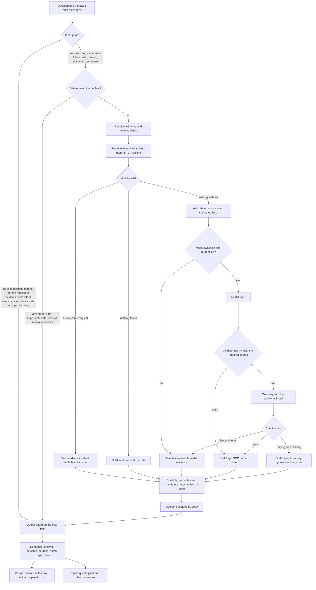
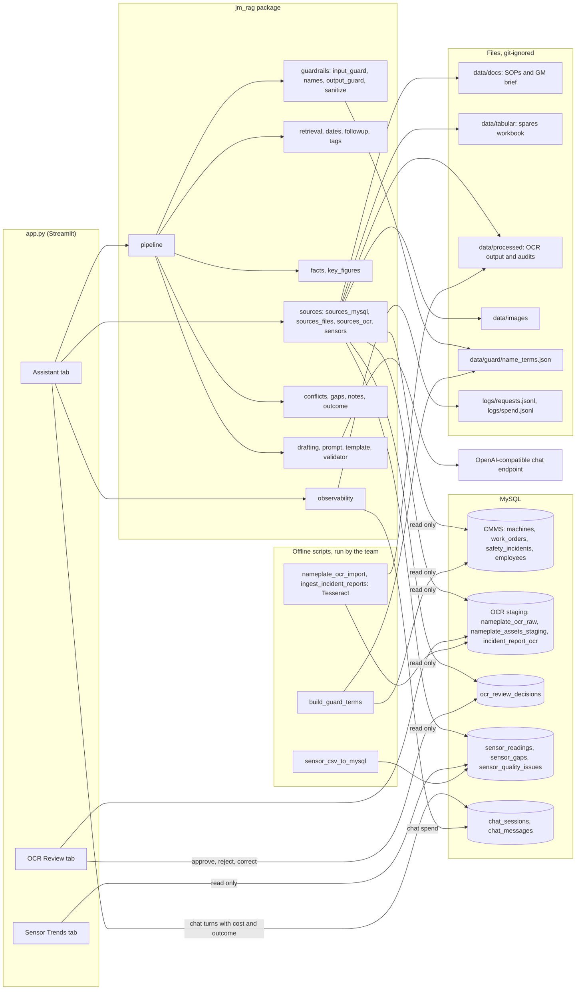

# Architecture

Written 15 Nov 2026 from the code on branch `enhance/rag-hardening`.

The app is one Streamlit page (`app.py`) with three tabs: **Assistant**, **OCR Review** and **Sensor Trends**. The Assistant tab calls one function, `jm_rag.pipeline.answer_question`. That function holds all the policy: what is refused, which caveats are mandatory, whether a model draft is acceptable, and which outcome the user sees. The model only phrases an answer from evidence that code retrieved and checked.

The assistant is read-only and takes no action: it never writes to the CMMS tables, and OCR corrections go through the existing human review gate in the OCR Review tab.

## 1. Request pipeline

The response is a plain dict with the keys `answer`, `outcome`, `refusal_class`, `sources`, `cited_ids`, `notes`, `flags`, `usage`, `trace` and `errors` (`_finish` in `jm_rag/pipeline.py`).

## 2. Data and components

Writes: the app writes only to `chat_sessions` and `chat_messages` (the conversation), `ocr_review_decisions` (a person's review in the OCR Review tab) and the two log files. The offline scripts write to the OCR staging and sensor tables. Nothing writes to `machines`, `work_orders`, `safety_incidents` or `employees`.

## 3. The parts in plain words

### Guardrails (`jm_rag/guardrails/`)

- **Input guard** (`input_guard.py`, phrasing lists in `patterns.py`). It runs before any evidence is loaded. It refuses questions in these classes: empty, too long (500 characters by default), prompt injection, a request for names, ranking people, incident details about one person, a request to change data, a request to bypass safety, private data, and off-topic or creative requests. Each class has a fixed refusal message that offers what the app can give instead, usually aggregate counts. A refused question loads no evidence and makes no model call.
- **Flags.** The input guard also sets flags that do not refuse: the question asks for a judgement or cause (`inference_request`), a date after the data ends, a document that is not in the package (5-Why), or a future schedule. Each flag adds a fixed note and makes the outcome "Cannot answer fully".
- **Name screening** (`names.py`). It uses a list of employee names built from MySQL by `scripts/build_guard_terms.py` into a git-ignored file. If the list is missing, the app says so in the sidebar and in the trace.
- **Sanitising** (`sanitize.py`). Names, ID numbers, keys and personal fields (such as the OCR reviewer) are removed from every source before it reaches the model or the evidence panel, and from saved chat messages.
- **Output guard** (`output_guard.py`). It runs last, on the final text including notes. If it finds a name, an ID number, an API key or an internal marker (SQL, the system prompt), it replaces the whole answer with a safe refusal and drops the evidence.

### Validator (`jm_rag/validator.py`, used by `jm_rag/drafting.py`)

A model draft is checked by code before anyone sees it:

- every `[S#]` citation must exist, and a factual answer must cite something;
- every number and every identifier with a digit (a machine tag, a report ID) must appear in the cited sources or the question;
- a quote of four words or more must appear word for word in a cited source;
- the draft must not describe a safety bypass or private data;
- for a question that asks for a judgement, the draft must not use a condition phrase such as "in good shape" or "safe to use", not even negated.

A draft that fails gets one retry with the problems listed. If the retry fails too, code answers instead (the template).

### Computed facts (`jm_rag/facts.py`, `jm_rag/key_figures.py`)

Counts, totals, minima, maxima, date ranges, severity on one scale, parts below minimum, and the month a sensor rise starts are worked out by code from all matching records, not only the five retrieved. They are added as one extra source titled "Computed facts". Code then lists the figures and caveats from that source that answer the question. If the draft leaves any out after the retry, code appends a "Key figures (computed by code): ..." line with citations.

### Conflicts and gaps (`jm_rag/conflicts.py`, `conflicts_records.py`, `gaps.py`)

Code compares sources where the repo holds both sides: nameplate lubricant against the spares `ALL` row, SOP crane loads against the nameplate, nameplate model against the CMMS, several versions of one incident, a near miss with lost days, and an SOP event with no matching incident. A real disagreement makes the outcome Conflict and adds a note that shows both sides and says which source is trusted. Gaps are things the data cannot answer, such as a plate field the OCR did not read, a flagged capacity reading, a shift split, an SOP topic no SOP covers, or whether two employee codes are one person. A gap adds a note and makes the outcome "Cannot answer fully".

### Outcome (`jm_rag/outcome.py`)

Decided by code, in this order: refuse, clarify, error (no evidence because a source failed), abstain (no evidence, a gap, or a flag), conflict, answer. The model never chooses the outcome.

### Fallbacks

| Situation | What happens | Note shown |
|---|---|---|
| No API key | Template answer from the evidence | "The AI endpoint is not configured, so this lists the retrieved evidence directly." |
| Endpoint error or timeout | Template answer | "The AI endpoint is unavailable, so this lists the retrieved evidence directly." |
| Draft fails the checks twice | Template answer | "The AI draft could not be verified against the evidence after one retry, ..." |
| Budget limit reached | No model call; template answer | "The model budget is used up, so this lists the retrieved evidence directly; no AI wording was generated." |
| A MySQL table or the spares workbook cannot be read | Answer from what is available, or outcome error | "I could not check ...; this answer uses only the sources that were available." |
| History table questions | Always built by code, no model call | none |

### Conversation state

Chats are stored in MySQL (`chat_sessions`, `chat_messages`), including each answer's cost and outcome. A restart with the same chat ID continues the conversation. Follow-ups such as "and CNC-03?" or "and in 2026?" are rewritten into a full question from the previous turn (`jm_rag/followup.py`). A bare year after a "which year?" question completes the earlier date.

### Cost monitoring (`jm_rag/observability.py`)

- Every model call records its prompt and completion tokens and its cost, retries included. Prices come from `.env`; a call without a price is stored as unknown, never as $0.
- The Assistant tab shows the cost under each answer ("This answer: N tokens, $X" or "No model call for this answer"). The sidebar shows "Last answer cost", "Session total" and "Today (all users and evals)".
- Chat costs are stored with the message in MySQL. Eval and other non-chat calls go to `logs/spend.jsonl`.
- `python -m jm_rag.observability` prints spend for today, the last 7 days and all time, split into chat, eval and other, and lists the five most expensive requests.
- Optional limits are `DAILY_BUDGET_USD` and `TOTAL_BUDGET_USD`. At 80% the sidebar warns. At the limit no model is called and code answers. Both are unset by default.

### Logs

| File | Written by | One line per | Fields |
|---|---|---|---|
| `logs/requests.jsonl` | the Assistant tab (`log_request`) | question | `request_id`, `ts`, `source`, `chat_id`, `question_chars`, `question_sha256` (16 hex characters), `guard_class`, `outcome`, `sources` (ID and type), `cited`, `notes` (count), `retries`, `steps_ms`, `total_ms`, `calls`, `prompt`, `completion`, `cost_usd`, `errors` (count) |
| `logs/spend.jsonl` | evals and other non-chat calls (`log_spend`) | run of model calls for one case or request | `ts`, `source`, `mode`, `case`, `model`, `calls`, `prompt`, `completion`, `cost_usd` |

Neither file holds question text, answer text or names. `logs/` is git-ignored.

## 4. Module map

| Module | Purpose |
|---|---|
| `pipeline.py` | `answer_question`: the steps in diagram 1 |
| `guardrails/` | input guard, refusal phrasing, name screening, sanitising, output guard |
| `retrieval.py`, `tags.py`, `intents.py` | query planning, machine tags, TF-IDF ranking |
| `dates.py`, `followup.py` | date windows, clarifications, relative dates, follow-ups |
| `facts.py`, `key_figures.py`, `incidents.py` | computed facts, required figures, grouping one incident's versions |
| `drafting.py`, `prompt.py`, `template.py`, `validator.py` | model path, system prompt (from `RAG_SKILL.md`), code-built answer, checks |
| `conflicts.py`, `conflicts_records.py`, `gaps.py`, `notes.py`, `outcome.py` | conflicts, gaps, mandatory notes, outcome |
| `tables.py` | work-order and incident tables |
| `sources.py`, `sources_mysql.py`, `sources_files.py`, `sources_ocr.py`, `sensors.py` | read-only loaders |
| `observability.py` | usage, cost, logs, spend summary, budget, spend report |
| `config.py` | paths, `DATA_END` (30 Jun 2026), question length limit |

`scripts/maintenance_rag.py` is a thin shim that re-exports the old names for older imports.
