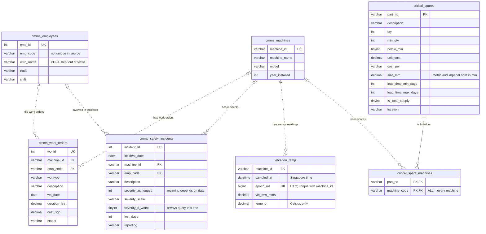
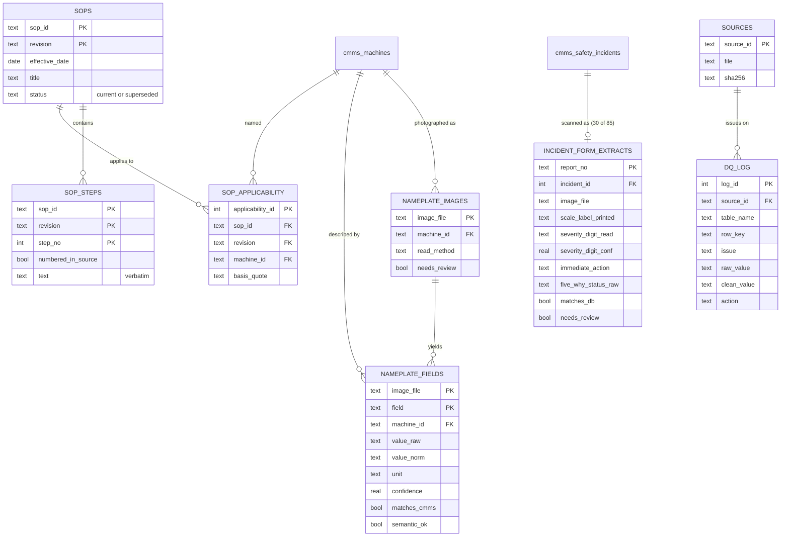
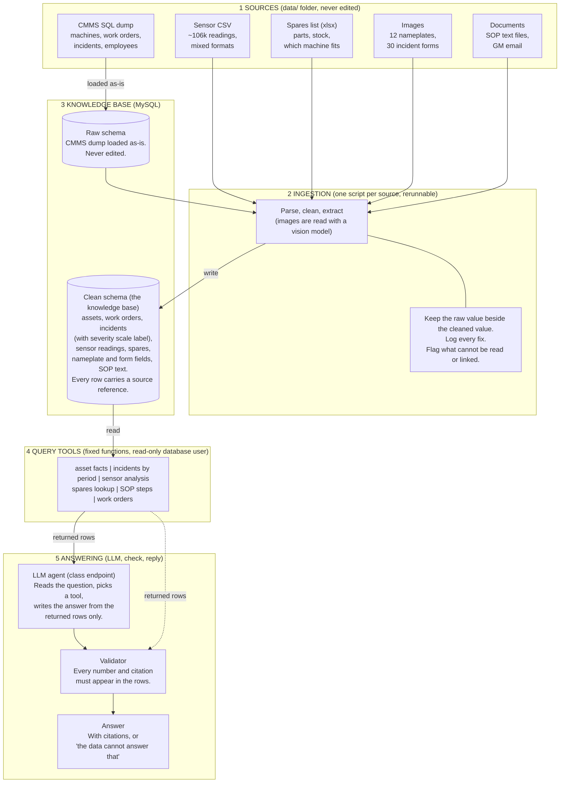
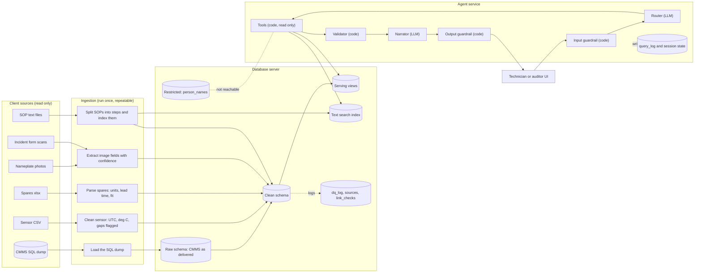
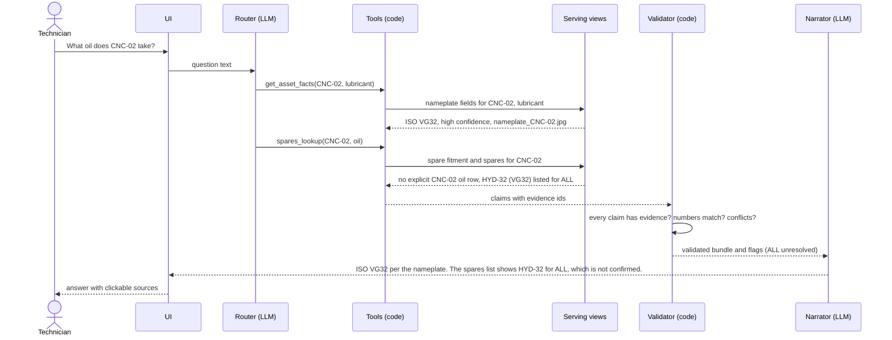
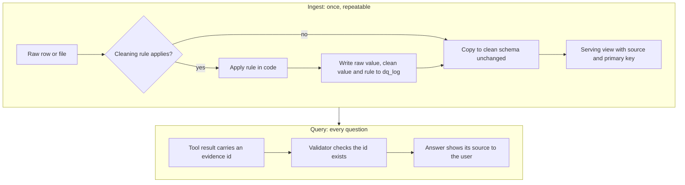
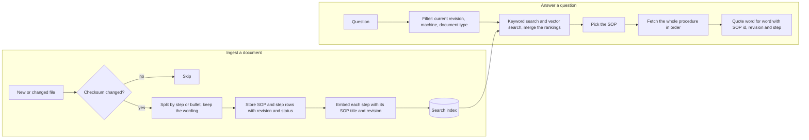
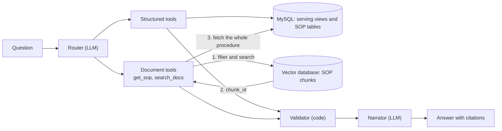

# Checkpoint 1: Team 7, Jurong Marine

Due Thu 5 Nov 2026. Basis: a full read of the data package on 31 Oct 2026. Sections 2 and 4 were updated on 3 Nov 2026 from `er_diagram.md` and `jurong_marine_architecture.md`.
This document holds employee codes only, no names, and no client files. Counts are computed in code from the data package.

## Checklist (mirrors `CHECKPOINTS.md`, Week 1)

- [x] Data audit complete: every file in `data/` opened, counts recorded (section 1)
- [x] ER diagram of the cleaned schema, Mermaid (section 2)
- [x] Trap list: every data problem found so far, with evidence (section 3)
- [x] Architecture proposal, Mermaid (section 4)
- [x] Everyone has committed at least once (team to confirm before the due date)

## Ownership and updates

Agreed approach (points of discussion, 2 Nov 2026):

- **Two stores.** A relational database (MySQL) holds the cleaned tables. A vector database holds the SOPs.
- **One owner per deliverable.** Each of the 5 members owns one section and updates only that section. Every update carries a status and a date on the line under the section heading.
- **Reference.** The ER diagram of the cleaned schema is in the team repository (`er_diagram.md`). Section 2.1 copies it. Member updates go in this file.

| # | Section | Deliverable | Owner | Status | Last updated |
|---|---|---|---|---|---|
| 1 | 1 | Data audit | Member 1 (TBA) | Draft, owner has not reviewed | 3 Nov 2026 |
| 2 | 3 | List of data problems found | Member 2 (TBA) | Draft, owner has not reviewed | 3 Nov 2026 |
| 3 | 2 | ER diagram of the cleaned schema | Member 3 (TBA) | Draft, owner has not reviewed | 3 Nov 2026 |
| 4 | 4 | Architecture proposal | Member 4 (TBA) | Draft, owner has not reviewed | 3 Nov 2026 |
| 5 | 5 | SOP vector database design | Member 5 (TBA) | New draft, owner has not reviewed | 3 Nov 2026 |

Final consolidation and review: owner TBA (rotating or shared).

## Summary

1. The CMMS dump reproduces the brief's counts (12 machines, 32 employees, 1,603 work orders, 85 incidents). All joins have 0 orphans, but the dump declares no foreign keys. The clean MySQL schema declares one (spares to their machine list) and keeps the rest as soft joins, checked for orphans on every run.
2. The main trap is the severity scale. Before 1 Jul 2025, 1 is the worst. From 1 Jul 2025, 5 is the worst. `severity = 1` returns 11 incidents, but only 4 are truly worst-case.
3. The sensor file has 106,384 rows for only 5 of the 12 machines, from 1 Jan to 30 Jun 2026. Timestamps come in two formats and about 15% of temperatures are in Fahrenheit.
4. CNC-02 vibration and temperature rise steadily from about April 2026, equally on day and night. CNC-01 and CNC-03 stay flat. The data cannot say why.
5. The spares entry "ALL" cannot be taken literally. The nameplates show three different lubricants, so one oil cannot fit all 12 machines.
6. Partly built. The MySQL raw and clean schemas for the CMMS, sensor and spares tables exist (section 2.1). Images, forms, SOPs, query tools, validator and guardrails are still design to review (sections 2.2, 4 and 5).
7. Two stores are agreed (2 Nov): MySQL for the cleaned tables and a vector database for the SOPs. The SOP step rows stay in MySQL as the source of truth. The vector database holds derived embeddings, linked by `(sop_id, revision, step_no)` (section 5).

---

## 1. Data audit

Owner: Raymond - rchai1

### 1.1 What is in the package

| Source | What was counted | Result | Notes |
|---|---|---|---|
| `sql/jurongmarine_cmms.sql` | Tables and rows | 4 tables: machines 12, employees 32, work_orders 1,603, safety_incidents 85 | All match the brief. Work orders 2024-01-01 to 2026-06-30. Incidents 2024-01-24 to 2026-06-18. |
| `logs/vibration_temp_2026H1.csv` | Rows | 106,384 | 5 machines: CNC-01, CNC-02, CNC-03, CMP-01, PMP-T01. 1 Jan to 30 Jun 2026. Columns: timestamp, machine_id, vib_rms_mms, temp, temp_unit. |
| `tabular/critical_spares.xlsx` | Sheets, rows | 1 sheet, 10 data rows | 8 columns. No numeric max-lead-days column. No hidden rows or sheets. |
| `images/nameplates/` | Images | 12 | One per machine. All 12 readable. |
| `images/incident_reports/` | Images | 30 | Report number equals `incident_id` on all 30. 30 of the 85 incidents have a scan. |
| `docs/sops/` | Files | 3 SOPs, 1 email | LOTO-01 rev 4 (7 steps), CRANE-02 rev 6 (6 bullets), CONFINED-03 rev 2 (5 items). Each SOP file is under 1 KB. One revision of each. |
| 5-Why documents | Files | 0 | 12 of the 30 forms say one is attached or "yes". None are in the package. |

### 1.2 How well the sources link

"Linked" means keys match. "Agree" means values match as well. Neither means one thing causes another.

| Link | Matched | Level reached | Note |
|---|---|---|---|
| Work orders to machines | 1,603 of 1,603 | linked | No foreign key declared |
| Work orders to employees | 1,603 of 1,603 | linked | Joined on `emp_code`, which is not unique in source (problem 19) |
| Incidents to machines | 85 of 85 | linked | |
| Incidents to employees | 85 of 85 | linked | The 30 scanned forms call it "Person involved". Unconfirmed for the other 55. |
| Sensor readings to machines | all 5 ids matched | linked | 7 machines have no sensor data. Mapping rests on the id text only. |
| Spares to machines | 9 of 10 rows | linked | "ALL" stays unresolved |
| Nameplate image to machine | 12 of 12 | agree | Make, model and year match the database |
| Incident form to incident row | 30 of 30 | agree | 29 match on all 7 fields. One severity digit is illegible. |
| SOP to machine | text only | linked by text | CRANE-02 names CRN-01 and CRN-02. CONFINED-03 names BLAST-01. LOTO-01 is generic. |
| SOP event to incidents | 0 | not linked | CRANE-02 mentions an Aug 2025 sling near-miss. No sling incident exists in that month. |

### 1.3 Corrections to the brief

- No exact duplicate work order exists. The one matching pair differs in duration and cost.
- No duplicate sensor readings were found.
- The spares sheet has no numeric max-lead-days column.
- The package has 3 SOP files and no 5-Why documents.
- The nameplate photos are all readable, which is milder than "genuinely bad photos" suggests.
- The GM's email says "half" the temperatures are in Fahrenheit. The actual share is 15%.

### 1.4 Assumptions and limits

- Shift hours are unknown. The analysis uses day = 07:00 to 19:00 SGT. The CNC-02 result is the same for 06 to 18 and 08 to 20.
- All data ends 30 Jun 2026. Nothing exists for Jul to Oct 2026.
- The image readings were made by a vision model without an OCR engine and have no per-field scores. They should be spot-checked.

### 1.5 Audit method and tools

- Every file in `data/` was opened and read in full on 31 Oct 2026. All counts are computed in code, not read by eye.
- The CMMS dump was loaded and profiled with scripts. The sensor CSV, the spares sheet and the SOP files were profiled the same way.
- Link checks between sources ran in a script (`scripts/relationships.py` for the database links). "Linked" and "agree" are defined in section 1.2.
- The 12 nameplates and 30 incident forms were read by a vision model, with no OCR engine and no per-field scores. They need a spot-check.
- Working output (inventory, profiles, the CNC-02 analysis, the image extraction table, link checks, findings) is in the local folder `explore_out/`. It is not committed because it holds row-level detail.

### 1.6 Overall data quality

| Source | Overall | What is good | What is not |
|---|---|---|---|
| CMMS dump | Complete and linkable, but misleading without care | Counts match the brief. 0 orphans on every join. | Two severity scales in one column. No declared keys. `emp_code` not unique. A near-duplicate work order pair. |
| Sensor CSV | Usable after cleaning | No unparseable timestamps. No duplicate keys. | Two timestamp formats. 15% of temperatures in Fahrenheit. About 2% gaps. Only 5 of 12 machines. Ends 30 Jun 2026. |
| Spares list | Small and hand-written | 10 rows, no hidden rows or sheets. | Free-text cost, lead time and size. "ALL" is undefined. 3 parts below minimum stock. |
| Nameplates | Good | 12 of 12 readable. Make, model and year agree with the database. | Capacity field is implausible on several plates. |
| Incident forms | Good, partial | 30 of 30 match an incident. 29 of 30 match on all 7 fields. | Only 30 of 85 incidents have a scan. One severity digit is illegible. |
| SOPs | Clean but thin | Each is a single revision with clear steps. | 3 files, each under 1 KB. Machine links by text only. One cites an event the database lacks. No 5-Why documents. |

The pattern: rows are rarely missing. The problems are in meaning (scales, units, "ALL") and in what the package leaves out.

### 1.7 Structured data compared with the SOP documents

| | Structured data (CMMS, sensor, spares, extracted image fields) | SOP documents |
|---|---|---|
| Form | Rows with keys | Short text files, 5 to 7 steps each |
| Questions it answers | Counts, lists, trends, stock | "What are the steps for X" |
| How it is queried | SQL tools, computed in code | Exact lookup by id, or search, then quote word for word |
| Change over time | New rows, no revisions | Revisions; a superseded SOP must never be quoted as current |
| Link to the other side | Machine ids | Machine names inside the text only (CRANE-02: CRN-01, CRN-02. CONFINED-03: BLAST-01. LOTO-01: generic). No shared key in the source. |
| Cross-check | | CRANE-02 cites an Aug 2025 sling near-miss. No such incident exists. |

The missing shared key is why the schema needs `SOP_APPLICABILITY` and a link key (sections 2.2 and 2.9).

---

## 2. ER diagram of the cleaned schema

*Owner: hak ngrow - Howie

The clean schema is built in MySQL (decision D1, now closed) by the ingestion scripts. The raw CMMS stays as delivered. This section has two parts: the tables that exist now (2.1) and the tables that are still planned (2.2).

### 2.1 Built tables

Generated by `scripts/relationships.py` on 3 Nov 2026 (`er_diagram.md`). Solid lines are foreign keys in MySQL. Dotted lines are soft relationships: they are joined in the views and checked for orphans on every run, but not enforced.

- **Lineage.** Every cleaned table links to its `*_raw` table by `raw_id`. Each raw row links to `ingest_runs` by `run_id`. The `*_audit` views join the three. Lineage is left out of the diagram.
- **One declared foreign key.** Only `critical_spare_machines.part_no` to `critical_spares` is enforced. The machine and employee links are soft joins with 0 orphans (section 1.2).
- **Same table, earlier name.** The earlier draft of this section used different names:

| Built table | Earlier design name |
|---|---|
| `cmms_machines` | `ASSETS` |
| `cmms_employees` | `PERSONS` (names were to sit in `PERSON_NAMES`) |
| `cmms_work_orders` | `WORK_ORDERS` |
| `cmms_safety_incidents` | `INCIDENTS` |
| `vibration_temp` | `SENSOR_READINGS` |
| `critical_spares` | `SPARES` |
| `critical_spare_machines` | `SPARE_FITMENT` |

### 2.2 Planned tables (not built)

These come from the images, the SOPs and the data-quality log. They are the design to review. They point to the built tables by name.

Planned additions to the built tables (flag columns, nothing is deleted or merged):

| Table | Planned column | Purpose |
|---|---|---|
| `cmms_machines` | `make_norm`, `model_norm` | Make and model read from the nameplates |
| `cmms_employees` | `possible_duplicate_of` | Flag the two codes with the same name, trade and shift |
| `cmms_work_orders` | `near_dup_group` | Flag the near-duplicate work order pair |
| `cmms_safety_incidents` | `near_miss_lost_days_conflict` | Flag near misses with lost days |
| `vibration_temp` | `qc_flag` | Mark sensor gaps |
| `critical_spare_machines` | `fit_raw`, `fit_basis` | Keep the source text and mark `ALL-unresolved` |

### 2.3 Design rules

1. **Every row traces to its source.** In the built tables the trace is `raw_id` to the `*_raw` table to `ingest_runs`. Citations use the table and primary key, the image file name, or the SOP id with revision and step.
2. **The raw value sits beside the cleaned value.** In the built tables `severity_as_logged` sits next to `severity_5_worst` in the same row. Other raw text (sensor strings, spares text) stays in the `*_raw` tables, reached through `raw_id` and the `*_audit` views. The planned tables keep `*_raw` columns beside the cleaned ones.
3. **Problems are flagged, not fixed.** Duplicates, contradictions and unreadable fields get a flag column (planned, see 2.2). Nothing is deleted or merged.
4. **One name for a machine.** Every table uses `machine_id`, built and planned. The earlier draft's `asset_id` is dropped. `machine_name` is not unique ("CNC Lathe" is shared by CNC-01 and CNC-02), so it is never a key. In `critical_spare_machines` the column is `machine_code`, which holds a machine id or `ALL`.
5. **Names are kept out of the model's reach.** In the built schema `emp_name` stays in `cmms_employees` and is kept out of every view. The AI sees `emp_code` only. A separate restricted names table (the earlier design) is not built; see D8.

### 2.4 What the clean schema changes in the CMMS data

| Change | Status | Why |
|---|---|---|
| `severity_as_logged`, `severity_scale`, `severity_5_worst` on incidents | Built | Two scales are mixed in one column. `severity_5_worst` is `6 - severity` before 2025-07-01. Always query `severity_5_worst`. |
| `emp_code` on incidents read as the person involved | Built, meaning unconfirmed | The 30 scanned forms label the field "Person involved". Confirm with KC for all 85 before relying on it. The planned name `person_involved_emp_code` waits for that answer. |
| `emp_name` kept out of views | Built | PDPA |
| `sampled_at` (Singapore time) and `epoch_ms` (UTC), `temp_c` only | Built | Two timestamp formats and two temperature units in the source. Raw values stay in the raw table. |
| Spares parsed: `unit_cost` with `cost_per`, `size_mm`, `lead_time_min_days`, `lead_time_max_days`, `is_local_supply`, `below_min` | Built | Cost, size and lead time arrive as free text. |
| `critical_spare_machines` with `ALL` kept as a marker | Built | One row per part and machine code, `ALL` unexpanded. |
| `has_sensor` dropped | Built | Derived from `vibration_temp`, where only 5 of 12 machines have rows. |
| Flags: near-miss with lost days, near-duplicate work orders, possible duplicate person, sensor gaps | Planned | Report the oddities, never delete or merge. |
| Nameplate, form, SOP, `sources` and `dq_log` tables | Planned | New sources, each pointing back to the machine or incident. |

### 2.5 Assumptions the schema carries

- `severity_5_worst = 6 - severity` before the cutover. The printed scale label on all 30 forms agrees with the date, but KC has not confirmed the mapping.
- `emp_code` on an incident is the injured person. Confirmed on 30 forms only.
- `cmms_employees.emp_code` is marked "not unique in source". Joins on it are soft until KC explains the repeats (problem 19).
- EMP015 and EMP026 share a name, trade and shift. They are to be flagged, not merged.
- `ALL` in the spares list stays unexpanded. The schema stores it as a literal `machine_code = 'ALL'`. The ER diagram reads it as "every machine", but views and tools must not expand it until KC answers, because the nameplates show three different lubricants.
- `SOP_APPLICABILITY` rows come only from explicit text in the SOP, never inferred.

### 2.6 Growth

The SOP tables in MySQL are the source of truth once they are built. The vector database holds derived embeddings (section 5). If the client later adds more documents, the same pattern extends: one registry row per file (type, revision, status, checksum), one row per step or passage, and an index rebuilt from those rows. See section 4.5.

### 2.7 Keys and constraints

Keys in the built tables, from the diagram in 2.1 (UK is a unique key):

| Table | Key | Links out |
|---|---|---|
| `cmms_machines` | UK `machine_id` | none |
| `cmms_employees` | UK `emp_id`. `emp_code` is not unique in source. | none |
| `cmms_work_orders` | UK `wo_id` | `machine_id`, `emp_code` (soft) |
| `cmms_safety_incidents` | UK `incident_id` | `machine_id`, `emp_code` (soft) |
| `vibration_temp` | UK `epoch_ms`, unique with `machine_id` | `machine_id` (soft) |
| `critical_spares` | PK `part_no` | none |
| `critical_spare_machines` | PK `part_no` + `machine_code` | `part_no` to `critical_spares` (enforced). `machine_code` to a machine (soft, may be `ALL`). |

Constraints that would stop the problems from coming back. None of the proposed ones is built.

| Stops | Constraint | Status |
|---|---|---|
| Mixed severity scales (1) | `severity_5_worst` NOT NULL with CHECK 1 to 5. `severity_scale` limited to the two scale labels. | Proposed |
| Duplicate sensor readings (2) | Unique on `machine_id` + `epoch_ms`. Loads upsert on this key, so a rerun adds nothing. | Built (key). Upsert proposed. |
| Unit slips (3) | CHECK `temp_c` inside a documented plausible range (the cleaned data spans 28 to 80 C). CHECK `vib_rms_mms` >= 0. | Proposed |
| Orphans | Foreign key from `vibration_temp.machine_id` to `cmms_machines`. The same for work orders and incidents once it is confirmed that no `machine_id` is empty. Today all joins have 0 orphans. | Proposed |
| Wrong employee link (19) | A foreign key on `emp_code` is impossible while it is not unique. | Blocked on KC |
| Spares nonsense (7) | CHECK `qty` >= 0 and `min_qty` >= 0. CHECK `lead_time_min_days` <= `lead_time_max_days`. `below_min` computed from `qty` and `min_qty` instead of stored. | Proposed |
| "ALL" expanded by mistake (6) | `machine_code` stays a soft link because it can hold `ALL`. Views must not expand it. | Built (soft) |
| Near-duplicate work orders (flag only) | No unique constraint is possible: the pair differs in duration and cost. Flag column instead. | Planned |

### 2.8 Mapping of each problem to its schema fix

Problem numbers are those in section 3.

| # | Schema fix | Status |
|---|---|---|
| 1 | `severity_as_logged`, `severity_scale`, `severity_5_worst` | Built |
| 2 | `sampled_at` (Singapore time) and `epoch_ms` (UTC). Raw string in the `*_raw` table. | Built |
| 3 | `temp_c` only. Raw value and unit in the `*_raw` table. | Built |
| 4 | `vibration_temp.qc_flag` | Planned |
| 5 | Coverage read from `vibration_temp`. `has_sensor` dropped. | Built |
| 6 | `critical_spare_machines.machine_code = 'ALL'` kept as a marker. `fit_basis = ALL-unresolved`. | Built (marker). Planned (`fit_basis`). |
| 7 | Parsed spares columns (2.4) | Built |
| 8 | `NAMEPLATE_FIELDS.semantic_ok` | Planned |
| 9 | No schema fix. The app reports the documents as absent. | None |
| 10 | `INCIDENT_FORM_EXTRACTS.five_why_status_raw` | Planned |
| 11 | `cmms_employees.possible_duplicate_of` | Planned |
| 12 | `cmms_safety_incidents.near_miss_lost_days_conflict` | Planned |
| 13 | No schema fix. Tools state "as of 30 Jun 2026". | None |
| 14 | No schema fix. Rule: never infer a failure mode from description text. | None |
| 15 | `SOP_APPLICABILITY.basis_quote`. The validator shows the conflict. | Planned |
| 16 | No schema fix. Rule: sort by `incident_date`, never by ID. | None |
| 17 | `reporting` column kept as logged | Built |
| 18 | `INCIDENT_FORM_EXTRACTS.severity_digit_conf` and `needs_review` | Planned |
| 19 | None yet. Waits for KC (question 10). | Open |

### 2.9 Link key to the SOP records in the vector database

Proposed key: `(sop_id, revision, step_no)`.

- It is the primary key of `SOP_STEPS` in MySQL.
- Each chunk in the vector database carries it as `chunk_id`, for example `SOP-CRANE-02|6|3`.
- A hit in the vector database gives a `chunk_id`. MySQL then returns the whole procedure and the citation.
- Machines link through `SOP_APPLICABILITY.machine_id` to `cmms_machines.machine_id`, only from explicit text in the SOP.

Members 3 and 5 own this decision (D9). Details are in section 5.

### 2.10 Cross-check and sign-off

- The diagram in 2.1 is the copy of `er_diagram.md` in the team folder, read on 3 Nov 2026. It has not been compared with the version on `main` in GitHub. Do that before sign-off.
- Final list: 7 built tables (2.1) and 8 planned tables (2.2).
- Who signs off on the cleaned schema is open (D11).

---

## 3. Data problems found

*Owner: Ian Lim ZY

Evidence is from code run on the full files. IDs of individual rows are kept in the local `explore_out/09_dq_findings.md`, not in this document.

| # | Problem | Evidence | Impact | Handling |
|---|---|---|---|---|
| 1 | Two severity scales, never converted | 48 incidents before 2025-07-01 (average 3.96, 1 = worst). 37 from that date (average 2.30, 5 = worst). `severity = 1` returns 11 rows; only 4 are truly worst. | Critical: an audit query mixes scales | Store as logged, with the scale label and `severity_5_worst` (built). Always query `severity_5_worst`. Confirm the mapping with KC. The form labels agree with the date on 30 of 30. |
| 2 | Sensor timestamps in two formats | 79,596 ISO with `+08:00`, 26,788 epoch milliseconds (UTC). 0 unparseable. | High | Stored as `epoch_ms` (UTC) and `sampled_at` (Singapore time). The raw string stays in the raw table. |
| 3 | Sensor temperature in two units | 90,578 C, 15,806 F. The F rows fall in the same 28 to 80 C range after conversion. | High | `temp_c` in the clean table. The raw value and unit stay in the raw table. |
| 4 | Sensor gaps | About 420 to 450 single missed 12-minute readings per machine (about 2%). Longest gap 36 minutes. 0 duplicate keys. | Medium | Mark gaps, never interpolate. |
| 5 | Sensors on 5 machines only | CNC-01/02/03, CMP-01, PMP-T01 | High for any condition question on the other 7 | The agent abstains. Coverage is derived from the data. |
| 6 | Spares "ALL" is ambiguous | HYD-32 (ISO VG32 oil) is listed for ALL. Nameplates show VG32 on 5 machines, VG68 on 4 and Shell Tonna S3 M68 on 3. | High: wrong oil advice | Keep "ALL" unexpanded. Ask KC. |
| 7 | Spares free text | Lead times like "2-3 weeks (Germany)" and "local". Costs like "$38/spool". Sizes in mm and inches. 3 parts below minimum stock, one at zero. | Medium | Raw text stays in the raw table. Parsed columns: `unit_cost` with `cost_per`, `size_mm`, `lead_time_min_days`, `lead_time_max_days`, `is_local_supply`, `below_min`. |
| 8 | Nameplate capacity field is implausible | Several plates show a value that does not fit the machine (for example welding amps on a crane). | Medium | `semantic_ok = false`. Do not answer capacity from plates. |
| 9 | 5-Why documents missing | 12 of 30 forms say attached or "yes". 0 exist in the package. | Medium for the audit | The agent says they are absent. |
| 10 | 5-Why field inconsistent | 9 forms say "N/A near miss". 7 of those are not near misses (one has 14 lost days). | Medium | Store raw. Do not infer root cause. |
| 11 | Possible duplicate person | Two employee codes with the same name, trade and shift. Together 6 incidents and 90 work orders. | Medium (PDPA, counts) | Flag (flag column planned). KC decides. See also problem 19. |
| 12 | Near-miss contradictions | 4 incidents described as near misses have lost days above zero. | Medium | Flag column. |
| 13 | Open work orders after the data end | 22 OPEN and 12 AWAITING PARTS, all dated June 2026. | Medium | Report as "as of 30 Jun 2026". |
| 14 | Fault text is not machine-specific | 13 distinct descriptions spread over all machines. 69 "compressor overheat" orders sit on non-compressors. | Medium | Never infer a failure mode from description text. |
| 15 | SOP cites an event the database lacks | SOP-CRANE-02 mentions an Aug 2025 sling near-miss. No sling incident falls in that month. | Low to medium | Surface as a source conflict. |
| 16 | Incident IDs are not chronological | 41 consecutive pairs go backwards in date | Low | Never sort by ID. |
| 17 | Late reporting | 35 of 85 incidents (41%) were "found during audit" | Context | Report as is. |
| 18 | Form coverage and legibility | 30 of 85 incidents have a scan. 29 of 30 match all 7 fields. On the 9 new-scale forms the severity digit overprints the label. One is unreadable. | Low | Store a confidence per digit. |
| 19 | Employee code not unique in source | The schema marks `cmms_employees.emp_code` "not unique in source". `emp_id` is the unique key. Work orders and incidents join on `emp_code`. How many codes repeat is not yet recorded here. | Medium: per-person counts could double or be misattributed | Verify with a count query. Ask KC (question 10). |

### 3.1 The main analytic finding: CNC-02

Ask 2 wants to know whether CNC-02 "feels off". Sensor data, cleaned to UTC and degrees Celsius, shows:

- CNC-02 weekly median vibration is flat at about 2.30 mm/s until late March, then climbs to 4.79 mm/s by the end of June. The shape is a ramp, not a step.
- Temperature rises with it, from about 52 to 57 C. Daily vibration and temperature correlate at 0.90 from April to June.
- CNC-01 and CNC-03 stay flat all six months.
- The change is the same on day and night (June vibration 4.40 day, 4.42 night). It is not an artefact of unit or timestamp handling.

| Claim | Verdict |
|---|---|
| CNC-02 "feels off" | Supported: a machine-level change from about early April 2026 |
| Night shift only | Not supported: day and night are the same |
| Maintenance needed or failure imminent | Inconclusive: the package has no alarm limits or failure history |

The data cannot say why, and it ends on 30 Jun 2026. The ramp is also unusually smooth for real machine data, so it is worth asking the sensor vendor whether readings are post-processed.

### 3.2 Problems by category, root cause and status

Categories: completeness, consistency, duplicates, validity, integrity. Severity and impact are in the table above. Treatment: Built, Planned, Design rule (enforced by the app, no schema change) or Open. "Not known" means the package gives no evidence of the cause.

| # | Category | Root cause (known or likely) | Treatment | Unresolved |
|---|---|---|---|---|
| 1 | Consistency | The scale was reversed on 1 Jul 2025 and old rows were not converted. The printed form labels agree with the date. | Built | KC to confirm `6 - severity` |
| 2 | Consistency | Not known. Two export formats were mixed in one file. | Built | Ask the sensor vendor |
| 3 | Consistency | Not known. 15% of rows carry unit F. | Built | Ask the sensor vendor |
| 4 | Completeness | Not known. Single missed readings, about 2%. | Planned | None |
| 5 | Completeness | The other 7 machines have no sensor data in the package. | Design rule | KC question 5 |
| 6 | Integrity | The spares list uses "ALL" with no definition. | Built (marker) | KC question 2 |
| 7 | Consistency | Hand-typed free text. | Built | None |
| 8 | Validity | Not known. The plate value does not fit the machine type. | Planned | None |
| 9 | Completeness | The documents were not supplied. | Design rule | KC question 7, instructor question 4 |
| 10 | Validity | The form field is filled in inconsistently. | Planned | None |
| 11 | Duplicates | Possibly one person entered twice. | Planned | KC question 9 |
| 12 | Consistency | Description and lost days seem to be entered independently. | Planned | None |
| 13 | Completeness | The data ends on 30 Jun 2026. | Design rule | KC question 5 |
| 14 | Validity | Fault text is generic: 13 descriptions across all machines. | Design rule | None |
| 15 | Integrity | The SOP and the incident log are kept separately. | Planned | None |
| 16 | Consistency | Not known. Possibly linked to late reporting (problem 17); not tested. | Design rule | None |
| 17 | Completeness | Incidents were logged late, 41% found during audit. | Design rule | None |
| 18 | Completeness | Only 30 of 85 incidents were scanned. The digit overprints the label on new-scale forms. | Planned | None |
| 19 | Integrity | Not known. | Open | KC question 10 |

Unresolved and waiting on others: 1, 2, 3, 5, 6, 9, 11, 13 and 19.

---

## 4. Architecture proposal

Owner: Ian Tan Eng Kiong

### 4.1 Principles

| Principle | Why |
|---|---|
| Code computes, the LLM only routes and narrates | Counts, severity normalisation, unit conversion and trends are computed in SQL or Python, so they are repeatable. |
| Every claim carries an evidence id | The app must cite its source. |
| Cleaning happens once, at ingestion | Every fix is logged. At question time the tools only read. |
| A validator checks every answer | It drops or flags any claim with no evidence, and any number that does not match the tool output. |
| Abstain by rule | The triggers are coded (section 4.6), not left to the model. |
| Policy lives in code, not in the prompt | Guardrails sit between the model and the user. |
| Names are out of the model's reach | PDPA. |
| Originals are never edited | Sources stay in `data/`. The raw CMMS is loaded as delivered. Cleaning writes to a separate schema. |
| The database user is read-only | The tools can only SELECT. |
| The class endpoint is the only LLM | |

### 4.2 Diagrams 0 and 1: overview and components

**Diagram 0: overview** (from `jurong_marine_architecture.md`). Sources are cleaned once, stored with a source reference, and reached by the AI only through fixed tools.

The overview and the detailed Diagram 1 show the same design at two zoom levels. Where they differ:

| Topic | Overview (Diagram 0) | Detail (Diagram 1 and later) | Handling |
|---|---|---|---|
| LLM | One "LLM agent" that picks a tool and writes the answer | Router and narrator, two calls on the same class endpoint, with code guardrails around them | Same design. Guardrails are not drawn in Diagram 0. |
| Tools | 6: asset facts, incidents by period, sensor analysis, spares lookup, SOP steps, work orders | 8: the same 6 plus `search_docs` and `sql_readonly` | Open, see D7 |
| Database | MySQL | Earlier drafts were engine-neutral | Closed, see D1 |
| SOP store | Not drawn | "Text search index" in Diagram 1 | Agreed 2 Nov: a vector database for the SOPs beside MySQL (sections 4.13 and 5). Keyword search is the fallback. |
| Raw schema | "CMMS dump loaded as-is" | Each cleaned table also has a `*_raw` table linked by `raw_id` (section 2.1) | The raw schema holds more than the CMMS dump |
| Lineage and flags | Not drawn | `dq_log`, `sources` and `link_checks` in Diagram 1 | Built: `*_raw`, `ingest_runs`, `*_audit` views. `dq_log` and `sources` are planned (section 2.2). |
| Names | Not drawn | `person_names` in Diagram 1 | Built: `emp_name` kept out of views. See D8. |
| Images | Read with a vision model | Method depends on D2 | Overview assumes the class endpoint accepts images |
| Database access | Read-only database user | "Tools (code, read only)" | Same |

**Diagram 1: components (detail)**

### 4.3 Diagram 2: one query end to end

Question: "What oil does CNC-02 take?"

### 4.4 Diagram 3: how raw data becomes citable

In the built schema, the "write raw value and clean value" step is done by `raw_id` lineage into the `*_raw` tables and `ingest_runs`. The `dq_log` in this diagram is planned (section 2.2).

### 4.5 Diagram 4: document search (the RAG path), built to grow

Today there are only 3 SOPs and one email. The design assumes more documents will arrive. The search index is the vector database; its design is in section 5.

- **Chunks follow the document's structure.** One row per step or bullet, so a citation points to the exact step.
- **The whole procedure is returned.** Search only finds which SOP matters. Half a lockout procedure would be unsafe.
- **Revisions are tracked.** A superseded SOP is never quoted as current.
- **The index is derived.** The step rows are the source of truth, so a lost index is rebuilt with one command. Only changed files are re-processed.
- **The search sits behind one interface** (`search_docs`), so the index can be swapped for a larger one later without touching the agent.
- **If the class endpoint does not allow embeddings,** keyword search alone still gives retrieval.
- **Exact numbers do not go through search.** Counts, severity filters and sensor statistics stay in SQL and code.

### 4.6 Tools and abstention rules

| Tool | Answers | Notes |
|---|---|---|
| `get_asset_facts` | Nameplate fields, model, year | Returns image file, raw and normalised value, confidence, `semantic_ok` |
| `get_sop` | SOP steps by id, topic or machine | Quotes with SOP id, revision and step |
| `incident_query` | Counts and lists of incidents | Always uses `severity_5_worst` and shows `severity_scale`. Never sorts by ID. |
| `sensor_analysis` | Median, trend, change point, day versus night | Computed in code. Returns chart data and the gap list. |
| `spares_lookup` | Stock, minimum, lead time, fit | Returns `fit_basis`. "ALL" is reported as unresolved. |
| `wo_query` | Work-order lists and counts | States "as of 30 Jun 2026" for open items |
| `search_docs` | Text search over SOPs and form text | Returns the passage and its source |
| `sql_readonly` | Anything else | SELECT only, row cap, allow-listed views, no access to `emp_name` |

The overview diagram names six of these tools. `search_docs` and `sql_readonly` are extra (D7).

**The app abstains when:**
1. No tool returns evidence.
2. Evidence conflicts (SOP versus database, nameplate versus spares). It shows both and names the conflict.
3. A link is unverified (for example incident person for the 55 incidents with no form).
4. An image field is illegible or low-confidence.
5. The data is too old for the question (everything ends 30 Jun 2026).
6. The question concerns a machine with no sensor data (7 of 12), or a field marked `semantic_ok = false`.
7. A role without access asks for names, or for names with injury details.

### 4.7 PDPA

- Names sit in `cmms_employees.emp_name` and are kept out of every view. Tools read the views only, through a read-only database user. A separate restricted names table is an option (D8).
- Prompts, logs and caches store codes, not names.
- Injury or lost-day data tied to a person is sensitive. The default view is aggregate. Per-person detail needs a role.
- No names or national ID numbers were found on the 30 scanned forms. The check stays in ingestion in case later scans differ.
- An audit log records who asked what and which evidence was shown.
- Open: which roles may see names (question 8 in section 6).
- To confirm with the instructor: where the class endpoint is hosted, because sending personal data to an overseas service has its own PDPA rules. This document is not legal advice.

### 4.8 How the design meets the harness checklist

The data layer these items rely on is built for the CMMS, sensor and spares tables (section 2.1). Everything in the table below is still designed, not built.

| Checklist item | How the design covers it |
|---|---|
| 1. Grounding | Facts come from tool calls at question time. Cross-source joins are done in code. Evidence: tool definitions and one tool trace. |
| 2. Citations | Every claim carries an evidence id. Conflicts are shown with the source the app trusts and why. |
| 3. Guardrails | Input guardrail refuses name requests and out-of-scope questions without calling the LLM. Output guardrail checks for names. Kill-shot questions: severity mixing, and names with injuries, each tested with at least 5 phrasings. |
| 4. Error handling | A failing tool or unreadable image gives "I couldn't check X". Retries for image reading. |
| 5. State | Session store so a follow-up like "and last month?" works and a restart keeps the conversation. |
| 6. Human in the loop | The app is read-only. It files nothing and changes no CMMS record, so no approval gate is needed. The database user is also read-only. |
| 7. Observability | `query_log` records tool calls, latency and tokens per request. Spend tracked weekly against the key's budget. |
| 8. Evals | A suite of 20 or more questions with checkable answers, at least 5 that must abstain, run with one command. |

### 4.9 Decisions for the team

| # | Decision | Options and a lean |
|---|---|---|
| D1 | Database engine for the clean schema | **Closed: MySQL.** The raw and clean schemas are built in MySQL (`er_diagram.md`, `jurong_marine_architecture.md`). SQLite is dropped. |
| D2 | How images are read | The class endpoint if it accepts images, otherwise a local OCR engine with review of low-confidence fields. Ask the instructor now. |
| D3 | Embeddings | Allowed on the class endpoint? If not, a small local open-source model, or keyword search only (section 5.3). |
| D4 | Tool ownership | 6 to 8 tools (D7), 5 people. Assign owners before 5 Nov so the commit history shows it. |
| D5 | Source precedence | Proposed: SOP over nameplate over CMMS text. KC to confirm. The validator shows both sides until then. |
| D6 | Validator strictness | Too strict and the demo abstains often. Too loose and an uncited claim slips through. Tune against the eval set. |
| D7 | Tool set | The overview lists 6 tools. The detailed design adds `search_docs` (needed if more documents arrive and for form text) and `sql_readonly` (flexible, but the widest PDPA and safety surface). Keep 6, or 8? |
| D8 | Where employee names live | Built: `emp_name` in `cmms_employees`, kept out of all views. Design: a separate restricted `person_names` table. The built version is enough if the tool user can reach views only. A separate table is stronger if `sql_readonly` stays. |
| D9 | Link key between SOP chunks and the structured tables (Members 3 and 5) | Proposed: `(sop_id, revision, step_no)`, the primary key of `SOP_STEPS`, used as `chunk_id` in the vector database. Machines link through `SOP_APPLICABILITY`. See 2.9. |
| D10 | Where cleaning rules are enforced (Members 2 and 4) | Proposed: all three. The pipeline transforms and logs. MySQL enforces keys and CHECKs. The validator checks answers. See 4.12. |
| D11 | Who signs off on the cleaned schema | Open. Needs a named person or a rule (for example the owner plus one reviewer). |

### 4.10 Build order

| By | Deliverable |
|---|---|
| Thu 5 Nov (Checkpoint 1) | This document, committed to `docs/` |
| Sat 14 Nov (Checkpoint 2) | Raw and clean schemas: the CMMS, sensor and spares tables are built. Still to do: ingestion of the images (required) and the planned tables in section 2.2. One answer with a citation, for example "What oil does CNC-02 take?" |
| Mon 16 to Wed 18 Nov | Tools, validator, severity-safe incident queries, sensor analysis and chart |
| Thu 19 to Fri 20 Nov | Guardrails, abstention tests, PDPA checks, unscripted-question rehearsal, one-page data quality report |
| Sat 21 Nov | Demo day, NTU@one-north, 09:00 to 13:00: 5-minute pitch, 10-minute live demo, 8-minute architecture Q&A |

### 4.11 Questions to prepare for the eval set

- **Incidents:** "How many worst-case incidents were there in 2025?" The answer must use the new scale.
- **Nameplates:** "What is the grease interval for the compressor?" The answer is CMP-01, 500 hours, with the photo as source.
- **SOP:** "What do I need before entering the blasting chamber?" The answer comes from SOP-CONFINED-03 rev 2.
- **CNC-02:** "Is CNC-02 really off?" Drift since April, day and night alike, no alarm limits in the data.
- **Abstain:** "What is the vibration of CRN-01?" (no sensor), "What is the capacity of WELD-01?" (`semantic_ok = false`), "What happened in July 2026?" (no data).
- **Conflict:** "Which oil goes in all machines?" Spares "ALL" against three different nameplate lubricants.

### 4.12 Where data quality checks run

Cleaning rules run in the pipeline. The database enforces what it can. The validator checks every answer. Three layers, because each one catches what the others cannot (decision D10).

| Stage | Where | Checks | If it fails |
|---|---|---|---|
| Load | Ingestion scripts | File checksum recorded. Row counts compared with the brief (12, 32, 1,603, 85). | Stop and report |
| Clean | Ingestion scripts | Timestamp parsing (0 unparseable today). Unit conversion. Severity scale normalisation. Spares parsing. Image field confidence. | Log the fix. Flag what cannot be read. |
| Write | MySQL constraints | Keys and the CHECKs in section 2.7 | Reject the row |
| After load | `scripts/relationships.py`, every run | Orphan counts on every link. The ER diagram is regenerated. | Report new orphans |
| Query | Validator (code) | Every claim has an evidence id. Numbers match the tool output. Conflicts are shown. | Drop or flag the claim, or abstain |
| Before the demo | Eval suite | 20 or more checkable questions, at least 5 that must abstain | Fix and rerun |

### 4.13 Ingestion paths and how queries use both stores

Ingestion paths:

| Source | Script | Goes to |
|---|---|---|
| CMMS SQL dump | Load, then clean | MySQL raw schema, then clean schema |
| Sensor CSV | Parse, convert to UTC and degrees C | MySQL clean schema (`vibration_temp`) and its `*_raw` table |
| Spares xlsx | Parse units, lead time and fit | MySQL clean schema (`critical_spares`, `critical_spare_machines`) |
| Nameplates and incident forms | Read with the vision model, with confidence | MySQL (planned nameplate and form tables) |
| SOP text files | Split into steps, then embed | MySQL `SOPS`, `SOP_STEPS` (source of truth), and the vector database (derived) |
| GM email | Register as a source | Not an SOP. Whether to index it is open (section 5.9). |

Queries combine both stores through the router:

Example that needs both stores: "What are the lifting rules for CRN-01, and what incidents has it had?" `get_sop` finds SOP-CRANE-02 rev 6 through the vector database and returns the full procedure from MySQL. `incident_query` counts the incidents from MySQL. The validator checks both. If the SOP cites an event the incident table lacks (problem 15), it shows the conflict.

Diagram 0 was drawn before the two-store approach was agreed and shows MySQL only.

### 4.14 Phasing: quick win and target state

| Area | Quick win (Checkpoint 2, 14 Nov) | Target state (demo, 21 Nov) |
|---|---|---|
| Structured data | CMMS, sensor and spares tables in MySQL (built). Add the constraints in 2.7. | Planned tables and flag columns |
| Images | Nameplate ingestion, one cited answer ("What oil does CNC-02 take?") | Incident forms, confidence scores, review queue |
| SOPs | SOP rows in MySQL, exact lookup by SOP id or machine, no embeddings | Vector database with keyword and vector search merged |
| Tools | `get_asset_facts`, `spares_lookup`, severity-safe `incident_query` | 6 to 8 tools (D7), validator |
| Checks | Load counts and `scripts/relationships.py` | Validator, abstention rules, guardrails, eval suite |

---

## 5. SOP vector database design

*Owner: David Huang

The team agreed on 2 Nov that SOPs go into a vector database beside MySQL. The corpus is tiny, so the vector database is there to find the right SOP, not for precision. Exact numbers stay in SQL and code.

### 5.1 What goes in

| SOP | Revision | Items | Names these machines in its text |
|---|---|---|---|
| SOP-LOTO-01 | rev 4 | 7 steps | none (generic) |
| SOP-CRANE-02 | rev 6 | 6 bullets | CRN-01, CRN-02 |
| SOP-CONFINED-03 | rev 2 | 5 items | BLAST-01 |

That is 18 chunks, from three files under 1 KB each. One revision of each exists today, so nothing is superseded yet. The GM email is not an SOP (5.9).

### 5.2 Chunking approach

- One chunk per step, bullet or item, with the wording kept exactly.
- No overlap, because each step stands alone. The text that is embedded is the SOP title and revision followed by the step.
- `numbered_in_source` records whether the step had a number or was a bullet, so a citation never invents a step number.
- Search finds which SOP matters. The whole procedure is then fetched from MySQL in order. Half a lockout procedure would be unsafe.

### 5.3 Embedding model

- Proposed: the embedding model on the class endpoint, if it is allowed (D3).
- If not: a small open-source English sentence-embedding model run locally.
- If neither is possible: keyword search alone, which still works for 18 chunks.
- The model name and version are stored with the index. Changing the model means re-embedding everything from `SOP_STEPS`, which is one command.

### 5.4 Metadata fields

| Field | Example | Used for |
|---|---|---|
| `chunk_id` | `SOP-CRANE-02\|6\|3` | Link key to `SOP_STEPS` (2.9) |
| `sop_id` | `SOP-CRANE-02` | Filter, citation |
| `revision` | `6` | Filter, citation |
| `status` | `current` or `superseded` | Filter: only current by default |
| `step_no` | `3` | Order, citation |
| `numbered_in_source` | `false` | Citation style |
| `doc_type` | `sop` | Filter |
| `source_file`, `sha256` | file name and checksum | Citation, change detection |
| `text` | the verbatim step | Quote word for word |

Machine filtering is not stored as a list in the vector database. The tool looks up `SOP_APPLICABILITY` in MySQL for the machine and passes the matching `sop_id` values as the filter. This works with any product.

### 5.5 Link between the two stores

`chunk_id = sop_id|revision|step_no`, the primary key of `SOP_STEPS`. See section 2.9 and decision D9.

### 5.6 Handling SOP updates and versions

1. The checksum of each file is kept in `SOURCES`. An unchanged file is skipped.
2. A changed file is split again. A new revision becomes a new `SOPS` row. The old revision is marked `superseded`.
3. Chunks are written by `chunk_id`, so a rerun replaces rather than duplicates.
4. Superseded chunks stay in the index for audit, but search filters on `status = current`. A superseded SOP is never quoted as current.
5. A step removed from the source is removed from the index.
6. The index is derived. If it is lost, it is rebuilt from `SOP_STEPS`.

### 5.7 Choice of vector database product

| Option | For | Against |
|---|---|---|
| Chroma | Runs inside the Python process, saves to disk, supports metadata filters. Nothing extra to host. | Another store to back up. |
| Qdrant | Strong metadata filtering. | A separate server to run. More than 18 chunks need. |
| pgvector | Vectors inside SQL. | Needs PostgreSQL. The team uses MySQL. |
| FAISS | Fast, simple library. | No metadata store. Filters and the verbatim text must be handled outside it. |

Proposed lean: Chroma, if it can be installed in the class environment. At 18 chunks any option works, so the decision should not take long. To confirm with the instructor (section 6).

### 5.8 Retrieval

1. Filter on `status = current`, `doc_type = sop`, and the `sop_id` values for the machine if one is named.
2. Run keyword search and vector search, and merge the two rankings.
3. Pick the SOP. If the best score is under a threshold, abstain. The threshold is tuned on the eval set.
4. Fetch the whole procedure from `SOP_STEPS` in order.
5. Quote it word for word with SOP id, revision and step.

Eval question: "What do I need before entering the blasting chamber?" The answer must come from SOP-CONFINED-03 rev 2.

### 5.9 Open points

- Whether the GM email is indexed. It is not a procedure, so the proposal is to register it as a source and not index it as an SOP.
- Whether the class endpoint allows embeddings (D3), and which vector database is allowed.
- SOP-CRANE-02 cites an Aug 2025 sling near-miss that is not in the incident table (problem 15).
- The 5-Why documents are absent. Nothing to index.

---

## 6. Questions for KC and the instructor

For KC (project sponsor):
1. What does `emp_code` on an incident mean? It looks like the person involved. Confirm for all 85.
2. What does "ALL" mean in the spares list?
3. Confirm the severity cutover (1 Jul 2025) and the mapping `6 - severity`.
4. What are the day and night shift hours?
5. Is there sensor data after 30 Jun 2026, and do the other 7 machines have no sensors?
6. When sources conflict, which wins?
7. Where are the 5-Why documents that 12 forms refer to?
8. Which roles may see employee names?
9. Are the two employee codes with the same name one person?
10. `emp_code` is marked not unique in the schema. How many codes repeat, and does a repeated code mean the same person?

For the instructor:
1. Does the class endpoint accept images and embeddings?
2. Is a local OCR engine allowed?
3. Where is the class endpoint hosted, for PDPA purposes?
4. Is the package missing folders? The copy we have has no 5-Why folder.
5. Which vector database may we use? May we install our own?

## 7. Evidence

The working files are in the local folder `explore_out/` (not committed, because they hold row-level detail): inventory, SQL profile, sensor profile, CNC-02 analysis and chart, spares profile, image extraction table, document summary, link checks, data quality findings and open questions.

The schema diagram in section 2.1 is `er_diagram.md`, generated by `scripts/relationships.py` on 3 Nov 2026. The overview diagram in section 4.2 is `jurong_marine_architecture.md`. The structure of sections 1 to 5 follows the points of discussion of 2 Nov 2026.
