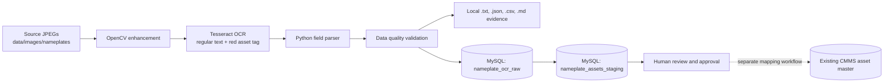

# Jurong Marine CMMS — Machine Nameplate OCR to MySQL

**Project:** `team7_jurong_marine`  
**Source:** `data/images/nameplates/*.jpg` (also accepts `.jpeg`, `.png`, `.tif`, `.tiff`)  
**Target:** Existing MySQL 8 database (including MySQL running in Docker)  
**Method:** Python + OpenCV image enhancement + Tesseract OCR + structured extraction + data-quality checks + MySQL staging  
**Status:** Implementation guide. The supplied script has been syntax-checked and its parser tested against sample nameplate text; it has **not** been executed against your local JPEG folder or your actual MySQL database.

## 1. What this solution does

Your 12 sample photographs show a machine brand, model, serial number, manufacturing **month/year**, rated power, sometimes current and maximum speed or capacity, weight, lubricant, grease interval, and a red `ASSET TAG (JME)`.

The workflow:



**Do not write OCR output directly into your authoritative CMMS asset master.** OCR can confuse `0/O`, `1/I`, serial numbers, decimal points and engineering units. This implementation deliberately writes to separate **raw** and **staging** tables; it never changes your existing CMMS tables. Each staging row is marked `needs_review = 1` until validated by a person.

## 2. Project directory layout

Run commands from the repository root (the folder containing `docker-compose.yml` or `compose.yaml`, if applicable):

```text
team7_jurong_marine/
├── .env                         # EXISTING secrets, never commit to Git
├── requirements-nameplates.txt
├── scripts/
│   └── nameplate_ocr_import.py
├── sql/
│   └── nameplate_schema.sql     # Optional; Python can create these tables
└── data/
    ├── images/
    │   └── nameplates/
    │       ├── nameplate_CNC-01.jpg
    │       ├── nameplate_CNC-02.jpg
    │       ├── nameplate_CNC-03.jpg
    │       ├── nameplate_CRN-01.jpg
    │       └── ...other JPEGs...
    └── processed/
        └── nameplates/          # Created automatically on execution
            ├── nameplate_assets_staging.csv
            ├── nameplate_ocr_audit.md
            ├── nameplate_CNC-01.txt
            ├── nameplate_CNC-01.json
            ├── nameplate_CNC-01_preprocessed.png
            └── ...
```

Copy the provided `nameplate_ocr_import.py` into `scripts/`, `requirements-nameplates.txt` into the repository root, and optionally `nameplate_schema.sql` into `sql/`. The Markdown guide is self-contained: the entire importer and table definitions are reproduced at the end.

## 3. Install dependencies (Windows 11 / PowerShell)

### Step 3.1 — Confirm your Python virtual environment

From your `team7_jurong_marine` directory:

```powershell
# If you already have a working (.venv), activate it instead of creating another.
python -m venv .venv
.\.venv\Scripts\Activate.ps1
python -m pip install --upgrade pip
python -m pip install -r .\requirements-nameplates.txt
```

If activation is blocked by PowerShell policy, use `.\.venv\Scripts\python.exe` instead of `python` for subsequent commands; there is no need to change your system's execution policy.

### Step 3.2 — Install the separate Tesseract OCR executable

**`pytesseract` is only a Python wrapper**. You must also install the Tesseract executable and English language data.

```powershell
winget search tesseract
winget install UB-Mannheim.TesseractOCR
```

Or follow the official Tesseract installation guidance, which points Windows users to the UB Mannheim installer. A typical installation path is `C:\Program Files\Tesseract-OCR\tesseract.exe`.

Test:

```powershell
& 'C:\Program Files\Tesseract-OCR\tesseract.exe' --version
& 'C:\Program Files\Tesseract-OCR\tesseract.exe' --list-langs
```

Ensure `eng` appears in the language list. The Python script can use this full path even if Tesseract is not in your Windows `PATH`.

### Step 3.3 — Configure your existing MySQL Docker instance

Confirm the container is running and check its published **host port**:

```powershell
docker compose ps
```

Examples of port mappings: `0.0.0.0:3306->3306/tcp` means Python should connect to `127.0.0.1:3306`; `0.0.0.0:3307->3306/tcp` means connect to `127.0.0.1:3307`. If there is no published host port, a Python script running on Windows cannot connect to the container through `127.0.0.1`; publish the port in Compose, or run the importer inside a Docker network using the service hostname.

**Important:** Set `MYSQL_DATABASE` to the name of an **existing database**. A `.sql` filename such as `jurongmarine_cmms.sql` is not necessarily the database name. Verify it through DBeaver or:

```powershell
docker compose exec mysql mysql -uroot -p -e 'SHOW DATABASES;'
```

The command above requests the password interactively instead of putting it into terminal history. If your Compose service is not named `mysql`, use its actual service name.

### Step 3.4 — Add the variables to your repository-root `.env`

Use the supplied `.env.nameplates.example` as a template. If you already have a project `.env`, **append these values without overwriting unrelated keys**:

```dotenv
TESSERACT_CMD=C:\Program Files\Tesseract-OCR\tesseract.exe
MYSQL_HOST=127.0.0.1
MYSQL_PORT=3306
MYSQL_USER=root
MYSQL_PASSWORD=REPLACE_WITH_YOUR_PASSWORD
MYSQL_DATABASE=REPLACE_WITH_YOUR_EXISTING_DATABASE
```

In a non-lab environment, use a dedicated MySQL account with permission to create and modify **only the OCR staging tables**, not the root user. Do not commit `.env` to GitHub; ensure `.env` is listed in `.gitignore`.

## 4. Run the pipeline

### Step 4.1 — Validate OCR locally before any database changes

```powershell
python .\scripts\nameplate_ocr_import.py --dry-run --limit 1
```

Review the `data/processed/nameplates/` folder. For the first tested image, the script produces a `.txt` raw OCR transcript, `.json` parsed fields/validation issues and a `_preprocessed.png` for inspection. It also produces `nameplate_assets_staging.csv` and `nameplate_ocr_audit.md`.

To process **all** images without connecting to MySQL:

```powershell
python .\scripts\nameplate_ocr_import.py --dry-run
```

### Step 4.2 — Import all images into MySQL staging

```powershell
python .\scripts\nameplate_ocr_import.py
```

No manual `CREATE TABLE` step is necessary if the configured database account has `CREATE TABLE` permission. The importer creates two tables if absent:

- `nameplate_ocr_raw`: original OCR evidence, image hash, red-tag OCR, JSON extraction and flags.
- `nameplate_assets_staging`: typed/normalized fields for review and later mapping to your existing CMMS schema.

**Idempotency:** The relative image path (`source_key`) is unique; rerunning the importer updates that file's staging record instead of creating a new copy. SHA-256 is captured as evidence. Do not store a revised image under a new filename unless you intentionally want an additional source record.

You can override the default input/output folders:

```powershell
python .\scripts\nameplate_ocr_import.py `
  --input '.\data\images\nameplates' `
  --output '.\data\processed\nameplates'
```

## 5. Fields extracted and normalization rules

| Database field | Sample from supplied nameplates | Processing rule |
|---|---|---|
| `asset_tag` | `CNC-03` | Read red asset tag; also check filename, flag mismatch or no OCR verification |
| `manufacturer` | `DMG`, `KONECRANES`, `MAZAK` | Search known brands in first lines (extensible list) |
| `model` | `Mori DMU-50` | Value after `MODEL` |
| `serial_number` | `DM4958733` | **Text**, preserve letters and leading zeros |
| `manufactured_ym` | `2022-08` | Normalize `08/2022` to `YYYY-MM`; do **not** invent a day |
| `power_kw` | `15.0` | Numeric from `POWER` line |
| `electrical_spec` | `3PH380-440V` | Preserve the nameplate electrical notation |
| `fla_amps` | `31.0` | Numeric where `FLA ... A` exists |
| `max_speed_rpm` | `3500` | Numeric where `MAX SPEED ... RPM` exists |
| `capacity_raw` | `450 A @ 60%` | Preserve unvalidated text/units verbatim |
| `weight_kg` | `8092.0` | Numeric from `WEIGHT` line |
| `lubricant` | `ISO VG68` | Preserve label description |
| `grease_interval_hours` | `500` | Numeric operating-hour interval; **not a calendar interval** |
| `ocr_confidence` | e.g. `82.5` | Mean recognized-word confidence (not probability of accuracy) |
| `flags_json` | `SUSPECT_CAPACITY_UNIT` | Data-quality issues with severity and explanation |
| `needs_review` | `1` | All imported records require physical/source verification |

The raw OCR text and the original JPEG remain the source of evidence. **`NULL` means OCR did not find a value**, not that the machine definitely lacks that specification. Model/serial/voltage text may be distorted by OCR and must be checked before approval.

## 6. Important data-quality traps from your 12 sample images

These are observations from the supplied photographs, **not confirmed equipment faults**.

| Tag | Observed capacity text | Reason to verify |
|---|---|---|
| `CRN-01` | `450 A @ 60%` | Welding-current/duty-cycle style unit on a crane |
| `PMP-T01` | `450 A @ 60%` | Not a typical pump flow/head specification |
| `BLAST-01` | `450 A @ 60%` | Not a typical blasting capacity unit |
| `WELD-01` | `2000 kg` | Lifting-weight style capacity on welding equipment |
| `WELD-02` | `30 kW FAD 88 cfm` | Compressor-style free-air-delivery notation on welding equipment |
| `CMP-01` | `POWER 15 kW`; `CAPACITY 30 kW FAD 88 cfm` | Power-value mismatch requiring interpretation |

The script flags these **if** OCR extracts the relevant capacity text. It also flags missing model/serial/manufacturing month, unrecognized manufacturer, low-confidence OCR, a missing/unverified asset tag and an impossible future manufacture month. It does **not** silently replace suspicious values or assume they are valid.

**Operational caution:** A nameplate grease interval of `500 h` must not be translated into “500 calendar hours.” A correct preventive-maintenance schedule requires operating-hour readings and service history. Lubricant labels should not automatically be treated as grease specifications; consult the OEM manual.

## 7. Verify imported records in DBeaver

Connect DBeaver to the same MySQL host/port/database shown in `.env`, then run:

```sql
-- List imported nameplates and review status.
SELECT
    s.asset_tag, s.category, s.manufacturer, s.model, s.serial_number,
    s.manufactured_ym, s.power_kw, s.capacity_raw,
    s.weight_kg, s.lubricant, s.grease_interval_hours,
    r.ocr_confidence, s.needs_review, r.source_file
FROM nameplate_assets_staging AS s
JOIN nameplate_ocr_raw AS r ON r.id = s.raw_id
ORDER BY s.asset_tag;

-- See high-severity quality issues using MySQL 8 JSON_TABLE.
SELECT
    s.asset_tag, jt.severity, jt.code, jt.detail
FROM nameplate_assets_staging AS s
JOIN JSON_TABLE(
    s.flags_json, '$[*]'
    COLUMNS (
        severity VARCHAR(16) PATH '$.severity',
        code VARCHAR(80) PATH '$.code',
        detail VARCHAR(500) PATH '$.detail'
    )
) AS jt
WHERE jt.severity = 'high'
ORDER BY s.asset_tag;

-- Verify unique tags and investigate duplicates.
SELECT asset_tag, COUNT(*) AS copies
FROM nameplate_assets_staging
WHERE asset_tag IS NOT NULL
GROUP BY asset_tag
HAVING COUNT(*) > 1;

-- Inspect the original recognized text for one asset.
SELECT r.source_file, r.ocr_text, r.asset_tag_red_ocr, r.parsed_json
FROM nameplate_ocr_raw AS r
WHERE r.asset_tag_detected = 'CNC-03';
```

The SQL queries are read-only. This script **does not** infer or change your existing CMMS `assets`, `machines`, `maintenance_plan`, or `work_orders` tables. Mapping from staging into the actual asset master depends on your current cleaned schema and should follow a manual approval step.

## 8. Example result and expected audit deliverables

The source **photograph** for `CNC-03` shows the following fields (this table is a manual example, not a claim that the script already processed it):

| Field | Example value |
|---|---|
| Source | `nameplate_CNC-03.jpg` |
| Tag | `CNC-03` |
| Manufacturer | `DMG` |
| Model | `Mori DMU-50` |
| Serial | `DM4958733` |
| Mfg month | `2022-08` |
| Power | `15 kW` |
| FLA | `31 A` |
| Max speed | `3500 RPM` |
| Weight | `8092 kg` |
| Lubricant | `ISO VG68` |
| Grease interval | `500 h` |

The automatically generated Markdown report can support **Week 1 data audit** evidence: image inventory, staging extraction results, suspected trap list and verification notes. For complete Week 1 deliverables you must also record row/page counts for **other** files under `data/` and maintain the ER/architecture diagrams for the whole project.

## 9. Troubleshooting

| Symptom | Fix |
|---|---|
| `TesseractNotFoundError` | Install Tesseract, set `TESSERACT_CMD` to `tesseract.exe`, confirm `eng` language data |
| `ModuleNotFoundError: mysql.connector` | Activate the correct `.venv`; run `python -m pip install -r requirements-nameplates.txt` |
| `Image folder not found` | Run from `team7_jurong_marine/` or use `--input` with a full path |
| OCR text missing / inaccurate | Compare processed PNG with source; capture clearer, straighter, higher-resolution photo, adjust preprocessing or regex |
| Unknown database `1049` | Set `MYSQL_DATABASE` to an existing **database name**, not a `.sql` file path |
| Can't connect / `2003` | Check `docker compose ps`, published host port, credentials and service state |
| `Access denied` / `1045` | Verify username/password and MySQL privileges |
| Existing data unexpectedly unchanged | This pipeline intentionally imports to separate `nameplate_*` staging tables only |
| Red tag OCR fails | Filename fallback is used when available, and a `TAG_UNVERIFIED` flag is added |
| Query returns fewer than 12 assets | Check image extensions, local error list, duplicate relative filenames, and OCR logs |

**Useful official references:** [Tesseract installation](https://github.com/tesseract-ocr/tessdoc/blob/main/Installation.md), [pytesseract Python wrapper](https://pypi.org/project/pytesseract/), [MySQL Connector/Python documentation](https://dev.mysql.com/doc/connector-python/en/).

## 10. Git/version-control notes

Review your repository `.gitignore` so secrets and raw operational records are handled appropriately. Typical entries:

```gitignore
.env
.venv/
__pycache__/
*.pyc
# Optional: generated raw OCR evidence may contain operationally sensitive data.
data/processed/nameplates/
```

Suggested commit includes the importer, requirements, schema, this Markdown guide and **reviewed/approved anonymized** audit artefacts if the capstone requires them. Machine serial numbers or other operational details should be handled according to your project security rules.

---

# Appendix A — Complete Python script

Save the following file as `scripts/nameplate_ocr_import.py`. A standalone copy is also supplied in the downloadable ZIP package.

```python
#!/usr/bin/env python3
"""Jurong Marine nameplate JPG/PNG -> OCR -> QA-staged MySQL + local audit files.

Run from team7_jurong_marine repository root:
    python scripts/nameplate_ocr_import.py --dry-run
    python scripts/nameplate_ocr_import.py

The script never writes to the existing CMMS equipment master. It writes only
nameplate_ocr_raw and nameplate_assets_staging for human verification.
"""
from __future__ import annotations

import argparse
import csv
import hashlib
import json
import os
import re
import shutil
from collections import Counter
from datetime import date
from pathlib import Path

import cv2
import mysql.connector
import numpy as np
import pytesseract
from dotenv import load_dotenv
from pytesseract import Output

ALLOWED_EXTS = {".jpg", ".jpeg", ".png", ".tif", ".tiff"}
TAGS = re.compile(r"\b(?:CNC|CRN|LTH|MILL|PMP|WELD|BLAST|CMP)[-\s]?[A-Z0-9]{1,4}\b", re.I)
KNOWN_MAKERS = (
    "KONECRANES", "COLCHESTER", "BRIDGEPORT", "LINCOLN", "DEMAG",
    "MAZAK", "MILLER", "CUSTOM", "ATLAS", "DMG", "KSB",
)
CATEGORY = {
    "CNC": "CNC", "CRN": "Crane/Hoist", "LTH": "Lathe",
    "MILL": "Milling Machine", "PMP": "Pump", "WELD": "Welding Equipment",
    "BLAST": "Blasting Equipment", "CMP": "Compressor",
}
FIELDS = [
    "source_file", "asset_tag", "category", "manufacturer", "model", "serial_number",
    "manufactured_ym", "power_kw", "electrical_spec", "fla_amps", "max_speed_rpm",
    "capacity_raw", "weight_kg", "lubricant", "grease_interval_hours",
    "ocr_confidence", "needs_review", "issues",
]

DDL_RAW = """
CREATE TABLE IF NOT EXISTS nameplate_ocr_raw (
  id BIGINT UNSIGNED NOT NULL AUTO_INCREMENT PRIMARY KEY,
  source_key VARCHAR(512) NOT NULL,
  source_file VARCHAR(255) NOT NULL,
  file_sha256 CHAR(64) NOT NULL,
  asset_tag_detected VARCHAR(64) NULL,
  asset_tag_red_ocr VARCHAR(255) NULL,
  ocr_text LONGTEXT NOT NULL,
  ocr_confidence DECIMAL(5,2) NULL,
  parsed_json JSON NOT NULL,
  flags_json JSON NOT NULL,
  imported_at TIMESTAMP NOT NULL DEFAULT CURRENT_TIMESTAMP ON UPDATE CURRENT_TIMESTAMP,
  UNIQUE KEY uq_nameplate_source (source_key),
  KEY idx_nameplate_hash (file_sha256),
  KEY idx_nameplate_tag (asset_tag_detected)
) ENGINE=InnoDB DEFAULT CHARSET=utf8mb4;
"""
DDL_STAGE = """
CREATE TABLE IF NOT EXISTS nameplate_assets_staging (
  id BIGINT UNSIGNED NOT NULL AUTO_INCREMENT PRIMARY KEY,
  raw_id BIGINT UNSIGNED NOT NULL,
  asset_tag VARCHAR(64) NULL,
  category VARCHAR(50) NULL,
  manufacturer VARCHAR(100) NULL,
  model VARCHAR(150) NULL,
  serial_number VARCHAR(100) NULL,
  manufactured_ym CHAR(7) NULL,
  power_kw DECIMAL(10,2) NULL,
  electrical_spec VARCHAR(120) NULL,
  fla_amps DECIMAL(10,2) NULL,
  max_speed_rpm INT NULL,
  capacity_raw VARCHAR(255) NULL,
  weight_kg DECIMAL(12,2) NULL,
  lubricant VARCHAR(255) NULL,
  grease_interval_hours INT NULL,
  needs_review TINYINT(1) NOT NULL DEFAULT 1,
  flags_json JSON NOT NULL,
  created_at TIMESTAMP NOT NULL DEFAULT CURRENT_TIMESTAMP,
  updated_at TIMESTAMP NOT NULL DEFAULT CURRENT_TIMESTAMP ON UPDATE CURRENT_TIMESTAMP,
  UNIQUE KEY uq_nameplate_raw_id (raw_id),
  KEY idx_staging_asset_tag (asset_tag),
  CONSTRAINT fk_nameplate_raw FOREIGN KEY (raw_id)
    REFERENCES nameplate_ocr_raw(id) ON DELETE CASCADE
) ENGINE=InnoDB DEFAULT CHARSET=utf8mb4;
"""


def clean_tag(value: str | None) -> str | None:
    if not value:
        return None
    match = TAGS.search(value.upper())
    if not match:
        return None
    tag = re.sub(r"\s+", "-", match.group(0).upper())
    # Reject partial tags like CNC- when OCR misses a number.
    return tag if re.search(r"\d", tag) else None


def pick_line(text: str, expression: str) -> str | None:
    """Return remainder of the first line matching an anchored field label."""
    pattern = re.compile(r"^\s*" + expression + r"\s*[:;\-]?\s*(.*?)\s*$", re.I)
    for raw in text.splitlines():
        m = pattern.search(raw)
        if m:
            value = m.group(1).strip(" :\t")
            return value if value else None
    return None


def first_number(value: str | None) -> float | None:
    m = re.search(r"\b\d+(?:[.,]\d+)?\b", value or "")
    return float(m.group(0).replace(",", ".")) if m else None


def integer_number(value: str | None) -> int | None:
    v = first_number(value)
    return int(v) if v is not None else None


def tag_from_plate(text: str) -> str | None:
    for line in text.splitlines():
        if re.search(r"ASSET\s*TAG", line, re.I):
            match = clean_tag(line)
            if match:
                return match
    return None


def parse_nameplate(text: str, red_text: str, filename: str) -> dict:
    lines = [s.strip() for s in text.splitlines() if s.strip()]
    # Prefer the large brand name near the top of the plate.
    manufacturer = None
    for line in lines[:6]:
        upper = line.upper()
        if re.match(r"^(?:MODEL|SERIAL|MFG|POWER|CAPACITY|FLA|WEIGHT)", upper):
            continue
        for brand in KNOWN_MAKERS:
            if re.search(rf"\b{re.escape(brand)}\b", upper):
                manufacturer = brand.title() if brand != "DMG" and brand != "KSB" else brand
                break
        if manufacturer:
            break

    filename_tag = clean_tag(Path(filename).stem.replace("_", " "))
    plate_tag = tag_from_plate(red_text) or tag_from_plate(text)
    # Red mask sometimes yields only 'CNC-03' without an ASSET TAG prefix.
    if not plate_tag:
        plate_tag = clean_tag(red_text)
    asset_tag = filename_tag or plate_tag  # File name is an identifier, not proof of accuracy.

    raw_date = pick_line(text, r"(?:MFG|MFD|MANUFACTURE)\s*(?:DATE)?")
    date_match = re.search(r"\b(0?[1-9]|1[0-2])\s*[/.-]\s*((?:19|20)\d{2})\b", raw_date or "")
    manufactured_ym = f"{date_match.group(2)}-{int(date_match.group(1)):02d}" if date_match else None

    power_line = pick_line(text, r"POWER")
    speed_match = re.search(r"MAX\s*SPEED\s*[:\-]?\s*(\d+)\s*RPM", text, re.I)
    fla_match = re.search(r"\bFLA\s*[:\-]?\s*(\d+(?:\.\d+)?)\s*A\b", text, re.I)
    electrical_match = re.search(r"\b3\s*PH\s*\d{3}(?:\s*[-–]\s*\d{3})?\s*V(?:\s*50\s*HZ)?", power_line or "", re.I)
    lubricant = pick_line(text, r"LUBRICANT")
    # Avoid merging maintenance fields if OCR joins adjacent lines.
    grease = pick_line(text, r"GREASE\s*INTERVAL")
    category = CATEGORY.get(asset_tag.split("-")[0]) if asset_tag else None

    return {
        "source_file": filename,
        "asset_tag": asset_tag,
        "filename_tag": filename_tag,
        "plate_tag": plate_tag,
        "category": category,
        "manufacturer": manufacturer,
        "model": pick_line(text, r"MODEL"),
        "serial_number": pick_line(text, r"SERIAL\s*(?:NO|N0|NUMBER)"),
        "manufactured_ym": manufactured_ym,
        "power_kw": first_number(power_line),
        "electrical_spec": electrical_match.group(0).upper().replace(" ", "") if electrical_match else None,
        "fla_amps": first_number(fla_match.group(1)) if fla_match else None,
        "max_speed_rpm": int(speed_match.group(1)) if speed_match else None,
        "capacity_raw": pick_line(text, r"CAPACITY"),
        "weight_kg": first_number(pick_line(text, r"WEIGHT")),
        "lubricant": lubricant,
        "grease_interval_hours": integer_number(grease),
    }


def flag_issues(asset: dict, confidence: float) -> list[dict[str, str]]:
    issues: list[dict[str, str]] = []

    def add(code: str, severity: str, detail: str) -> None:
        issues.append({"code": code, "severity": severity, "detail": detail})

    if not asset["asset_tag"]:
        add("MISSING_ASSET_TAG", "high", "No recognizable asset tag in filename or OCR.")
    elif not asset["plate_tag"]:
        add("TAG_UNVERIFIED", "medium", "Asset tag taken from filename; plate OCR did not verify it.")
    elif asset["filename_tag"] and asset["filename_tag"] != asset["plate_tag"]:
        add("TAG_MISMATCH", "high", f"Filename={asset['filename_tag']}; plate={asset['plate_tag']}.")
    for field in ("manufacturer", "model", "serial_number", "manufactured_ym", "power_kw", "weight_kg", "grease_interval_hours"):
        if asset.get(field) is None:
            add("MISSING_" + field.upper(), "medium", f"OCR did not confidently parse {field}.")
    if asset.get("manufactured_ym") and asset["manufactured_ym"] > date.today().strftime("%Y-%m"):
        add("FUTURE_MANUFACTURE_DATE", "high", f"Date {asset['manufactured_ym']} is in the future.")
    if confidence < 65:
        add("LOW_OCR_CONFIDENCE", "medium", f"Mean Tesseract word confidence {confidence:.1f}% (not a correctness guarantee).")
    if asset.get("grease_interval_hours") is not None and not 0 < asset["grease_interval_hours"] <= 20000:
        add("GREASE_INTERVAL_RANGE", "medium", "Unexpected maintenance interval; confirm unit and OCR.")

    tag = asset.get("asset_tag") or ""
    cap = (asset.get("capacity_raw") or "").upper()
    if tag.startswith(("CRN-", "PMP-", "BLAST-")) and re.search(r"\bA\b\s*@?\s*\d+\s*%", cap):
        add("SUSPECT_CAPACITY_UNIT", "high", "Amperes at duty cycle appear on crane/pump/blasting asset; verify plate or asset mapping.")
    if tag.startswith("WELD-") and (re.search(r"\bKG\b", cap) or "FAD" in cap or "CFM" in cap):
        add("SUSPECT_WELDER_CAPACITY", "high", "Capacity resembles lifting or compressor rating rather than welding output.")
    if tag.startswith("CMP-") and "KW" in cap:
        capacity_kw = first_number(cap)
        rated_kw = asset.get("power_kw")
        if capacity_kw is not None and rated_kw is not None and abs(capacity_kw - rated_kw) > 0.1:
            add("COMPRESSOR_POWER_CONFLICT", "medium", f"POWER={rated_kw}kW but CAPACITY includes {capacity_kw}kW; verify meanings.")
    return issues


def read_image(path: Path) -> np.ndarray:
    # imdecode handles non-ASCII file paths on Windows more reliably than imread.
    data = np.fromfile(str(path), dtype=np.uint8)
    img = cv2.imdecode(data, cv2.IMREAD_COLOR)
    if img is None:
        raise ValueError(f"Unable to decode image: {path}")
    return img


def ocr_image(image: np.ndarray) -> tuple[str, float, str, np.ndarray]:
    enlarged = cv2.resize(image, None, fx=2, fy=2, interpolation=cv2.INTER_CUBIC)
    gray = cv2.cvtColor(enlarged, cv2.COLOR_BGR2GRAY)
    enhanced = cv2.createCLAHE(clipLimit=2.0, tileGridSize=(8, 8)).apply(gray)
    binary = cv2.adaptiveThreshold(
        enhanced, 255, cv2.ADAPTIVE_THRESH_GAUSSIAN_C,
        cv2.THRESH_BINARY, 31, 11,
    )
    variants = [(enhanced, "--oem 3 --psm 6"), (binary, "--oem 3 --psm 6")]
    best = ("", 0.0, -1.0, enhanced)
    for processed, config in variants:
        data = pytesseract.image_to_data(processed, lang="eng", config=config, output_type=Output.DICT)
        grouped: dict[tuple[int, int, int, int], list[str]] = {}
        confs = []
        for i, word in enumerate(data["text"]):
            word = str(word).strip()
            if not word:
                continue
            c = float(data["conf"][i])
            if c < 0:
                continue
            key = (data["page_num"][i], data["block_num"][i], data["par_num"][i], data["line_num"][i])
            grouped.setdefault(key, []).append(word)
            confs.append(c)
        text = "\n".join(" ".join(grouped[k]) for k in sorted(grouped))
        confidence = round(sum(confs) / len(confs), 2) if confs else 0.0
        keywords = sum(bool(re.search(rf"\b{key}\b", text, re.I)) for key in
                       ("MODEL", "SERIAL", "MFG", "POWER", "WEIGHT", "LUBRICANT", "GREASE", "ASSET"))
        score = 10 * keywords + confidence / 5
        if score > best[2]:
            best = (text, confidence, score, processed)

    # The user's sample plate prints the asset tag in red near the lower edge.
    h, w = image.shape[:2]
    lower = image[int(h * 0.65):, :]
    hsv = cv2.cvtColor(lower, cv2.COLOR_BGR2HSV)
    red1 = cv2.inRange(hsv, (0, 35, 20), (20, 255, 255))
    red2 = cv2.inRange(hsv, (160, 35, 20), (179, 255, 255))
    mask = cv2.bitwise_or(red1, red2)
    if cv2.countNonZero(mask) > 30:
        red_black_text = cv2.bitwise_not(mask)
        red_black_text = cv2.resize(red_black_text, None, fx=3, fy=3, interpolation=cv2.INTER_CUBIC)
        red_text = pytesseract.image_to_string(red_black_text, lang="eng", config="--oem 3 --psm 6")
    else:
        red_text = ""
    return best[0], best[1], red_text, best[3]


def mysql_connection():
    required = ["MYSQL_DATABASE", "MYSQL_USER", "MYSQL_PASSWORD"]
    missing = [key for key in required if not os.getenv(key)]
    if missing:
        raise RuntimeError("Missing .env keys: " + ", ".join(missing))
    return mysql.connector.connect(
        host=os.getenv("MYSQL_HOST", "127.0.0.1"),
        port=int(os.getenv("MYSQL_PORT", "3306")),
        user=os.environ["MYSQL_USER"], password=os.environ["MYSQL_PASSWORD"],
        database=os.environ["MYSQL_DATABASE"], connection_timeout=10,
        charset="utf8mb4", use_unicode=True,
    )


def save_asset(cursor, source_key: str, sha256: str, raw: str, red: str,
               confidence: float, asset: dict, issues: list[dict]) -> None:
    cursor.execute(
        """INSERT INTO nameplate_ocr_raw
           (source_key,source_file,file_sha256,asset_tag_detected,asset_tag_red_ocr,
            ocr_text,ocr_confidence,parsed_json,flags_json)
           VALUES (%s,%s,%s,%s,%s,%s,%s,%s,%s)
           ON DUPLICATE KEY UPDATE source_file=VALUES(source_file),file_sha256=VALUES(file_sha256),
           asset_tag_detected=VALUES(asset_tag_detected),asset_tag_red_ocr=VALUES(asset_tag_red_ocr),
           ocr_text=VALUES(ocr_text),ocr_confidence=VALUES(ocr_confidence),
           parsed_json=VALUES(parsed_json),flags_json=VALUES(flags_json)""",
        (source_key, asset["source_file"], sha256, asset["asset_tag"], red,
         raw, confidence, json.dumps(asset), json.dumps(issues)),
    )
    cursor.execute("SELECT id FROM nameplate_ocr_raw WHERE source_key=%s", (source_key,))
    raw_id = cursor.fetchone()[0]
    stage_cols = [
        "raw_id", "asset_tag", "category", "manufacturer", "model", "serial_number",
        "manufactured_ym", "power_kw", "electrical_spec", "fla_amps", "max_speed_rpm",
        "capacity_raw", "weight_kg", "lubricant", "grease_interval_hours",
        "needs_review", "flags_json",
    ]
    values = [raw_id] + [asset.get(k) for k in stage_cols[1:-2]] + [1, json.dumps(issues)]
    names = ",".join(stage_cols)
    placeholders = ",".join(["%s"] * len(stage_cols))
    updates = ",".join(f"{name}=VALUES({name})" for name in stage_cols[1:])
    cursor.execute(
        f"INSERT INTO nameplate_assets_staging ({names}) VALUES ({placeholders}) "
        f"ON DUPLICATE KEY UPDATE {updates}", tuple(values),
    )


def write_reports(results: list[dict], output: Path, errors: list[str], dry_run: bool) -> None:
    with (output / "nameplate_assets_staging.csv").open("w", newline="", encoding="utf-8-sig") as f:
        writer = csv.DictWriter(f, fieldnames=FIELDS, extrasaction="ignore")
        writer.writeheader()
        for r in results:
            writer.writerow({**r["asset"], "ocr_confidence": r["confidence"],
                             "needs_review": 1, "issues": "; ".join(x["code"] for x in r["issues"])})

    all_flags = [(r["asset"].get("asset_tag") or r["asset"]["source_file"], issue)
                 for r in results for issue in r["issues"]]
    counts = Counter(issue["severity"] for _, issue in all_flags)
    rows = [
        "# Jurong Marine — Nameplate OCR Data Audit", "",
        f"- Images processed: **{len(results)}**",
        f"- OCR / schema mode: **{'Dry run (no MySQL writes)' if dry_run else 'MySQL staging import requested'}**",
        f"- Validation findings: **{len(all_flags)}** (high: {counts['high']}, medium: {counts['medium']})",
        "- **All extracted fields are unverified until compared with the source image.**",
        "- Manufacturing month is stored as `YYYY-MM`; an exact day was not supplied.", "",
        "## Extracted staging inventory", "",
        "| Source image | Asset tag | Manufacturer | Model | Serial | Mfg (YYYY-MM) | Power (kW) | Grease interval (h) | Mean OCR conf. | Findings |",
        "|---|---|---|---|---|---|---:|---:|---:|---:|",
    ]
    for r in results:
        a = r["asset"]
        def fmt(value):
            return str(value).replace("|", "\\|").replace("\n", " ") if value is not None else "—"
        rows.append("| " + " | ".join(fmt(v) for v in (
            a["source_file"], a["asset_tag"], a["manufacturer"], a["model"],
            a["serial_number"], a["manufactured_ym"], a["power_kw"],
            a["grease_interval_hours"], r["confidence"], len(r["issues"]))) + " |")
    rows += ["", "## Data-quality trap list (requires verification)", "",
             "| Asset tag | Severity | Code | Evidence / explanation |",
             "|---|---|---|---|"]
    for tag, issue in all_flags:
        rows.append("| " + " | ".join(x.replace("|", "\\|") for x in
                                   (tag, issue["severity"], issue["code"], issue["detail"])) + " |")
    rows += ["", "## Processing errors", ""]
    rows += [f"- {err}" for err in errors] if errors else ["None."]
    rows += ["", "## Review instructions", "",
             "1. Open the source JPEG and its `.txt`/`.json` evidence files.",
             "2. Check the serial number, model, power, capacity, units, weight, lubricant and interval.",
             "3. Verify unusual capacity values against manufacturer specifications or physical plate.",
             "4. Correct and approve records in your CMMS workflow before copying into production asset master.",
             "5. Preserve original OCR and photograph as auditable source evidence.", ""]
    (output / "nameplate_ocr_audit.md").write_text("\n".join(rows), encoding="utf-8")


def main():
    load_dotenv()
    parser = argparse.ArgumentParser(description="OCR machine nameplates and stage records in MySQL")
    parser.add_argument("--input", default="data/images/nameplates", help="Source image folder relative to repository root")
    parser.add_argument("--output", default="data/processed/nameplates", help="Destination for evidence and audit files")
    parser.add_argument("--dry-run", action="store_true", help="Extract files only; do not connect to MySQL")
    parser.add_argument("--limit", type=int, default=0, help="Process first N images for a quick test")
    args = parser.parse_args()
    input_dir, output = Path(args.input).resolve(), Path(args.output).resolve()
    if not input_dir.is_dir():
        parser.error(f"Image folder not found: {input_dir}. Run from repository root or provide --input.")
    output.mkdir(parents=True, exist_ok=True)

    executable = os.getenv("TESSERACT_CMD") or shutil.which("tesseract")
    if not executable and os.name == "nt":
        default = Path(r"C:\Program Files\Tesseract-OCR\tesseract.exe")
        executable = str(default) if default.is_file() else None
    if not executable:
        parser.error("Tesseract executable not found. Install Tesseract and set TESSERACT_CMD in .env.")
    pytesseract.pytesseract.tesseract_cmd = executable

    images = sorted(p for p in input_dir.rglob("*") if p.is_file() and p.suffix.lower() in ALLOWED_EXTS)
    if args.limit:
        images = images[:args.limit]
    if not images:
        parser.error(f"No image files found in {input_dir}")

    conn = None
    results, errors = [], []
    try:
        if not args.dry_run:
            conn = mysql_connection()
            cur = conn.cursor()
            cur.execute(DDL_RAW)
            cur.execute(DDL_STAGE)
            conn.commit()
            cur.close()

        for path in images:
            try:
                img = read_image(path)
                raw, conf, red, preprocessed = ocr_image(img)
                asset = parse_nameplate(raw, red, path.name)
                issues = flag_issues(asset, conf)
                sha = hashlib.sha256(path.read_bytes()).hexdigest()
                relative_key = path.relative_to(input_dir).as_posix()
                evidence_name = re.sub(r"[^a-zA-Z0-9._-]", "_", relative_key).rsplit(".", 1)[0]
                (output / f"{evidence_name}.txt").write_text(raw + "\n\n--- RED TEXT OCR ---\n" + red, encoding="utf-8")
                cv2.imwrite(str(output / f"{evidence_name}_preprocessed.png"), preprocessed)
                (output / f"{evidence_name}.json").write_text(
                    json.dumps({"source_key": relative_key, "sha256": sha,
                                "ocr_confidence": conf, "asset": asset, "issues": issues},
                               indent=2, ensure_ascii=False), encoding="utf-8")
                if conn:
                    cursor = conn.cursor()
                    try:
                        save_asset(cursor, relative_key, sha, raw, red, conf, asset, issues)
                        conn.commit()
                    except Exception:
                        conn.rollback()
                        raise
                    finally:
                        cursor.close()
                results.append({"asset": asset, "issues": issues, "confidence": conf})
                print(f"[OK] {path.name}: {asset['asset_tag'] or 'UNKNOWN'} | conf={conf:.1f} | issues={len(issues)}")
            except Exception as ex:
                error = f"{path.name}: {type(ex).__name__}: {ex}"
                errors.append(error)
                print(f"[ERROR] {error}")
        write_reports(results, output, errors, args.dry_run)
    finally:
        if conn:
            conn.close()
    print(f"\nProcessed {len(results)}/{len(images)} images. Reports: {output}")
    if errors:
        print(f"Errors: {len(errors)}. See nameplate_ocr_audit.md")
        raise SystemExit(1)


if __name__ == "__main__":
    main()
```

# Appendix B — MySQL DDL (optional manual creation)

Save as `sql/nameplate_schema.sql` if you want to create/review the tables manually. The Python script runs the equivalent DDL automatically if the tables do not exist.

```sql
-- Optional manual schema creation; the Python importer creates these staging tables automatically.
-- Run only inside your EXISTING MySQL database.


CREATE TABLE IF NOT EXISTS nameplate_ocr_raw (
  id BIGINT UNSIGNED NOT NULL AUTO_INCREMENT PRIMARY KEY,
  source_key VARCHAR(512) NOT NULL,
  source_file VARCHAR(255) NOT NULL,
  file_sha256 CHAR(64) NOT NULL,
  asset_tag_detected VARCHAR(64) NULL,
  asset_tag_red_ocr VARCHAR(255) NULL,
  ocr_text LONGTEXT NOT NULL,
  ocr_confidence DECIMAL(5,2) NULL,
  parsed_json JSON NOT NULL,
  flags_json JSON NOT NULL,
  imported_at TIMESTAMP NOT NULL DEFAULT CURRENT_TIMESTAMP ON UPDATE CURRENT_TIMESTAMP,
  UNIQUE KEY uq_nameplate_source (source_key),
  KEY idx_nameplate_hash (file_sha256),
  KEY idx_nameplate_tag (asset_tag_detected)
) ENGINE=InnoDB DEFAULT CHARSET=utf8mb4;


CREATE TABLE IF NOT EXISTS nameplate_assets_staging (
  id BIGINT UNSIGNED NOT NULL AUTO_INCREMENT PRIMARY KEY,
  raw_id BIGINT UNSIGNED NOT NULL,
  asset_tag VARCHAR(64) NULL,
  category VARCHAR(50) NULL,
  manufacturer VARCHAR(100) NULL,
  model VARCHAR(150) NULL,
  serial_number VARCHAR(100) NULL,
  manufactured_ym CHAR(7) NULL,
  power_kw DECIMAL(10,2) NULL,
  electrical_spec VARCHAR(120) NULL,
  fla_amps DECIMAL(10,2) NULL,
  max_speed_rpm INT NULL,
  capacity_raw VARCHAR(255) NULL,
  weight_kg DECIMAL(12,2) NULL,
  lubricant VARCHAR(255) NULL,
  grease_interval_hours INT NULL,
  needs_review TINYINT(1) NOT NULL DEFAULT 1,
  flags_json JSON NOT NULL,
  created_at TIMESTAMP NOT NULL DEFAULT CURRENT_TIMESTAMP,
  updated_at TIMESTAMP NOT NULL DEFAULT CURRENT_TIMESTAMP ON UPDATE CURRENT_TIMESTAMP,
  UNIQUE KEY uq_nameplate_raw_id (raw_id),
  KEY idx_staging_asset_tag (asset_tag),
  CONSTRAINT fk_nameplate_raw FOREIGN KEY (raw_id)
    REFERENCES nameplate_ocr_raw(id) ON DELETE CASCADE
) ENGINE=InnoDB DEFAULT CHARSET=utf8mb4;

```

# Appendix C — Python package requirements

Save as `requirements-nameplates.txt`:

```text
opencv-python-headless>=4.8,<5
numpy>=1.26,<3
pytesseract>=0.3.10,<1
Pillow>=10,<13
mysql-connector-python>=8.4
python-dotenv>=1.0,<2
```
