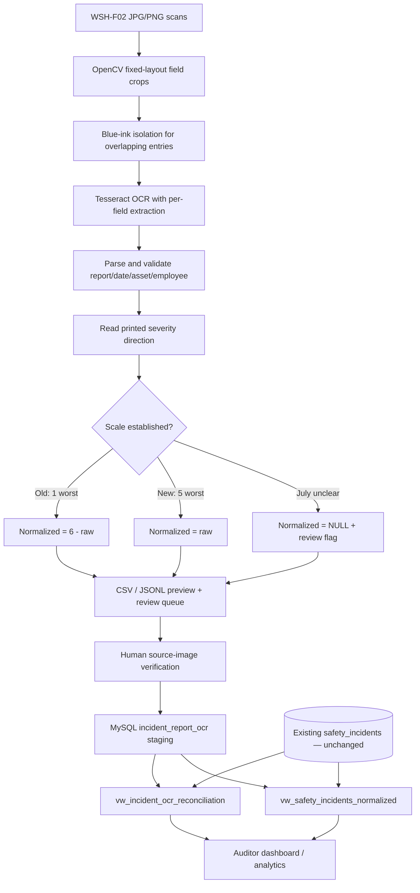
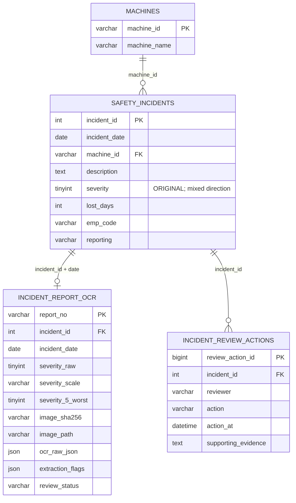

# Jurong Marine — WSH Incident Report OCR, MySQL Ingestion & Severity Audit

**Project:** `team7_jurong_marine`  
**Input:** `data/images/incident_reports/IR-*.jpg` (WSH-F02 incident report photos)  
**Existing source table:** `safety_incidents` in the Jurong Marine MySQL 8 database  
**Supporting snapshot:** `Jurong_Marine_SQL_to_excel_safety_incidents.xlsx`  
**Deliverable date:** 1 November 2026  
**Risk:** **CRITICAL — old records use `1 = most severe`, new records use `5 = most severe`; conversion was never applied to legacy data.**

[Full ZIP](jurong_marine_incident_ocr_package.zip)

## 1. Summary and verified findings

I inspected the **19 supplied incident-report photographs** and the **85-record `safety_incidents` spreadsheet extract** (columns `incident_id`, `incident_date`, `machine_id`, `description`, `severity`, `lost_days`, `emp_code`, `reporting`). The photos represent a subset of the database, **not the entire set of 85 incidents**.

| Measure | Verified result | Audit implication |
|---|---:|---|
| Records in supplied MySQL Excel extract | **85** | Baseline for database reconciliation |
| Photos supplied and manually transcribed | **19** | Source-document comparison set |
| Photo-to-database exact matches on the 8 legacy fields | **19/19** | Current *raw* values align for this provided subset; this does **not** prove the full database correct |
| Incident records labelled `found during audit` in database | **35/85** | Investigate first-notice and incident-report timing; free text is not a timestamp |
| Records dated July 2025 in database | **2** | Exact severity cutover date is not proven from the data alone |
| July 2025 records | **ID 906: 11 Jul, pictured**; **ID 907: 4 Jul, no corresponding supplied photo** | ID 907 must **not** be automatically assigned a scale |
| Database descriptions labelled near misses with nonzero lost workdays | **4** (902, 917, 944, 966) | Need event classification / medical leave review |
| Photographed injury records with `N/A near miss` in root-cause field | **4** (919, 924, 977, 982) | Internal contradiction; investigation cannot be dismissed automatically |

**Important qualification:** The accompanying `incident_reports_manual_reference.csv` contains a **manual transcription** of the supplied photographs; it is **not output from the OCR program**. `incident_reports_reconciliation_baseline.csv` compares that transcription with the Excel snapshot. The Python program separately generates its own OCR files when run locally.

### 1.1 Confirmed severity direction examples

| Report | Date | Photo says | Raw severity | Standardized (`5 = most severe`) | Note |
|---|---|---|---:|---:|---|
| IR-2024-900 | 2024-07-01 | `1 = MOST SEVERE` | 4 | **2** | Old scale, invert |
| IR-2024-924 | 2024-12-03 | `1 = MOST SEVERE` | 2 | **4** | Seriousness would be understated without inversion |
| IR-2025-912 | 2025-04-12 | `1 = MOST SEVERE` | 4 | **2** | **2025 report still uses old scale** |
| IR-2025-906 | 2025-07-11 | `5 = MOST SEVERE` | 3 | **3** | New scale independently evidenced by form |
| IR-2025-911 | 2025-10-08 | `5 = MOST SEVERE` | 2 | **2** | New scale; do not invert |
| IR-2025-904 | 2025-12-29 | `5 = MOST SEVERE` | 2 | **2** | New scale; blue digit overlaps printed header |

**Core transformation** (only after confirming the source scale):

```python
def normalize_severity(raw_severity: int, source_scale: str) -> int:
    if not 1 <= raw_severity <= 5:
        raise ValueError('Severity must be 1..5')
    if source_scale == 'OLD_1_WORST':
        return 6 - raw_severity
    if source_scale == 'NEW_5_WORST':
        return raw_severity
    raise ValueError('Unverified scale — manual review required')
```

**Do not assume `2025-07-01` is the actual changeover day.** We only know the change was **sometime in July 2025**. The application treats dates before July as old and August onward as new; **every July incident must be verified against an original form or an approved documented cutover policy**. In particular, the pictured 11 July form has the new-scale label, but the 4 July record has no supplied source form. The SQL view deliberately returns `NULL` for an unverified July standardized severity.

Also **never infer a scale from the numeric incident ID**: for example, ID 904 is dated 2025, while IDs 900–984 in this database are mixed across 2024–2026.

## 2. Proposed non-destructive processing architecture



**Why staging instead of `UPDATE safety_incidents`:** changing the raw `severity` field destroys evidence of what was originally recorded; OCR may misread a digit; and some record classifications contradict their narratives. The proposed schema **keeps the original table unchanged**, retains photo hashes, stages OCR findings separately, and exposes a normalized **view** suitable for analytics after review. For July records, the view additionally requires the **approved photo's raw severity to equal the database's raw severity**; unresolved source/DB disagreements remain `NULL`.

### Suggested project layout

```text
team7_jurong_marine/
├── .env                                   # private; excluded from Git
├── .gitignore
├── scripts/
│   ├── ingest_incident_reports.py         # supplied script
│   └── incident_reports_requirements.txt
├── sql/
│   └── incident_reports_schema.sql        # supplied SQL schema and views
├── docs/
│   └── incident_reports_ocr_etl.md        # this guide
└── data/
    ├── images/
    │   └── incident_reports/
    │       ├── IR-2024-900.jpg
    │       ├── IR-2024-924.jpg
    │       └── ...
    └── processed/
        └── incident_reports/
            ├── incident_reports_ocr_preview.csv
            ├── incident_reports_ocr_full.jsonl
            ├── incident_reports_review_queue.csv
            └── debug_crops/               # only if --debug-crops
```

## 3. Python and OCR installation (Windows PowerShell)

Run these commands in the repository root:

```powershell
cd "C:\Users\ianli\SCTP-AIE-MODULE5-GenAI Deployment and Capstone\Capstone Project\team7_jurong_marine"

# Reuse existing .venv if present. Otherwise create it:
python -m venv .venv
.\.venv\Scripts\Activate.ps1

# Copy provided files into scripts/, sql/ and docs/ as shown above.
python -m pip install -r .\scripts\incident_reports_requirements.txt

# Install the separate Windows Tesseract OCR application first.
# Check the installed executable:
& "C:\Program Files\Tesseract-OCR\tesseract.exe" --version
```

**Note:** `pytesseract` is only a Python wrapper. It does **not** install the Tesseract engine. Obtain Tesseract for Windows from a trusted distribution and ensure the trained English language package (`eng`) is installed. The script recognizes the standard Windows path or accepts `--tesseract-exe`. These scan examples contain English text.

## 4. MySQL setup (Docker and DBeaver)

### 4.1 Identify the database / published port

In PowerShell:

```powershell
docker compose ps
docker compose exec mysql mysql -u root -p -e "SHOW DATABASES;"
```

Enter your existing root password when prompted. The MySQL container listens on **3306 internally**. If host port 3306 was already occupied, your Compose port mapping may be **3307:3306** or another unused port. Verify the mapping before configuring Python; **do not assume** your database is literally named `jurong_marine`.

### 4.2 Configure a local `.env`

```dotenv
# Replace placeholders with the ACTUAL Compose/DBeaver connection settings.
MYSQL_HOST=127.0.0.1
MYSQL_PORT=3307
MYSQL_USER=root
MYSQL_PASSWORD=YOUR_EXISTING_PASSWORD
MYSQL_DATABASE=YOUR_EXISTING_JURONG_MARINE_DATABASE_NAME
```

For a real deployment, replace `root` with a least-privilege ingest account after the schema/views have been created. Do not commit credentials. Add this line to `.gitignore`:

```gitignore
.env
.venv/
data/processed/incident_reports/
```

For DBeaver: create/open your MySQL connection using the same host, host-published port, database, username and password, and select the correct existing schema.

### 4.3 Create staging table and views

Open `sql/incident_reports_schema.sql` in the **DBeaver SQL Editor**, make the correct Jurong Marine database the default, then **Execute SQL Script**. It creates:

- `incident_report_ocr`: independently captured photo data, **pending human review**.
- `vw_incident_ocr_reconciliation`: comparisons of scanned values against the existing raw database.
- `vw_safety_incidents_normalized`: consistently oriented severity for auditing and analysis, with July safeguards.

It does **not** drop or alter `safety_incidents`.

## 5. Execute OCR, review, then stage in MySQL

### 5.1 Run dry-run first (default; NO database changes)

```powershell
python .\scripts\ingest_incident_reports.py `
  --images-dir ".\data\images\incident_reports" `
  --out-dir ".\data\processed\incident_reports" `
  --debug-crops
```

The script writes:

1. **`incident_reports_ocr_preview.csv`** — extracted columns with severity scale and flags; edit/review separately from the source files.
2. **`incident_reports_ocr_full.jsonl`** — raw OCR text and field-by-field confidence values for forensic comparison.
3. **`incident_reports_review_queue.csv`** — source-image checklist; all OCR records require review before approval.
4. **`debug_crops/`** — per-field images useful for investigating failed recognition, especially overlapped severity digits.

**Observed test limitation:** On a local dry-run of **IR-2025-906.jpg**, the script correctly read the report number, date (`2025-07-11`), machine (`CNC-02`), employee (`EMP019`), `lost_days=1`, and the printed *new* scale. However, Tesseract **did not successfully read the blue severity digit `3` because it overlaps the printed “WSH matrix” text**. It was marked `SEVERITY_OCR_AMBIGUOUS` and stored as `NULL` instead of inventing a score. **That is intentional audit-safe behavior.** A human must confirm the digit on the original image; do not take the legacy database value as proof of the photo's digit.

### 5.2 Upload extracted evidence to the staging table

After the dry-run and SQL creation:

```powershell
python .\scripts\ingest_incident_reports.py `
  --images-dir ".\data\images\incident_reports" `
  --out-dir ".\data\processed\incident_reports" `
  --commit
```

The script inserts into **`incident_report_ocr` only**. Every record remains `PENDING_REVIEW`, even if its confidence is high; the scripts **never auto-approve** a legally or operationally significant incident. It compares image SHA-256 hashes on reruns: the same photo is skipped; a different photo using the same report number triggers a **conflict** rather than silently replacing existing evidence.

The program is a candidate baseline for the supplied **fixed WSH-F02 layout**; layout drift, colored ink differences, small/overprinted digits, and right-edge truncation require manual verification and potentially revised regions. It must **not** be treated as validated, unattended production OCR without a measured test-set accuracy and reviewer sign-off.

## 6. Audit SQL — the part the auditor will test

### 6.1 Compare JPEG OCR against existing MySQL rows

```sql
SELECT report_no, incident_id, image_incident_date,
       database_incident_date, image_severity_raw,
       database_severity_raw, severity_scale,
       image_severity_5_worst, ocr_confidence,
       review_status, reconciliation_result
FROM vw_incident_ocr_reconciliation
WHERE reconciliation_result <> 'MATCH'
ORDER BY incident_id;
```

**Reminder:** A `MATCH` on raw fields does **not** imply the severity scale was historically comparable. OCR fields still need human approval. The supplied 19-photo **manual** baseline matches all eight legacy columns in the Excel snapshot, but an OCR result may not.

### 6.2 Verify legacy reversal AND July handling

```sql
SELECT incident_id, incident_date,
       severity_raw_database,
       effective_severity_scale,
       severity_5_worst,
       severity_audit_status
FROM vw_safety_incidents_normalized
WHERE incident_id IN (900, 904, 906, 907, 911, 912, 924)
ORDER BY incident_id;
```

Expected behavior based on the verified records:

| ID | Date | Original | Expected standardized | Reason |
|---:|---|---:|---:|---|
| 900 | 2024-07-01 | 4 | **2** | Prior to switch; reverse |
| 904 | 2025-12-29 | 2 | **2** | After switch |
| 906 | 2025-07-11 | 3 | **NULL until its form label is manually approved**, then 3 | July cutover |
| 907 | 2025-07-04 | 2 | **NULL** | No supplied photo verifying old/new scale |
| 911 | 2025-10-08 | 2 | **2** | After switch |
| 912 | 2025-04-12 | 4 | **2** | Old scale, despite a 2025 report number |
| 924 | 2024-12-03 | 2 | **4** | Critical old-scale reversal example |

**Before approving ID 906**, an authorised reviewer should open its image and check the date, blue severity digit, printed label (`5 = MOST SEVERE`), and the corresponding MySQL raw value. If the OCR digit was blank, do not approve its *field extraction* as-is; follow a documented manual-correction process or explicitly approve the scale label independently with evidence. Example SQL below is for an **already independently verified and corrected** staging row:

```sql
-- Example only. Review photo and correct extraction in a controlled process first.
UPDATE incident_report_ocr
SET review_status = 'APPROVED',
    reviewed_by = 'REVIEWER_ID',
    reviewed_at = NOW()
WHERE report_no = 'IR-2025-906'
  AND incident_date = '2025-07-11'
  AND severity_raw = 3
  AND severity_scale = 'NEW_5_WORST'
  AND scale_source = 'FORM_LABEL';
```

If July 4 is determined to be before or after an officially confirmed switchover, record the **effective date and supporting policy**, and update the normalization logic under a schema migration; do not silently fill in July unknowns.

### 6.3 Spot unverified values and classification traps

```sql
-- July ambiguity / invalid severity: DO NOT coerce NULL to 0 or 1.
SELECT *
FROM vw_safety_incidents_normalized
WHERE severity_5_worst IS NULL;

-- 'Near miss' is inconsistent with nonzero work-loss in some records.
SELECT incident_id, incident_date, machine_id, description, lost_days
FROM safety_incidents
WHERE LOWER(description) LIKE '%near miss%' AND lost_days > 0
ORDER BY lost_days DESC;

-- Events discovered through audit: investigate actual notice/filing dates.
SELECT incident_id, incident_date, description, reporting
FROM safety_incidents
WHERE LOWER(reporting) LIKE '%found during audit%'
ORDER BY incident_date;

-- Report frequency by normalized impact. Excludes unresolved NULL scores.
SELECT YEAR(incident_date) AS year, severity_5_worst,
       COUNT(*) AS incident_count
FROM vw_safety_incidents_normalized
WHERE severity_5_worst IS NOT NULL
GROUP BY YEAR(incident_date), severity_5_worst
ORDER BY year, severity_5_worst DESC;
```

## 7. Evidence-based data-quality trap register

| Priority | Evidence | Issue | Recommended treatment |
|---|---|---|---|
| **CRITICAL** | 2024 form 924 raw `2` vs 2025 form 911 raw `2` | Same numerical severity means different severity directions. | Preserve raw severity; analytics must use `severity_5_worst`. |
| **CRITICAL** | Database ID **907**: `2025-07-04`; no corresponding supplied photo | July switchover day is unknown. | Return `NULL`, request original scan/policy. |
| **HIGH** | 2025 forms **904, 906, 911** | Blue severity number is printed over the black wording `WSH matrix`. | Blue-ink isolation, digit-level manual check, never default to DB raw severity. |
| **HIGH** | Photo **IR-2024-982** | Falling object/helmet damage, **14 lost workdays**, root cause field says `N/A near miss`. | Investigate injury status, RCA and medical leave evidence. |
| **HIGH** | Photos **919, 924, 977, 982** | Description indicates injury; root-cause field says `N/A near miss`. | Do not equate `N/A near miss` with a valid RCA waiver. |
| **HIGH** | Photo **917**; database records **902, 944, 966** | Described as *near miss* but nonzero lost workdays. | Verify actual injury/medical leave, correct category by approved amendment, preserve originals. |
| **HIGH** | Photographs with `see attached` / `yes` | Attached 5-Why investigation is **claimed**, but was not supplied among these photos. | Obtain supporting RCA attachments before treating investigations as closed. |
| **MEDIUM** | Photo **926**, **941**, **954**, **957**, **904**, **911** | `no - pending` RCA status. | Track investigation completion and corrective-action owner. |
| **MEDIUM** | **35/85** database records state `found during audit` | Possible late discovery; reporting date absent. | Add `first_notified_at`, `submitted_to_mom_at`, and evidence of actual submission; do **not** invent dates from the text. |
| **MEDIUM** | Photo descriptions reaching the right page edge | Some text is visually cut off, e.g. `helmet cracke...`. | Compare original document and database; no automatic guessed text completion. |
| **MEDIUM** | Same numeric incident-ID series across years | e.g. 904 is 2025 but 924 is 2024. | Use `incident_date` for scale interpretation; link OCR by report + numeric ID and verify date match. |
| **MEDIUM** | `lost_days` in SQL vs statutory MC | Working days lost are **not necessarily MC calendar days**, hospitalisation leave, or light duty. | Keep a separate verified MOM reportability field. |

### Notes on reporting requirements (Singapore)

MOM's published accident-reporting guidance says reportable **non-fatal work injuries** generally require submission **within 10 days of the employer's first notice**; fatal accidents and dangerous occurrences have their own notification requirements. MOM also distinguishes medical leave from other measures. Consequently **neither `lost_days` nor `reporting='reported next day'` proves statutory compliance**; the latter is only free text, not a verified actual filing timestamp. For MC durations, MOM counts **calendar days** rather than simply scheduled working days.

References:  
- MOM — Work-related accidents: what and when to report: https://www.mom.gov.sg/workplace-safety-and-health/work-accident-reporting/what-and-when-to-report  
- MOM — Report a work-related accident: https://www.mom.gov.sg/workplace-safety-and-health/work-accident-reporting/report-a-work-related-accident  
- MOM — How should I count MC days?: https://ask.gov.sg/mom/questions/cm9kjrbnh00mrdfrqfxh13few

This document supports an **internal data-quality audit**; it is not a substitute for formally determining each event's legal reporting classification.

## 8. Proposed cleaned schema / downstream feature mapping

| Existing or extracted field | Cleaned field | Handling |
|---|---|---|
| `safety_incidents.incident_id` | `incident_id` | Keep numeric ID; check source photo/report date |
| `IR-2025-906` from JPEG | `report_no` | Unique photo-side key |
| `incident_date` | `incident_date` | Parse as day/month/year in photo; store SQL `DATE` |
| `machine_id` | `machine_id` | Preserve ID; join CMMS machine reference; do not autocorrect unknown machines |
| `description` | `description` | Preserve source narrative; optional controlled incident category after human review |
| `severity` from original | `severity_raw_database` | **Never overwrite** |
| Form's old/new label | `effective_severity_scale` | Source label preferred for audited July cases |
| Computed score | `severity_5_worst` | `6 - raw` for old, otherwise `raw`; July unverified = `NULL` |
| `lost_days` | `lost_days` | Retain working-day metric separately from MC calendar days |
| `reporting` | `reporting` | Keep original free-text reporting note |
| OCR date/time? | `first_notified_at`, `submitted_to_mom_at` | **Not in provided inputs**; do not fabricate |
| `Root cause (5-Why attached?)` | `root_cause_reference` | Record exactly; verify attachments separately |
| Photo | `image_path`, `image_sha256` | Keep source evidence and integrity hash |
| OCR quality | `ocr_confidence`, `extraction_flags` | Support human review |
| Approval | `review_status`, `reviewed_by`, `reviewed_at` | Record reviewer sign-off |

## 9. Mermaid ER diagram (cleaned analytical design)



`INCIDENT_REVIEW_ACTIONS` and `MACHINES` in this diagram represent **recommended broader CMMS integration**, not tables created by the supplied SQL. Existing master-machine schema must be checked before using the join. Only `incident_report_ocr` and the two views are created here.

## 10. Validation and acceptance checklist

- [ ] The raw legacy `safety_incidents` table is backed up and **not modified** by OCR ingestion.
- [ ] Every original photo is retained with a verifiable SHA-256 digest.
- [ ] All 19 supplied photographs are detected by the script's file enumeration.
- [ ] Every generated record's key fields are checked against its source JPEG (particularly severity digit, date, and machine).
- [ ] `IR-2024-924`: raw 2 → standardized **4**.
- [ ] `IR-2025-912`: April 2025 raw 4 → standardized **2**.
- [ ] `IR-2025-911`: October 2025 raw 2 → standardized **2**.
- [ ] July ID **906** remains unapproved until its *overprinted* digit and printed scale are reviewed.
- [ ] July ID **907** remains `NULL` until independent evidence establishes its scale.
- [ ] No missing severity is replaced with `0`, `1`, `5`, or the legacy MySQL value merely to pass reconciliation.
- [ ] Four photographed `N/A near miss` RCA contradictions are escalated.
- [ ] Four database near-miss/nonzero-lost-days contradictions are investigated.
- [ ] RCA attachments, actual incident first-notice times and MOM submission evidence are sought rather than guessed.
- [ ] MySQL reconciliation query is saved as audit evidence, with reviewed exceptions documented.
- [ ] Team commits code, schema, audit report and **safe example data**, excluding `.env` and unnecessary personnel documents.

## 11. Files provided and their roles

| File | Purpose |
|---|---|
| `incident_reports_ocr_etl.md` | This complete setup, audit and remediation guide |
| `ingest_incident_reports.py` | Python photo-crop OCR → CSV / JSONL → MySQL staging |
| `incident_reports_schema.sql` | MySQL staging, reconciliation and normalized views |
| `incident_reports_requirements.txt` | Python pip dependencies |
| `incident_reports_manual_reference.csv` | Independently transcribed **19 example photos** for OCR testing (not OCR output) |
| `incident_reports_reconciliation_baseline.csv` | Photo reference vs supplied **85-row Excel** extract, with mismatch flags |

**Final auditor position:** Keep **raw severity** for evidentiary integrity, publish a separately **normalized severity** for analytics, and treat **July 2025 as a verified-exception period** rather than assuming a fabricated exact cutover date. The source-image inconsistencies must remain visible as review exceptions instead of being overwritten to make an ETL run “green.”
