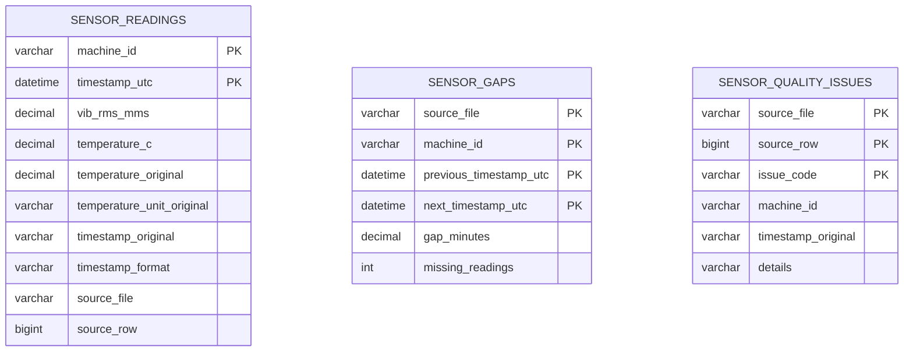

# Sensor CSV Cleaning and MySQL 8 Ingestion — Jurong Marine

> **Source file analysed:** `vibration_temp_2026H1.csv`  
> **Purpose:** Normalise mixed ISO 8601 / epoch-millisecond timestamps, convert Fahrenheit to Celsius, find missing sensor samples and load results into MySQL without silently filling gaps.  
> **Test status:** Cleaning and gap detection were executed successfully on the uploaded file. **Live MySQL ingestion was not executed** because your database is not connected to this environment.

## 1. Actual findings from your uploaded CSV

| Metric | Result |
|---|---:|
| Rows in source CSV | **106,384** |
| Machines | **5** (`CNC-01`, `CNC-02`, `CNC-03`, `CMP-01`, `PMP-T01`) |
| ISO 8601 timestamps | **79,596** |
| Unix epoch-millisecond timestamps | **26,788** |
| Original readings in Celsius | **90,578** |
| Original readings in Fahrenheit | **15,806** |
| Expected sampling interval (verified from data) | **12 minutes** |
| Coverage in Singapore time | **1 Jan – 30 Jun 2026** |
| Expected samples (5 × 21,720) | **108,600** |
| Actual unique valid samples | **106,384** |
| Missing samples across all machines | **2,216** |
| Distinct internal gap events | **2,173** |
| Longest observed gap between readings | **36 minutes** |
| Bad values, timestamps, or duplicate sensor-time pairs | **0 detected** |

Each machine covers the same start and end timestamps. Therefore the 2,216 missing slots are internal missing samples, not extrapolated samples outside the observed period. Approximate completeness is **97.96%** overall (106,384 / 108,600). An ISO time of `2026-01-01T00:00:00+08:00` and epoch milliseconds `1767196800000` represent the **same UTC instant:** `2025-12-31T16:00:00Z`.

## 2. Outputs and destination tables

| Output generated by the Python script | Purpose | MySQL table |
|---|---|---|
| `sensors_cleaned.csv` | One UTC-normalised, Celsius-normalised row per machine and timestamp | `sensor_readings` |
| `sensor_gaps.csv` | One record per internal missing-data interval | `sensor_gaps` |
| `sensor_quality_issues.csv` | Invalid records and duplicate/conflicting sensor timestamps | `sensor_quality_issues` |
| `sensor_data_audit.md` | Human-readable audit and completeness per machine | File only |
| `sensor_summary.json` | Summary for automated reports | File only |

The original source timestamp, temperature value and unit remain in `sensor_readings`. Invalid values are not silently converted. Missing sensor observations are **not** replaced with invented readings.

## 3. Suggested placement in your capstone repository

```text
team7_jurong_marine/
├── data/
│   ├── logs/
│   │   └── vibration_temp_2026H1.csv
│   └── processed/
│       ├── sensors_cleaned.csv
│       ├── sensor_gaps.csv
│       ├── sensor_quality_issues.csv
│       ├── sensor_summary.json
│       └── sensor_data_audit.md
├── scripts/
│   └── sensor_csv_to_mysql.py
└── docs/
    └── sensor_mysql_pipeline.md
```

Copy the Python script below to `scripts/sensor_csv_to_mysql.py`. It uses the **Python standard library for cleaning** and requires `mysql-connector-python` **only** to write to MySQL.

## 4. Windows PowerShell setup and dry run

From the `team7_jurong_marine` project folder:

```powershell
# Activate your existing environment, if you use one
.\.venv\Scripts\Activate.ps1

# Needed only for direct MySQL insertion; cleaning works without this package
python -m pip install mysql-connector-python

# Run a dry run to generate all audit and cleaned output files; no DB writes
python .\scripts\sensor_csv_to_mysql.py `
    --input .\data\raw\vibration_temp_2026H1.csv `
    --output-dir .\data\processed `
    --expected-minutes 12
```

The script prints the number of rows, timestamp formats, unit counts, gap events, and missing samples. Confirm the audit matches the counts in Section 1 before connecting to MySQL.

## 5. Prepare MySQL 8 and DBeaver

1. Start your MySQL Docker service (`docker compose up -d mysql`), then inspect the **host-side** published port with `docker compose ps`. If your Compose file uses `ports: ["3307:3306"]`, use **127.0.0.1:3307** from Windows; if it uses `3306:3306`, use **127.0.0.1:3306**.
2. Connect DBeaver with **MySQL**, host **127.0.0.1**, the published port, your actual username and password, and database **`jurongmarine_cmms`** (or substitute your actual database).
3. If the database does not exist, run the following in the DBeaver SQL editor:

```sql
CREATE DATABASE IF NOT EXISTS jurongmarine_cmms
  CHARACTER SET utf8mb4 COLLATE utf8mb4_0900_ai_ci;
```

The ETL script creates **three tables automatically** in the selected existing database. An equivalent `sensor_schema.sql` file is provided for DBeaver review or manual execution. You need CREATE, INSERT, SELECT and DELETE privileges on the database to run the full pipeline; use a restricted ETL account for production instead of root.

> **Important:** `mysql -uroot -p data/sql/file.sql` does **not** import an SQL file; the MySQL client treats the filename argument as a database name. If manually executing SQL, open the `.sql` file in DBeaver or redirect its contents into the client.

## 6. Load directly into MySQL

In a **temporary PowerShell session**, set the credentials (replace the placeholder with your actual password; never save passwords in the `.py`, `.md`, Git, or your CSV):

```powershell
$env:MYSQL_PASSWORD = 'YOUR_ACTUAL_MYSQL_PASSWORD'
$env:MYSQL_HOST = '127.0.0.1'
$env:MYSQL_PORT = '3307'              # CHANGE: use the host port shown by docker compose ps
$env:MYSQL_DATABASE = 'jurongmarine_cmms'
$env:MYSQL_USER = 'root'              # Prefer a limited ETL account for production

python .\scripts\sensor_csv_to_mysql.py `
    --input .\data\raw\vibration_temp_2026H1.csv `
    --output-dir .\data\processed `
    --expected-minutes 12 `
    --load-mysql

# Clear password from this shell after loading
Remove-Item Env:MYSQL_PASSWORD
```

When running this Python script *from inside another Docker container*, use `--mysql-host mysql --mysql-port 3306` if the containers share the Compose network. From the **Windows host**, use 127.0.0.1 and the **published** port.

**Import behaviour:** A unique MySQL primary key `(machine_id, timestamp_utc)` prevents double-loading the same observation. Re-running the script keeps existing readings intact. Duplicate timestamps **within the CSV** are reported, and the first reading is retained. Existing database rows are never overwritten on conflict; inspect overlapping source files separately if they disagree.

## 7. Validate the results in DBeaver

```sql
USE jurongmarine_cmms;

-- Expect 106384 readings if these tables were previously empty
SELECT COUNT(*) AS total_readings FROM sensor_readings;

-- Inspect the five machines and their sensor ranges
SELECT machine_id,
       COUNT(*) AS readings,
       ROUND(AVG(temperature_c), 2) AS avg_temp_c,
       MAX(temperature_c) AS max_temp_c,
       MAX(vib_rms_mms) AS max_vibration_mms
FROM sensor_readings
GROUP BY machine_id
ORDER BY machine_id;

-- Expect 2173 events, accounting for 2216 missing readings
SELECT machine_id,
       COUNT(*) AS gap_events,
       SUM(missing_readings) AS missing_readings,
       MAX(gap_minutes) AS max_gap_minutes
FROM sensor_gaps
GROUP BY machine_id
ORDER BY machine_id;

-- See sample UTC readings alongside their Singapore local times
SELECT machine_id, timestamp_utc,
       CONVERT_TZ(timestamp_utc, '+00:00', '+08:00') AS timestamp_sgt,
       vib_rms_mms, temperature_c,
       temperature_original, temperature_unit_original
FROM sensor_readings
ORDER BY timestamp_utc, machine_id
LIMIT 20;

-- Audit rejected rows (zero for the provided source file)
SELECT issue_code, COUNT(*) AS issue_count
FROM sensor_quality_issues
GROUP BY issue_code;
```

### MySQL data model



Gap and issue tables are *audit summaries*, not foreign-key children of the reading table: rejected rows may lack a valid reading timestamp. No artificial sensor measurements are inserted for missing intervals.

## 8. Data-quality and operations notes

- **Epoch units:** 13-digit decimal strings are treated as **milliseconds**; timezone-aware ISO strings are normalised to **UTC**. `DATETIME(3)` is stored in UTC by convention; MySQL does not attach timezone data to this type.
- **No timezone guessing:** ISO values without an offset or `Z` are rejected for investigation. This protects event correlation.
- **Temperature:** Fahrenheit is converted with `(F - 32) × 5 / 9` and stored at 3 decimal places. Source units are preserved.
- **Gaps:** With a verified 12-minute reporting cadence, a 24-minute interval implies **one missing reading**, and 36 minutes implies **two**. A one-minute jitter allowance avoids flagging minor timing drift. Gaps are reported per machine; **no forward filling or interpolation** is performed.
- **Reading validation:** Non-numeric vibration/temperature, negative vibration RMS, unknown units, blank machine IDs and invalid timestamps are flagged and excluded from the cleaned dataset. You can add equipment-specific anomaly thresholds later based on manufacturer specifications.
- **Reimport policy:** Readings remain unchanged if they already exist in MySQL. Gap/issue records for a **source filename** are recalculated on each load. Use unique, immutable source filenames when importing additional CSV exports.
- **Data scope:** Completeness is measured between the earliest and latest reading **for each machine**. If the export starts or ends during a sensor outage, boundary gaps will not appear without an explicit measurement window.
- **Operational deployment:** Back up the raw input, use a dedicated MySQL user, protect database credentials, and monitor failed ingestion runs. This script is suitable for this 106k-row capstone input; for larger continuous feeds, add chunked processing, source batch identifiers and cross-file conflict checks.

## 9. Full executable Python script

Save the following as `scripts/sensor_csv_to_mysql.py`:

```python
#!/usr/bin/env python3
"""Normalise sensor readings, report gaps and optionally load into MySQL 8.

Python 3.9+. Cleaning requires only the standard library.
MySQL loading requires: pip install mysql-connector-python
"""

import argparse
import csv
import json
import math
import os
import re
from collections import defaultdict
from datetime import datetime, timedelta, timezone
from decimal import Decimal, InvalidOperation, ROUND_HALF_UP
from pathlib import Path

REQUIRED = {"timestamp", "machine_id", "vib_rms_mms", "temp", "temp_unit"}
EPOCH_MS = re.compile(r"^\d{13}$")
QUANT = Decimal("0.001")

TABLES = [
    """CREATE TABLE IF NOT EXISTS sensor_readings (
      machine_id VARCHAR(64) NOT NULL,
      timestamp_utc DATETIME(3) NOT NULL COMMENT 'Always UTC; MySQL DATETIME has no timezone',
      vib_rms_mms DECIMAL(10,3) NOT NULL,
      temperature_c DECIMAL(10,3) NOT NULL,
      temperature_original DECIMAL(10,3) NOT NULL,
      temperature_unit_original VARCHAR(8) NOT NULL,
      timestamp_original VARCHAR(80) NOT NULL,
      timestamp_format VARCHAR(16) NOT NULL,
      source_file VARCHAR(255) NOT NULL,
      source_row BIGINT NOT NULL,
      loaded_at TIMESTAMP NOT NULL DEFAULT CURRENT_TIMESTAMP,
      PRIMARY KEY (machine_id, timestamp_utc),
      KEY idx_sensor_readings_time (timestamp_utc)
    ) ENGINE=InnoDB DEFAULT CHARSET=utf8mb4""",
    """CREATE TABLE IF NOT EXISTS sensor_gaps (
      source_file VARCHAR(255) NOT NULL,
      machine_id VARCHAR(64) NOT NULL,
      previous_timestamp_utc DATETIME(3) NOT NULL,
      next_timestamp_utc DATETIME(3) NOT NULL,
      gap_minutes DECIMAL(12,3) NOT NULL,
      missing_readings INT NOT NULL,
      PRIMARY KEY (source_file, machine_id, previous_timestamp_utc, next_timestamp_utc),
      KEY idx_sensor_gaps_machine (machine_id)
    ) ENGINE=InnoDB DEFAULT CHARSET=utf8mb4""",
    """CREATE TABLE IF NOT EXISTS sensor_quality_issues (
      source_file VARCHAR(255) NOT NULL,
      source_row BIGINT NOT NULL,
      machine_id VARCHAR(64),
      timestamp_original VARCHAR(80),
      issue_code VARCHAR(64) NOT NULL,
      details VARCHAR(255) NOT NULL,
      PRIMARY KEY (source_file, source_row, issue_code)
    ) ENGINE=InnoDB DEFAULT CHARSET=utf8mb4""",
]


def parse_timestamp(raw):
    value = raw.strip()
    if EPOCH_MS.fullmatch(value):
        # timedelta avoids floating-point epoch conversion drift.
        parsed = datetime(1970, 1, 1, tzinfo=timezone.utc) + timedelta(milliseconds=int(value))
        return parsed, "epoch_ms"
    try:
        parsed = datetime.fromisoformat(value.replace("Z", "+00:00"))
    except ValueError as exc:
        raise ValueError(f"Invalid ISO 8601 / 13-digit epoch-ms timestamp: {value!r}") from exc
    if parsed.tzinfo is None or parsed.utcoffset() is None:
        raise ValueError("ISO timestamp lacks timezone: verify source timezone before loading")
    return parsed.astimezone(timezone.utc), "iso8601"


def parse_number(raw, column):
    try:
        value = Decimal(raw.strip())
    except (InvalidOperation, AttributeError):
        raise ValueError(f"Invalid {column}: {raw!r}") from None
    if not value.is_finite():
        raise ValueError(f"Non-finite {column}: {raw!r}")
    return value


def mysql_datetime(dt):
    return dt.astimezone(timezone.utc).replace(tzinfo=None)


def utc_iso(dt):
    return dt.astimezone(timezone.utc).isoformat(timespec="milliseconds").replace("+00:00", "Z")


def write_csv(path, columns, rows):
    with path.open("w", encoding="utf-8", newline="") as file:
        writer = csv.DictWriter(file, fieldnames=columns)
        writer.writeheader()
        writer.writerows(rows)


def process(input_path, output_dir, expected_minutes, jitter_seconds):
    cleaned = []
    issues = []
    source_name = input_path.name
    seen = {}
    timestamp_formats = defaultdict(int)
    units = defaultdict(int)
    total_rows = 0

    with input_path.open("r", encoding="utf-8-sig", newline="") as file:
        reader = csv.DictReader(file)
        if not reader.fieldnames or not REQUIRED.issubset(reader.fieldnames):
            raise ValueError(f"Required CSV columns: {sorted(REQUIRED)}; got {reader.fieldnames}")

        for source_row, raw in enumerate(reader, start=2):
            total_rows += 1
            raw_ts = (raw.get("timestamp") or "").strip()
            machine = (raw.get("machine_id") or "").strip()
            raw_vib = (raw.get("vib_rms_mms") or "").strip()
            raw_temp = (raw.get("temp") or "").strip()
            raw_unit = (raw.get("temp_unit") or "").strip()
            try:
                if not machine:
                    raise ValueError("Blank machine_id")
                if len(machine) > 64:
                    raise ValueError("machine_id exceeds 64 characters")
                timestamp, timestamp_format = parse_timestamp(raw_ts)
                vibration = parse_number(raw_vib, "vib_rms_mms")
                temperature = parse_number(raw_temp, "temp")
                if vibration < 0:
                    raise ValueError("Negative vibration RMS")
                unit = raw_unit.upper().replace("°", "").strip()
                if unit in ("C", "CELSIUS"):
                    temperature_c = temperature
                    unit = "C"
                elif unit in ("F", "FAHRENHEIT"):
                    temperature_c = (temperature - Decimal(32)) * Decimal(5) / Decimal(9)
                    unit = "F"
                else:
                    raise ValueError(f"Unknown temperature unit: {raw_unit!r}")
                temperature_c = temperature_c.quantize(QUANT, rounding=ROUND_HALF_UP)
                vibration = vibration.quantize(QUANT, rounding=ROUND_HALF_UP)
                temperature = temperature.quantize(QUANT, rounding=ROUND_HALF_UP)
                key = (machine, timestamp)
                if key in seen:
                    prev = seen[key]
                    is_conflict = (prev["vib_rms_mms"] != str(vibration)
                                   or prev["temperature_c"] != str(temperature_c))
                    issues.append({
                        "source_file": source_name, "source_row": source_row,
                        "machine_id": machine, "timestamp_original": raw_ts,
                        "issue_code": "CONFLICTING_DUPLICATE" if is_conflict else "DUPLICATE_SENSOR_TIMESTAMP",
                        "details": f"Same machine + UTC timestamp as source row {prev['source_row']}; first row retained",
                    })
                    continue
                item = {
                    "machine_id": machine, "timestamp_utc": utc_iso(timestamp),
                    "vib_rms_mms": str(vibration), "temperature_c": str(temperature_c),
                    "temperature_original": str(temperature),
                    "temperature_unit_original": unit,
                    "timestamp_original": raw_ts, "timestamp_format": timestamp_format,
                    "source_file": source_name, "source_row": source_row,
                    "_timestamp_obj": timestamp,
                }
                seen[key] = item
                cleaned.append(item)
                timestamp_formats[timestamp_format] += 1
                units[unit] += 1
            except (ValueError, ArithmeticError, OverflowError) as exc:
                issues.append({
                    "source_file": source_name, "source_row": source_row,
                    "machine_id": machine, "timestamp_original": raw_ts,
                    "issue_code": "INVALID_READING", "details": str(exc)[:255],
                })

    cleaned.sort(key=lambda x: (x["machine_id"], x["_timestamp_obj"]))
    by_machine = defaultdict(list)
    for item in cleaned:
        by_machine[item["machine_id"]].append(item)

    gaps = []
    expected_seconds = expected_minutes * 60
    for machine, records in by_machine.items():
        for previous, current in zip(records, records[1:]):
            delta_seconds = (current["_timestamp_obj"] - previous["_timestamp_obj"]).total_seconds()
            if delta_seconds <= expected_seconds + jitter_seconds:
                continue
            # Eg 12->36 minutes: two missing 12-minute intervals.
            missing = max(1, math.ceil(delta_seconds / expected_seconds) - 1)
            gaps.append({
                "source_file": source_name, "machine_id": machine,
                "previous_timestamp_utc": previous["timestamp_utc"],
                "next_timestamp_utc": current["timestamp_utc"],
                "gap_minutes": f"{delta_seconds / 60:.3f}",
                "missing_readings": missing,
            })

    clean_columns = [
        "machine_id", "timestamp_utc", "vib_rms_mms", "temperature_c",
        "temperature_original", "temperature_unit_original", "timestamp_original",
        "timestamp_format", "source_file", "source_row",
    ]
    gap_columns = [
        "source_file", "machine_id", "previous_timestamp_utc", "next_timestamp_utc",
        "gap_minutes", "missing_readings",
    ]
    issue_columns = [
        "source_file", "source_row", "machine_id", "timestamp_original", "issue_code", "details",
    ]
    output_dir.mkdir(parents=True, exist_ok=True)
    write_csv(output_dir / "sensors_cleaned.csv", clean_columns,
              ({k: row[k] for k in clean_columns} for row in cleaned))
    write_csv(output_dir / "sensor_gaps.csv", gap_columns, gaps)
    write_csv(output_dir / "sensor_quality_issues.csv", issue_columns, issues)

    total_missing = sum(row["missing_readings"] for row in gaps)
    machine_stats = {}
    for machine, rows in sorted(by_machine.items()):
        machine_gaps = [g for g in gaps if g["machine_id"] == machine]
        # Completeness between the first and last observed readings of this machine only.
        first, last = rows[0]["_timestamp_obj"], rows[-1]["_timestamp_obj"]
        expected_slots = int((last - first).total_seconds() // expected_seconds) + 1
        machine_stats[machine] = {
            "valid_readings": len(rows),
            "expected_between_first_last": expected_slots,
            "gap_events": len(machine_gaps),
            "missing_readings": sum(int(g["missing_readings"]) for g in machine_gaps),
            "completeness_pct": round(100 * len(rows) / expected_slots, 4) if expected_slots else None,
            "first_reading_utc": utc_iso(first),
            "last_reading_utc": utc_iso(last),
        }

    summary = {
        "source_file": source_name, "total_rows": total_rows, "valid_unique_readings": len(cleaned),
        "quality_issue_rows": len(issues), "timestamp_formats": dict(timestamp_formats),
        "original_temperature_units": dict(units), "expected_reporting_minutes": expected_minutes,
        "gap_events": len(gaps), "missing_readings_between_observed": total_missing,
        "max_gap_minutes": max((float(row["gap_minutes"]) for row in gaps), default=0),
        "sensors": machine_stats,
    }
    (output_dir / "sensor_summary.json").write_text(json.dumps(summary, indent=2), encoding="utf-8")

    parts = [
        "# Sensor CSV data-quality audit", "",
        f"**Source:** `{source_name}`", "",
        f"- Original data rows: **{total_rows:,}**",
        f"- Valid unique readings: **{len(cleaned):,}**",
        f"- Bad/duplicate rows flagged: **{len(issues):,}**",
        f"- Timestamp formats: **{dict(timestamp_formats)}**",
        f"- Original temperature units: **{dict(units)}**",
        f"- Expected cadence: **{expected_minutes} minutes**",
        f"- Internal gap events: **{len(gaps):,}**",
        f"- Missing readings between observed endpoints: **{total_missing:,}**",
        f"- Largest internal gap: **{summary['max_gap_minutes']:g} minutes**", "",
        "## Per-machine completeness", "",
        "| Machine | Observed | Expected* | Gap events | Missing slots | Completeness |",
        "|---|---:|---:|---:|---:|---:|",
    ]
    for machine, ms in machine_stats.items():
        parts.append(
            f"| {machine} | {ms['valid_readings']:,} | {ms['expected_between_first_last']:,} | "
            f"{ms['gap_events']:,} | {ms['missing_readings']:,} | {ms['completeness_pct']:.2f}% |"
        )
    parts += [
        "", "*Expected slots are calculated between each machine's first and last observed reading;",
        "missing readings before or after those endpoints are not included. Timestamp values are normalised to UTC.*",
        "", "## Cleaning decisions", "",
        "- 13-digit epoch values interpreted as **milliseconds since 1970-01-01 UTC**.",
        "- Timezone-aware ISO 8601 values converted to UTC. **Naive ISO timestamps are rejected** instead of guessed.",
        "- Fahrenheit temperatures converted to Celsius using `(F - 32) * 5 / 9`.",
        "- Raw timestamp and temperature values retained for traceability.",
        "- Duplicates for the same `(machine_id, timestamp_utc)` are flagged and the first row is retained.",
        "- Missing sensor readings are **not interpolated or forward-filled**.",
        "- Gaps are derived per machine after sorting by UTC timestamp.",
        "", "## Outputs", "",
        "- `sensors_cleaned.csv` — normalised readings for MySQL ingestion.",
        "- `sensor_gaps.csv` — detected missing-interval events.",
        "- `sensor_quality_issues.csv` — invalid/duplicate records.",
        "- `sensor_summary.json` — machine-readable summary.",
    ]
    (output_dir / "sensor_data_audit.md").write_text("\n".join(parts) + "\n", encoding="utf-8")
    return cleaned, gaps, issues, summary


def batches(rows, size=1000):
    for start in range(0, len(rows), size):
        yield rows[start:start + size]


def mysql_load(cleaned, gaps, issues, args):
    try:
        import mysql.connector
    except ImportError as exc:
        raise SystemExit("Install MySQL driver: python -m pip install mysql-connector-python") from exc
    password = os.getenv("MYSQL_PASSWORD")
    if password is None:
        raise SystemExit("Set MYSQL_PASSWORD in your environment (never hardcode DB credentials).")
    try:
        connection = mysql.connector.connect(
            host=args.mysql_host, port=args.mysql_port,
            user=args.mysql_user, password=password,
            database=args.mysql_database, charset="utf8mb4",
        )
    except mysql.connector.Error as exc:
        raise SystemExit(f"Cannot connect to MySQL: {exc}. Check Docker host port and database name.") from exc

    try:
        cursor = connection.cursor()
        cursor.execute("SET time_zone = '+00:00'")
        for ddl in TABLES:
            cursor.execute(ddl)
        source_file = args.input.name
        # Do not overwrite existing readings; composite PK and no-op UPSERT make re-import idempotent.
        insert_reading = """INSERT INTO sensor_readings
          (machine_id, timestamp_utc, vib_rms_mms, temperature_c,
           temperature_original, temperature_unit_original, timestamp_original,
           timestamp_format, source_file, source_row)
          VALUES (%s,%s,%s,%s,%s,%s,%s,%s,%s,%s)
          ON DUPLICATE KEY UPDATE machine_id = machine_id"""
        inserted = 0
        for chunk in batches(cleaned):
            values = [(
                r["machine_id"], mysql_datetime(r["_timestamp_obj"]),
                r["vib_rms_mms"], r["temperature_c"], r["temperature_original"],
                r["temperature_unit_original"], r["timestamp_original"],
                r["timestamp_format"], r["source_file"], r["source_row"],
            ) for r in chunk]
            cursor.executemany(insert_reading, values)
            inserted += cursor.rowcount
        # Replace only this CSV's derived issues and gap rows on a rerun.
        cursor.execute("DELETE FROM sensor_gaps WHERE source_file = %s", (source_file,))
        cursor.execute("DELETE FROM sensor_quality_issues WHERE source_file = %s", (source_file,))
        insert_gap = """INSERT INTO sensor_gaps
          (source_file, machine_id, previous_timestamp_utc, next_timestamp_utc,
           gap_minutes, missing_readings) VALUES (%s,%s,%s,%s,%s,%s)"""
        for chunk in batches(gaps):
            values = [(
                r["source_file"], r["machine_id"],
                datetime.fromisoformat(r["previous_timestamp_utc"].replace("Z", "+00:00")).replace(tzinfo=None),
                datetime.fromisoformat(r["next_timestamp_utc"].replace("Z", "+00:00")).replace(tzinfo=None),
                r["gap_minutes"], r["missing_readings"],
            ) for r in chunk]
            cursor.executemany(insert_gap, values)
        insert_issue = """INSERT INTO sensor_quality_issues
          (source_file, source_row, machine_id, timestamp_original, issue_code, details)
          VALUES (%s,%s,%s,%s,%s,%s)"""
        for chunk in batches(issues):
            cursor.executemany(insert_issue, [(
                r["source_file"], r["source_row"], r["machine_id"],
                r["timestamp_original"], r["issue_code"], r["details"],
            ) for r in chunk])
        connection.commit()
        print(f"MySQL import completed: {inserted:,} newly inserted readings; "
              f"{len(gaps):,} gap events; {len(issues):,} data-quality issues.")
        if inserted < len(cleaned):
            print("Some readings already existed. Their stored values were kept (no-op UPSERT). "
                  "Investigate conflicting values if loading overlapping files.")
    except Exception:
        connection.rollback()
        raise
    finally:
        connection.close()


def main():
    parser = argparse.ArgumentParser(description=__doc__)
    parser.add_argument("--input", type=Path, required=True, help="Original sensor CSV")
    parser.add_argument("--output-dir", type=Path, default=Path("data/processed"))
    parser.add_argument("--expected-minutes", type=int, default=12)
    parser.add_argument("--jitter-seconds", type=int, default=60)
    parser.add_argument("--load-mysql", action="store_true", help="Load results into MySQL")
    parser.add_argument("--mysql-host", default=os.getenv("MYSQL_HOST", "127.0.0.1"))
    parser.add_argument("--mysql-port", type=int, default=int(os.getenv("MYSQL_PORT", "3306")))
    parser.add_argument("--mysql-database", default=os.getenv("MYSQL_DATABASE", "jurongmarine_cmms"))
    parser.add_argument("--mysql-user", default=os.getenv("MYSQL_USER", "root"))
    args = parser.parse_args()
    if args.expected_minutes <= 0 or args.jitter_seconds < 0:
        parser.error("Expected minutes must be positive; jitter seconds cannot be negative")
    if not args.input.is_file():
        parser.error(f"File not found: {args.input}")
    cleaned, gaps, issues, summary = process(
        args.input, args.output_dir, args.expected_minutes, args.jitter_seconds
    )
    print(json.dumps({k: v for k, v in summary.items() if k != "sensors"}, indent=2))
    print(f"Wrote audit, cleaned CSV, gaps, issues, summary to: {args.output_dir}")
    if args.load_mysql:
        mysql_load(cleaned, gaps, issues, args)
    else:
        print("Dry run complete: no MySQL connection attempted. Add --load-mysql to import.")


if __name__ == "__main__":
    main()

```

## 10. MySQL DDL (optional manual setup)

Save the following as `sensor_schema.sql` or use the supplied `.sql` download:

```sql
-- MySQL 8 schema for sensor pipeline. Change database name if necessary.
CREATE DATABASE IF NOT EXISTS jurongmarine_cmms CHARACTER SET utf8mb4 COLLATE utf8mb4_0900_ai_ci;
USE jurongmarine_cmms;

CREATE TABLE IF NOT EXISTS sensor_readings (
      machine_id VARCHAR(64) NOT NULL,
      timestamp_utc DATETIME(3) NOT NULL COMMENT 'Always UTC; MySQL DATETIME has no timezone',
      vib_rms_mms DECIMAL(10,3) NOT NULL,
      temperature_c DECIMAL(10,3) NOT NULL,
      temperature_original DECIMAL(10,3) NOT NULL,
      temperature_unit_original VARCHAR(8) NOT NULL,
      timestamp_original VARCHAR(80) NOT NULL,
      timestamp_format VARCHAR(16) NOT NULL,
      source_file VARCHAR(255) NOT NULL,
      source_row BIGINT NOT NULL,
      loaded_at TIMESTAMP NOT NULL DEFAULT CURRENT_TIMESTAMP,
      PRIMARY KEY (machine_id, timestamp_utc),
      KEY idx_sensor_readings_time (timestamp_utc)
    ) ENGINE=InnoDB DEFAULT CHARSET=utf8mb4;

CREATE TABLE IF NOT EXISTS sensor_gaps (
      source_file VARCHAR(255) NOT NULL,
      machine_id VARCHAR(64) NOT NULL,
      previous_timestamp_utc DATETIME(3) NOT NULL,
      next_timestamp_utc DATETIME(3) NOT NULL,
      gap_minutes DECIMAL(12,3) NOT NULL,
      missing_readings INT NOT NULL,
      PRIMARY KEY (source_file, machine_id, previous_timestamp_utc, next_timestamp_utc),
      KEY idx_sensor_gaps_machine (machine_id)
    ) ENGINE=InnoDB DEFAULT CHARSET=utf8mb4;

CREATE TABLE IF NOT EXISTS sensor_quality_issues (
      source_file VARCHAR(255) NOT NULL,
      source_row BIGINT NOT NULL,
      machine_id VARCHAR(64),
      timestamp_original VARCHAR(80),
      issue_code VARCHAR(64) NOT NULL,
      details VARCHAR(255) NOT NULL,
      PRIMARY KEY (source_file, source_row, issue_code)
    ) ENGINE=InnoDB DEFAULT CHARSET=utf8mb4;

```

## 11. Generated audit from this CSV (reproduced)

# Sensor CSV data-quality audit

**Source:** `vibration_temp_2026H1.csv`

- Original data rows: **106,384**
- Valid unique readings: **106,384**
- Bad/duplicate rows flagged: **0**
- Timestamp formats: **{'iso8601': 79596, 'epoch_ms': 26788}**
- Original temperature units: **{'C': 90578, 'F': 15806}**
- Expected cadence: **12 minutes**
- Internal gap events: **2,173**
- Missing readings between observed endpoints: **2,216**
- Largest internal gap: **36 minutes**

## Per-machine completeness

| Machine | Observed | Expected* | Gap events | Missing slots | Completeness |
|---|---:|---:|---:|---:|---:|
| CMP-01 | 21,276 | 21,720 | 436 | 444 | 97.96% |
| CNC-01 | 21,268 | 21,720 | 445 | 452 | 97.92% |
| CNC-02 | 21,291 | 21,720 | 418 | 429 | 98.02% |
| CNC-03 | 21,285 | 21,720 | 428 | 435 | 98.00% |
| PMP-T01 | 21,264 | 21,720 | 446 | 456 | 97.90% |

*Expected slots are calculated between each machine's first and last observed reading;
missing readings before or after those endpoints are not included. Timestamp values are normalised to UTC.*

## Cleaning decisions

- 13-digit epoch values interpreted as **milliseconds since 1970-01-01 UTC**.
- Timezone-aware ISO 8601 values converted to UTC. **Naive ISO timestamps are rejected** instead of guessed.
- Fahrenheit temperatures converted to Celsius using `(F - 32) * 5 / 9`.
- Raw timestamp and temperature values retained for traceability.
- Duplicates for the same `(machine_id, timestamp_utc)` are flagged and the first row is retained.
- Missing sensor readings are **not interpolated or forward-filled**.
- Gaps are derived per machine after sorting by UTC timestamp.

## Outputs

- `sensors_cleaned.csv` — normalised readings for MySQL ingestion.
- `sensor_gaps.csv` — detected missing-interval events.
- `sensor_quality_issues.csv` — invalid/duplicate records.
- `sensor_summary.json` — machine-readable summary.
