# ER diagram of the cleaned schema (Raymond's version)

Draft, 3 Nov 2026. Builds on the team draft (`er_diagram.md`, 3 Nov) and Ian Tan's earlier PDF. Uses the same table and column names as the built tables where they exist, so the versions can be merged easily.

**What this version adds:**
1. **One diagram for built + planned tables** (the team draft splits them across two), so the reviewer sees the whole target schema at once.
2. **Names split into a restricted table** (`employees_private`), instead of keeping `emp_name` in `cmms_employees` and hiding it in views (draft decision D8). It's a stronger PDPA answer and doesn't depend on every view and tool being written correctly.
3. **Incident forms stored one row per field** (`incident_form_fields`), like nameplates. All 7 fields the forms carry can then be compared with the database, not just severity.
4. **Harness tables** (`query_log`, `pending_actions` left out on purpose, see notes), so observability is part of the schema from day one.

Status key used in the notes: **built** = exists in the team's MySQL today; **planned** = to build.

```mermaid
erDiagram
    cmms_machines ||--o{ cmms_work_orders : "has"
    cmms_machines ||--o{ cmms_safety_incidents : "has"
    cmms_machines ||--o{ vibration_temp : "measured by"
    cmms_machines ||--o{ nameplate_fields : "specified by"
    cmms_machines ||--o{ sop_applicability : "covered by"
    cmms_machines ||--o{ critical_spare_machines : "uses"
    critical_spares ||--|{ critical_spare_machines : "fits"
    cmms_employees ||--o{ cmms_work_orders : "did"
    cmms_employees ||--o{ cmms_safety_incidents : "involved in"
    cmms_employees ||--|| employees_private : "name held in"
    cmms_safety_incidents ||--o{ incident_form_fields : "scanned as"
    image_files ||--o{ nameplate_fields : "read into"
    image_files ||--o{ incident_form_fields : "read into"
    sops ||--|{ sop_steps : "contains"
    sops ||--o{ sop_applicability : "applies to"
    sources ||--o{ dq_log : "fixes logged"

    cmms_machines {
        varchar machine_id PK "e.g. CNC-02"
        varchar machine_name "not unique"
        varchar make "from nameplate"
        varchar model
        int year_installed
    }
    cmms_employees {
        int emp_id PK
        varchar emp_code UK "used by other tables"
        varchar trade
        varchar shift
        varchar possible_duplicate_of "flag"
    }
    employees_private {
        varchar emp_code PK, FK
        varchar emp_name "restricted, AI has no grant"
    }
    cmms_work_orders {
        int wo_id PK
        varchar machine_id FK
        varchar emp_code FK
        varchar wo_type
        varchar description
        date wo_date
        decimal duration_hrs
        decimal cost_sgd
        varchar status "as of 30 Jun 2026"
        varchar near_dup_group "flag"
    }
    cmms_safety_incidents {
        int incident_id PK
        date incident_date
        varchar machine_id FK
        varchar emp_code FK "person involved"
        varchar description
        int severity_as_logged "meaning depends on date"
        varchar severity_scale "old_1_worst or new_5_worst"
        tinyint severity_5_worst "always query this"
        int lost_days
        varchar reporting
        bool near_miss_lost_days_conflict "flag"
    }
    vibration_temp {
        varchar machine_id PK, FK
        bigint epoch_ms PK "UTC"
        datetime sampled_at "Singapore time"
        decimal vib_rms_mms
        decimal temp_c "Celsius only"
        varchar qc_flag "gap or ok"
    }
    critical_spares {
        varchar part_no PK
        varchar description
        int qty
        int min_qty
        decimal unit_cost
        varchar cost_per
        decimal size_mm "inch converted"
        int lead_time_min_days
        int lead_time_max_days
        bool is_local_supply
        varchar location
    }
    critical_spare_machines {
        varchar part_no PK, FK
        varchar machine_code PK "machine id or ALL"
        varchar fit_basis "ALL-unresolved"
    }
    image_files {
        varchar image_file PK
        varchar kind "nameplate or incident_form"
        varchar sha256
    }
    nameplate_fields {
        varchar image_file PK, FK
        varchar field PK "lubricant, grease_interval..."
        varchar machine_id FK
        varchar value_raw
        varchar value_norm
        varchar unit
        float confidence
        bool matches_cmms
        bool semantic_ok "false for implausible capacity"
        bool needs_review
    }
    incident_form_fields {
        varchar image_file PK, FK
        varchar field PK "date, machine, person, severity..."
        int incident_id FK
        varchar value_raw
        varchar value_norm
        float confidence
        bool matches_db
        bool needs_review
    }
    sops {
        varchar sop_id PK
        int revision PK
        varchar title
        date effective_date
        varchar status "current or superseded"
        varchar sha256
    }
    sop_steps {
        varchar sop_id PK, FK
        int revision PK, FK
        int step_no PK "chunk_id = sop_id|revision|step_no"
        bool numbered_in_source
        text step_text "verbatim"
    }
    sop_applicability {
        varchar sop_id FK
        int revision FK
        varchar machine_id FK
        varchar hazard_tag "e.g. confined_space"
        varchar basis_quote "text that names the machine"
    }
    sources {
        varchar source_id PK
        varchar file
        varchar sha256
        int row_count
        datetime loaded_at
    }
    dq_log {
        int log_id PK
        varchar source_id FK
        varchar table_name
        varchar row_key
        varchar rule
        varchar raw_value
        varchar clean_value
        varchar action "converted, flagged, kept"
    }
    query_log {
        varchar request_id PK
        varchar trace_id
        datetime asked_at
        varchar question
        text tool_calls
        int latency_ms
        int tokens_in
        int tokens_out
        decimal cost
        varchar answer_status "answered, abstained, refused"
    }
```

## Notes for the reviewer

**Lineage (not drawn, to keep the diagram readable).** As in the team draft, every built clean table links to its `*_raw` table by `raw_id`, and each raw row to `ingest_runs`. Planned tables carry `value_raw` beside `value_norm`. Every answer cites a table + primary key, an image file + field, or `sop_id|revision|step_no`.

**Built vs planned.**
- Built: `cmms_machines`, `cmms_employees`, `cmms_work_orders`, `cmms_safety_incidents`, `vibration_temp`, `critical_spares`, `critical_spare_machines`.
- Planned: everything else, plus the flag columns (`possible_duplicate_of`, `near_dup_group`, `near_miss_lost_days_conflict`, `qc_flag`, `fit_basis`) and `make`.

**Keys and constraints.**
- `cmms_employees.emp_code` is shown as unique (UK). My check found **no repeated codes** (pending the final count query), so it can be declared unique. Then the work-order and incident links can become real foreign keys. If the check shows repeats, keep it as a soft join (team draft's position).
- `severity_5_worst`: `NOT NULL`, `CHECK BETWEEN 1 AND 5`; `severity_scale` limited to two values. Rule: `6 − severity` before 2025-07-01, unchanged after. Verified on 85 rows: 48 old / 37 new, and only 4 truly worst-case although `severity = 1` returns 11.
- `vibration_temp`: unique `(machine_id, epoch_ms)`, so a rerun adds nothing. `CHECK vib_rms_mms >= 0`, `CHECK temp_c` within a documented range.
- `critical_spare_machines.machine_code` stays a soft link because it can hold `ALL`. No view expands `ALL`.

**PDPA.**
- `emp_name` lives only in `employees_private`. The AI's database user has `SELECT` on views only, no grant on `employees_private`.
- Prompts and logs carry `emp_code`, never names.

**Deliberately left out.**
- `pending_actions` (human-in-the-loop). The agent is read-only, so per the harness checklist we state that no approval gate is needed.
- `sensor_gaps` as a table: gaps are marked by `qc_flag` and computed in a view.
- `link_checks`: orphan counts come from `scripts/relationships.py` on every run.
