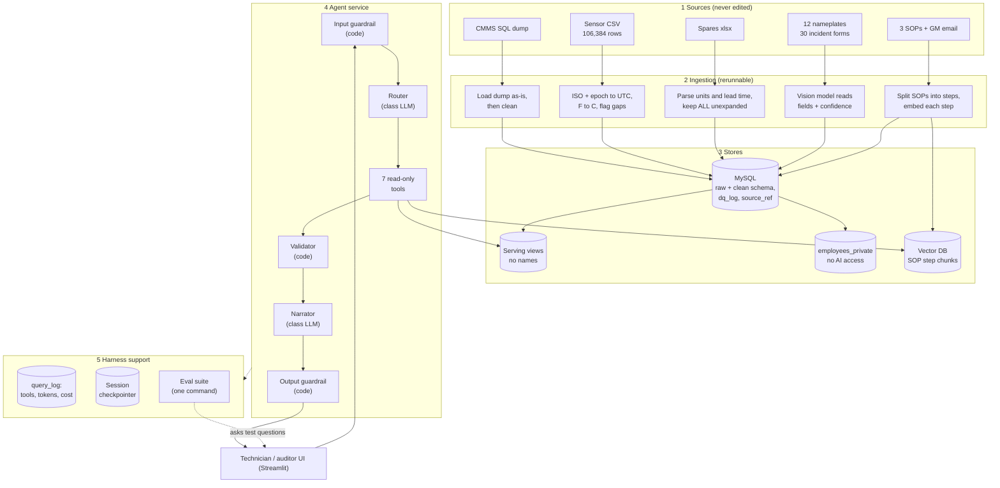
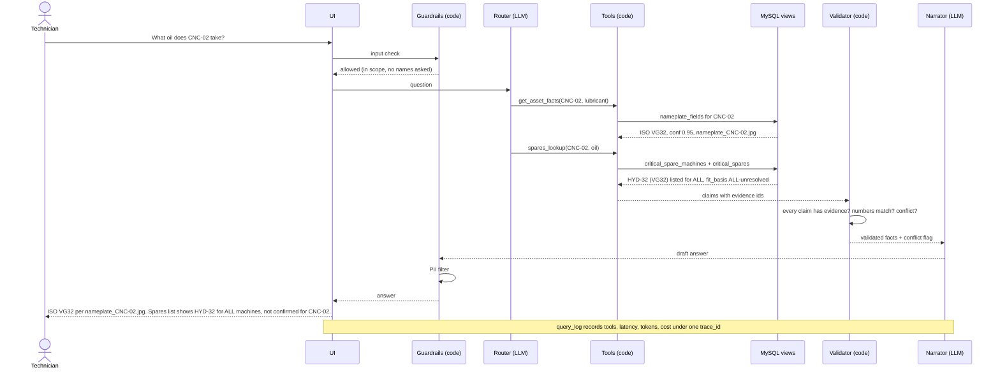
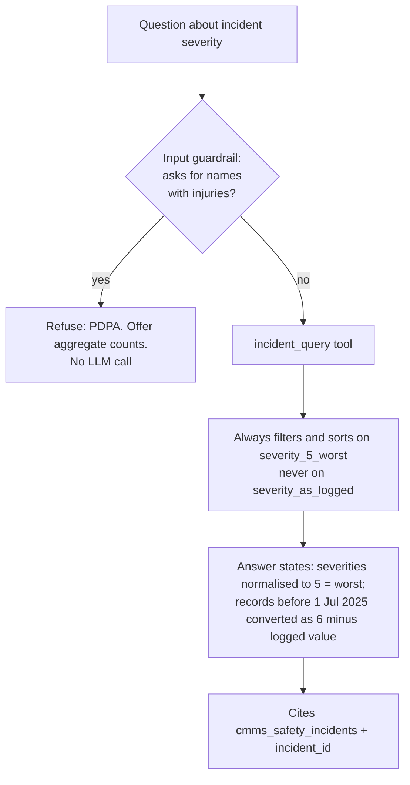

# Architecture proposal (Raymond's version)

Draft, 3 Nov 2026. Builds on the team draft (`jurong_marine_architecture.md` and section 4 of the checkpoint file).

**What this version adds:**
- **One overview that includes both stores** (MySQL and the SOP vector database). The draft's Diagram 0 was drawn before the two-store decision.
- **One fixed tool list** (7 tools). The draft has 6 in one diagram and 8 in another.
- **The harness layers drawn in:** input guardrail, validator, output guardrail, query log, session checkpointer, eval runner. The 8-minute architecture Q&A will probe these, and the rubric grades them.

## Diagram A: overview (sources to answer)

**How to read it:** sources (top) are cleaned once at ingestion and stored with the raw value and a source reference. The agent never sees raw tables or names: its tools read only the serving views and the vector DB. Every question passes the input guardrail; every answer passes the validator and the output guardrail before the user sees it. Everything the agent does is logged, and the eval suite replays test questions through the same UI path. SOP steps are stored in MySQL as the source of truth; the vector DB holds derived embeddings used only to find the right SOP.

## Diagram B: one question end to end, with a source conflict

"What oil does CNC-02 take?" exercises a photo, the spares sheet, a conflict and a citation in one question.

## Diagram C: the severity kill-shot, refused or answered safely

## Tools (fixed list of 7, all read-only)

| Tool | Answers | Store | Notes |
|---|---|---|---|
| `get_asset_facts` | Make, model, year, nameplate specs | MySQL | Returns image file, raw/normalised value, confidence, `semantic_ok` |
| `incident_query` | Counts and lists of incidents | MySQL | Always `severity_5_worst`, shows the scale, never sorts by ID |
| `wo_query` | Work-order counts, cost, open items | MySQL | States "as of 30 Jun 2026" |
| `sensor_analysis` | Trend, change point, day vs night, chart data | MySQL | Computed in code; abstains for the 7 machines without sensors |
| `spares_lookup` | Stock, minimum, lead time, fit | MySQL | Reports `ALL` as unresolved |
| `get_sop` | Full procedure for a topic or machine | Vector DB → MySQL | Search finds the SOP; MySQL returns every step verbatim with sop_id, revision, step |
| `search_forms` | Text read from incident forms | MySQL | For "what immediate action was taken" type questions |

**No free-form `sql_readonly` tool.** It's the widest PDPA and safety surface (draft decision D7), and the 7 tools above cover the client's questions. If the eval suite shows a gap, add a narrow tool instead.

## Where checks run (decision D10)

| Layer | Where | What it stops |
|---|---|---|
| Ingestion | Python scripts | Unit, timestamp and severity errors. Every change written to `dq_log` |
| Storage | MySQL keys and CHECKs | Duplicate readings, impossible values, orphans |
| Input | Guardrail code | Name requests, unsafe shortcuts ("skip lockout"), out-of-scope questions, with no LLM call |
| Answer | Validator code | Uncited claims, numbers that don't match tool output, hidden conflicts |
| Output | Guardrail code | Names, NRIC or phone patterns reaching the user |
| Before release | Eval suite | Regressions: 20+ questions incl. traps, 2+ refusals, kill-shot phrasings |

## Harness checklist coverage

| # | Item | Where in this design |
|---|---|---|
| 1 | Grounding | 7 tools, computed at question time; cross-source joins in `get_asset_facts` and `spares_lookup` code |
| 2 | Citations + conflicts | Evidence id on every claim; validator raises conflicts; trust order SOP > nameplate > CMMS text (KC to confirm) |
| 3 | Guardrails | Input and output guardrail boxes, code only |
| 4 | Error handling | Each tool returns `{ok, data, error, source}`; on failure the narrator must say "I couldn't check X" |
| 5 | State | Session checkpointer (SQLite) keyed by session id |
| 6 | Human-in-the-loop | Read-only agent, read-only DB user: no gate needed (stated here on purpose) |
| 7 | Observability | `query_log` with `trace_id`, weekly spend in `docs/spend.md` |
| 8 | Evals | Eval suite, one command, results committed |

## Phasing

| | Quick win (CP2, 14 Nov) | Target (demo, 21 Nov) |
|---|---|---|
| Data | CMMS, sensor, spares built; nameplates ingested | Forms, SOP tables, flags, dq_log |
| Retrieval | `get_asset_facts` + one cited answer ("What oil does CNC-02 take?"); SOP lookup by id | Vector + keyword search merged |
| Agent | Router + 2–3 tools | All 7 tools, validator, guardrails, checkpointer |
| Proof | Load counts, orphan checks | Eval suite green, failure drill screenshots, query_log with cost |
