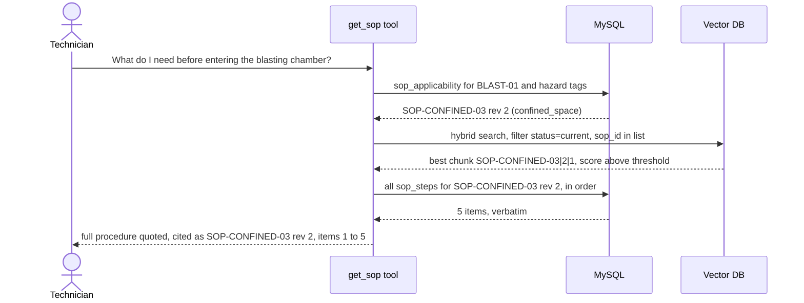

# SOP vector database design (Raymond's version)

Draft, 3 Nov 2026. **Mostly agrees with the team draft** (checkpoint file, section 5). This version is shorter, decides the open points, and adds hazard tags so generic SOPs (like lockout) can be found for any machine.

## 1. What goes in

| SOP | Revision | Items | Names these machines | Hazard tag (➕ new) |
|---|---|---|---|---|
| SOP-LOTO-01 | rev 4 | 7 steps | none (generic) | `energy_isolation` (applies to all powered machines) |
| SOP-CRANE-02 | rev 6 | 6 bullets | CRN-01, CRN-02 | `lifting` |
| SOP-CONFINED-03 | rev 2 | 5 items | BLAST-01 | `confined_space` |

18 chunks in total. Files are 434 to 706 bytes each. **The GM email is not indexed:** it's a requirement from the client, not a procedure. It's registered in `sources` so it can be cited in the data quality report.

## 2. Decisions

| Topic | Decision | Why |
|---|---|---|
| Chunking | **One chunk per step / bullet / item, wording kept exactly, no overlap.** Embedded text = SOP title + revision + step | Citations point to an exact step; steps stand alone |
| Retrieval returns | **The whole procedure, in order, from MySQL**, not just the matching step | Half a lockout procedure is unsafe |
| Source of truth | `sops` + `sop_steps` in MySQL; the vector DB is derived and rebuilt with one command | A lost or changed index can't change what the app quotes |
| Link key (D9) | `chunk_id = sop_id|revision|step_no` (primary key of `sop_steps`) | Same as the team draft |
| Machine link | `sop_applicability (sop_id, revision, machine_id, hazard_tag, basis_quote)`, filled only from text that names the machine. **➕ Generic SOPs get `machine_id = NULL` + a hazard tag**, so "before I service CNC-02" still finds SOP-LOTO-01 through `energy_isolation` | Without this, LOTO-01 (no machine named) is unreachable by machine filter. It also avoids an "ALL" marker like the spares list's |
| Embedding model (D3) | 1st choice: the class endpoint's embedding model, if offered. 2nd: a free local model (e.g. `sentence-transformers/all-MiniLM-L6-v2`). 3rd: keyword search only | Only the class key is allowed; no other paid AI |
| Search | **Hybrid: keyword (BM25) + vector, rankings merged.** With 18 chunks, keyword alone already finds "confined", "crane", "lockout" | Robust if embeddings are weak or unavailable |
| Product (D?) | **Chroma** (in-process, saves to disk, metadata filters). FAISS is the fallback if Chroma can't be installed | Nothing extra to host; filters by `status`, `sop_id` |
| Versions | File checksum in `sources`. Changed file → new `sops` row with a new revision, old one marked `superseded`. Search filters `status = current` | A superseded SOP is never quoted as current |
| Abstain | If the best match is below a threshold (tuned on the eval set), say no SOP covers it | Don't stretch a crane SOP to answer a welding question |

## 3. Metadata on each chunk

`chunk_id`, `sop_id`, `revision`, `status`, `step_no`, `numbered_in_source`, `hazard_tag`, `doc_type = sop`, `source_file`, `sha256`, `text` (verbatim).

Machine filtering is done in MySQL: look up `sop_applicability` for the machine and its hazard tags, then pass the matching `sop_id` values as the filter. That works the same with Chroma or FAISS.

## 4. How a question flows

## 5. Eval questions for this part

| Question | Expected |
|---|---|
| What do I need before entering the blasting chamber? | SOP-CONFINED-03 rev 2, all 5 items verbatim |
| What should I do before servicing CNC-02? | SOP-LOTO-01 rev 4 via `energy_isolation`, all 7 steps |
| Lifting rules for CRN-01? | SOP-CRANE-02 rev 6, all 6 bullets |
| What happened in the Aug 2025 sling near-miss? | Quotes SOP-CRANE-02's mention **and** says the incident table has no matching record (conflict) |
| What's the SOP for welding fume extraction? | Abstain: no SOP covers it |

## 6. Open points for the meeting

1. Does the class endpoint offer embeddings? (Ask the instructor now: it decides option 1 vs 2.)
2. Is installing Chroma allowed in the class environment?
3. Agree the hazard-tag idea for generic SOPs (my addition).
