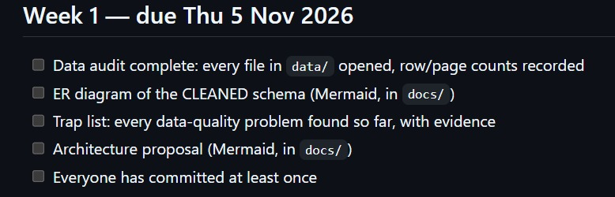
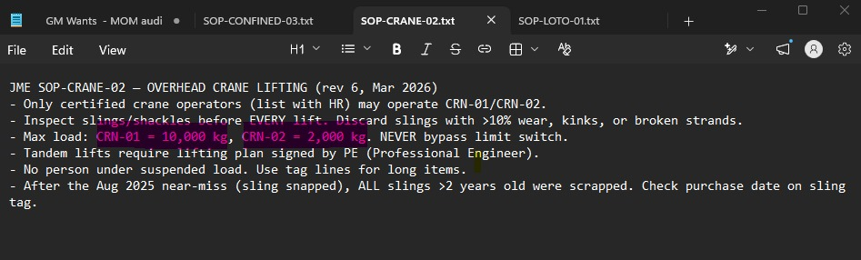
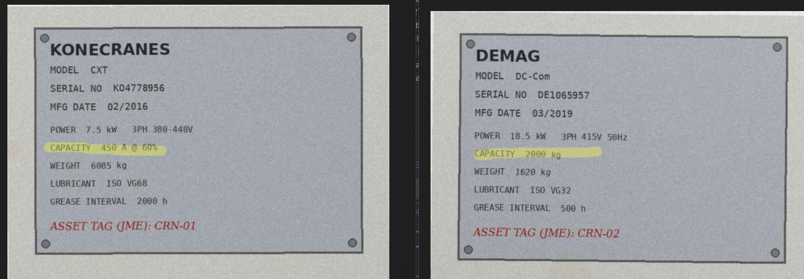
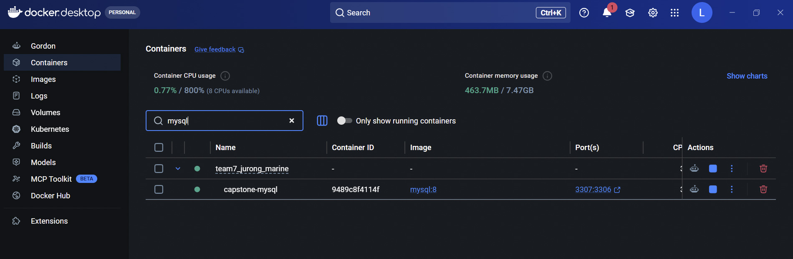
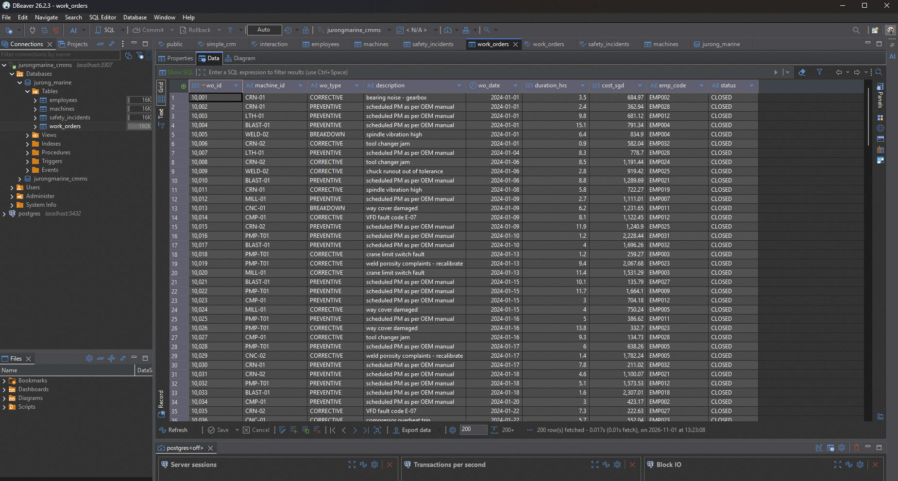

Reviewed: data\images\nameplates (12 machines JPGs)
## Machine Data and Nameplates

Reviewed the 12 machine nameplate images in `data/images/nameplates` and the 12 entries in the MySQL `machines` table.

The current table has four columns:

- `Machine_ID` (primary key)
- `Machine_name` (duplicated, non-unique, and ambiguous; use serial number and location to identify machines)
- `Model` (brand and model number are better represented as separate fields)
- `Year_installed` (integer)

Assumption: If there are fewer than 50 machines, these details can be updated manually.

The table should be improved; this data update does not require RAG or AI. Suggested columns:

- `Machine_ID` (primary key)
- `Serial_no` (unique)
- `Location`
- `Brand`
- `Model`
- `Year_installed`
- `MFG_Date`
- `Power`
- `Capacity`
- `Weight`
- `Lubricant`
- `Grease_interval`
- `Name_plate_JPG`

## General Manager's Brief

Reviewed `data/docs/sops/0000_gm_brief_email.txt`. The project should address the General Manager's requirements and the upcoming Ministry of Manpower (MOM) Workplace Safety and Health (WSH) audit, likely in Q4.

The brief identifies these needs:

- Make incident history queryable. The severity scale changed in July 2025: old severity 1 corresponds to new severity 5. The two scales must not be mixed.
- Help technicians find each machine's oil and grease interval, which are recorded on the photographed nameplates.
- Investigate CNC-02's reported change in behavior using the vibration logs. Predictive maintenance evidence could support the audit.
- Clean up the sensor CSV data, which contains mixed timestamp formats and temperatures recorded in both Fahrenheit and Celsius.

### Suggested Actions

- Reconcile the `safety_incidents` table with the incident report images; discrepancies could raise concerns during an audit.
- Update the machine table so the AI tool can answer questions using the machine data.
- Build an AI tool to monitor the vibration and temperature CSV, normalize timestamps and temperatures, and ingest the data into SQL.
- Analyze the relationship between maintenance cycles and vibration, and alert on vibration or temperature thresholds and changes.

## Crane SOP Review

Reviewed `data/docs/sops/SOP-CRANE-02.txt`. The maximum-load information in the SOP does not match the nameplate images, possibly because the SOP was updated manually.

## Additional Suggestion

Consider incorporating AI skills for the "Singapore MOM Workplace Safety Audit, Incident Classification & Reporting" and analyzing the safety incidents already tracked in the system. Review with the General Manager and professor which area is more important to prioritize.

## Additional Info on Module 5 Projects

## Additional Info on Module 5 Projects - Data Quality

## Additional Info on Module 5 Projects - Data Quality Comparison with ChatGPT

[Chatgpt research](../evidence/Jurong_Marine_Nameplate_Analysis.md)

## Additional Info on Module 5 Projects - Data Quality verification with Docker - MySQL - DBeaver - EXCEL

