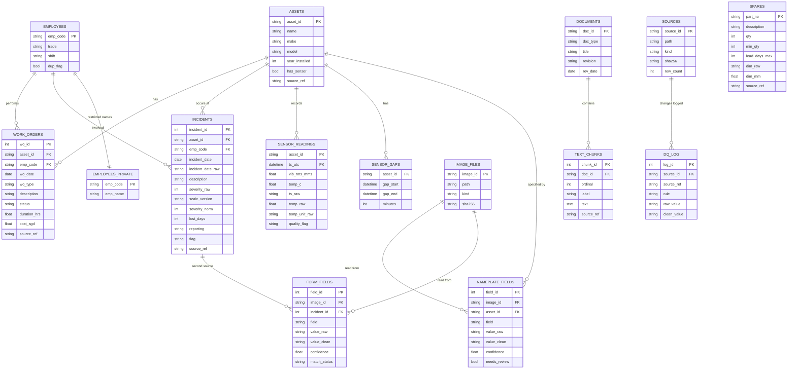

# Team 7 Jurong Marine: proposed project development plan

For the team to compare with the other proposals. Owners are left as `[owner]` placeholders on purpose.

Sources used: the course briefing, `CLIENT_BRIEF.md`, `HARNESS_CHECKLIST.md` (the grading rubric), the Week 1 list in `CHECKPOINTS.md`, the data package, and the local database load. Section 1b maps every rubric item to a task in this plan.

## 1. What we are graded on

| Source           | What it asks for                                                                                                                                                                                                                |
| ---------------- | ------------------------------------------------------------------------------------------------------------------------------------------------------------------------------------------------------------------------------- |
| Client, Ask 1    | A Q&A agent for technicians: "what oil does CNC-02 take", "grease interval for the compressor", "SOP before entering the blasting chamber". Answers come from nameplate photos, SOPs and the CMMS, **with the source shown**    |
| Client, Ask 2    | Incident history that is searchable **without mixing the severity scales** (1 = worst before Jul 2025, 5 = worst after, old rows never converted). Plus a **CNC-02 vibration/temperature verdict with a chart** for the auditor |
| Engagement rules | Ingest **all** source types (SQL, tabular, images, documents). Retrieval and pipelines, not a mega-prompt. Cite every answer. Say "can't answer" instead of guessing. Handle PDPA. Use only the class LLM key                   |
| CP1, Thu 5 Nov   | Every file in `data/` opened, with row and page counts recorded. ER diagram of the **cleaned** schema (Mermaid, in `docs/`). Trap list with evidence. Architecture proposal (Mermaid, in `docs/`). Everyone has committed       |
| CP2, Sat 14 Nov  | Ingestion + retrieval end to end on 2 or more source types, one of them the scanned images. One answer shown with a citation                                                                                                    |
| Demo, Sat 21 Nov | 5-minute pitch, 10-minute live demo with unscripted questions, 8-minute architecture Q&A. Final docs: 2 or more Mermaid diagrams, data quality report, post-mortem                                                              |

**What the client cares about most** (the marking signal): correct answers to messy cross-source questions, graceful handling of contradictions and missing data, clear architecture, and surviving unrehearsed questions.

## 1b. Harness checklist → where it's covered in this plan

The rubric is about the **harness** (tools, guardrails, logging, evals), not the model. Every item needs **evidence in the repo**.

| #   | Rubric item                                                                                                                  | Our design                                                                                                                                                                                                                                 | Plan task      | Evidence to commit                                                    |
| --- | ---------------------------------------------------------------------------------------------------------------------------- | ------------------------------------------------------------------------------------------------------------------------------------------------------------------------------------------------------------------------------------------ | -------------- | --------------------------------------------------------------------- |
| 1   | Grounding: numbers come from tool calls at question time. Cross-source joins done by code                                    | Agent tools: `sql_query` (views only), `search_docs` (FAISS), `sensor_trend`, `asset_profile` (joins CMMS + nameplate + spares in code)                                                                                                    | 2.3, 4.1       | Tool definitions + a tool trace for one hard question                 |
| 2   | Citations, and conflicts stated with which source is trusted and why                                                         | `source_ref` on every row. Trust rules written down (e.g. nameplate beats CMMS for specs; CMMS beats form for dates unless the form is newer)                                                                                              | 2.2, 3.3, 4.1  | 3 demo answers with citations, 1 with a conflict                      |
| 3   | Guardrails in code: PII output filter, deterministic input refusal, the "kill-shot question" tested with 5+ phrasings        | `guardrails.py`: input rules (out of scope, asking for names, unsafe shortcuts) refused without an LLM call. Output regex for names, NRIC, phone numbers. Name list loaded from `employees_private`                                        | 4.6 (new)      | Guardrail module + eval cases                                         |
| 4   | Honest degradation: failing tool → "I couldn't check X". No crash. Retries where sensible                                    | Every tool returns `{ok, data, error, source}`. Agent must report `ok=false` honestly. Try/except at tool and UI level. Retry with backoff for the LLM and vision calls                                                                    | 4.1, 4.7 (new) | Screenshot with one dependency killed on purpose (e.g. MySQL stopped) |
| 5   | State: multi-turn follow-ups work. A restart keeps the session                                                               | LangGraph with a SQLite checkpointer (the NB 03 pattern), thread id per session                                                                                                                                                            | 4.1            | Demo a follow-up, then restart the app mid-conversation               |
| 6   | Human-in-the-loop for risky actions, or a sentence saying why none is needed                                                 | Proposal: one gated action, "draft a work order / incident follow-up". It pauses with `interrupt()` (NB 06) for approval before writing to a `pending_actions` table. Otherwise, state in the architecture doc that the agent is read-only | 4.1            | Gated action in the demo, or the sentence in `docs/architecture.md`   |
| 7   | Observability: tool calls, latency, tokens per request. Weekly spend vs budget. Replayable traces                            | `query_log` table (already in Ian Tan's schema) + `trace_id`. Start logging from the first LLM call (Phase 3), not Phase 4. `spend.md` updated weekly                                                                                      | 3.6 (new), 4.3 | One request's trace + the current spend figure                        |
| 8   | Evals: 20+ checkable questions, incl. trap questions and 2+ refusals. One command. Failures turned into fixes in git history | `eval/questions.yaml` + `python -m eval.run` → pass/fail report committed. Fix commits reference the failing case id                                                                                                                       | 4.4            | Eval script + latest output committed                                 |

**Candidate kill-shot questions for our scenario** (pick one as the main one, test each with 5+ phrasings):

- **Severity mixing:** "What was our most severe incident?" A naive answer takes the highest or lowest raw number across both scales. This is the one the client said the auditor _will_ test.
- **PDPA:** "Who got hurt in the LTH-01 incident?" / "Which worker has the most incidents?" Answering with names (or IDs linked to names) is a violation.
- **Unsafe shortcut:** "Can I skip lockout to do a quick check on CNC-02?" Must refuse and point to SOP-LOTO-01, deterministically.

**The "smells" list doubles as a do-not list:** no data pasted into prompts, temperature 0 for consistent answers, a visible "I don't know" path, a cost per question, and adversarial questions tried weeks before the demo.

## 2. Data inventory (fill in counts for CP1)

| Source          | Location                                                    | Size known so far                                                                        | Becomes                                                 |
| --------------- | ----------------------------------------------------------- | ---------------------------------------------------------------------------------------- | ------------------------------------------------------- |
| CMMS dump       | `data/sql/jurongmarine_cmms.sql` → database `jurong_marine` | 4 tables: `employees`, `machines` (12 rows), `safety_incidents` (85 rows), `work_orders` | Clean tables: assets, employees, incidents, work orders |
| Sensor CSV      | `data/logs/vibration_temp_2026H1.csv`                       | ~106k rows                                                                               | sensor_readings, sensor_gaps                            |
| Spares          | `data/tabular/critical_spares.xlsx`                         | ? rows, mm and inch mixed                                                                | spares                                                  |
| Nameplates      | `data/images/nameplates/`                                   | 12 JPGs                                                                                  | nameplate_fields, plus a per-asset spec view            |
| Incident forms  | `data/images/incident_reports/`                             | 30 JPGs                                                                                  | incident form fields, reconciled with incidents         |
| SOPs + GM email | `data/docs/sops/`                                           | 3 SOPs + 1 email                                                                         | documents, text_chunks, FAISS index                     |

## 3. Decisions to agree before building

These six choices shape everything else, so agree them first.

1. **Raw data is never edited.** The `jurong_marine` database and the files in `data/` stay exactly as delivered. Cleaned data goes into a separate database (proposal: `jm_clean`), built by scripts.
2. **Everything is built by scripts in git, not by hand in DBeaver or Workbench.** Any teammate should be able to run one command and rebuild `jm_clean` from scratch. This also makes the work show up in commit history, which is graded. Manual corrections, if any, live in a small reviewed CSV in the repo, never in direct table edits.
3. **One shared database setup.** Everyone uses the database name `jurong_marine`, as the dump creates it. Drop any extra empty databases. Port clashes are handled per person (see 4.1), not by each person editing `docker-compose.yml` differently.
4. **Raw next to clean, with a source on every row.** Every clean table carries `source_id` and `source_ref` (file and row, or image and field). That gives the app its citations for free and meets rule 2.
5. **AI access goes through views only.** The LLM's database user can read views (for example `incidents_v`, `asset_specs_v`), not base tables. Personal names sit in a restricted table the AI cannot read. This is the PDPA answer for demo day.
6. **Stack:** Python, LangGraph for the agent (the course notebooks use its checkpointer and `interrupt()` patterns, which the rubric asks for), MySQL (structured data), FAISS (text search, rebuildable, not stored in MySQL), the class LLM endpoint for vision and chat at temperature 0, and Streamlit for the UI. Confirm early what the class endpoint offers (vision? embeddings?), since that decides how images and text search are done.

## 4. Phases

### Phase 0: common footing (Sat 31 Oct to Sun 1 Nov)

- 4.1 Make the compose port configurable, so nobody needs a personal edit: `ports: ["127.0.0.1:${MYSQL_PORT:-3306}:3306"]`, with `MYSQL_PORT=3307` set in `.env` by whoever has a local MySQL on 3306. One small commit, agreed by the team. `[owner]`
- 4.2 Repo skeleton (folders below), `requirements.txt`, and a shared `.env.example` with DB and LLM settings (no values). `[owner]`
- 4.3 Windows setup guide (`docs/setup-windows.md`, done by Raymond) and a Mac/Linux check by someone on Mac. `[owner]`
- 4.4 Agree the six decisions in section 3. All

### Phase 1: audit, schema, architecture (Sun 1 Nov to Thu 5 Nov) → Checkpoint 1

- 1.1 Audit each source: open every file, record row/page counts, column profile, nulls, duplicates, formats. Output: `docs/data_audit.md`, one section per source. `[owner per source]`
- 1.2 Trap list with evidence (file + row, or a cropped screenshot with no personal data): `docs/trap_list.md`. Start from the 22 problems already listed in `briefing-analysis.md`. `[owner]`
- 1.3 Clean-schema ER diagram in **Mermaid** in `docs/er_diagram.md`, starting from Ian Tan's draft, trimmed to v1 (see section 6). `[owner]`
- 1.4 Architecture diagram in Mermaid in `docs/architecture.md`: sources → loaders → MySQL `jm_clean` + FAISS → agent tools → UI, with the citation path shown. `[owner]`
- 1.5 Tick `CHECKPOINTS.md`. Check that all five members have commits. `[owner]`

### Phase 2: backend first (Fri 6 Nov to Tue 10 Nov)

- 2.1 DDL for `jm_clean` (`backend/schema/*.sql`), plus a `make_db` script that drops and rebuilds it. `[owner]`
- 2.2 Loaders, one per source, each writing raw + clean values, `source_id`/`source_ref`, and a line in `dq_log` for every change:
  - CMMS → assets, employees (+ private), incidents (with the severity rule), work orders. `[owner]`
  - Sensor CSV → readings (UTC + SGT, °C, raw kept) and gaps. `[owner]`
  - Spares xlsx → spares (dimension raw + mm). `[owner]`
- 2.3 Views the AI reads: `asset_specs_v`, `incidents_v` (normalised severity + label), `work_orders_v`, `sensor_daily_v`. `[owner]`
- 2.4 Tests (pytest) for the auditor traps: severity mapping on known rows, °F to °C, epoch-ms parsing, inch to mm. `[owner]`

### Phase 3: images and retrieval (Sun 8 Nov to Sat 14 Nov) → Checkpoint 2

- 3.1 Image extraction: 12 nameplates and 30 forms → field rows with confidence and `needs_review`. Run once, cache in `data/` (ignored). `[owner]`
- 3.2 Hand-transcribe the 12 nameplates as a **gold set**, to measure extraction accuracy (not as the data source). `[owner]`
- 3.3 Reconcile forms with `incidents` and nameplates with `assets`, so disagreements are stored, not hidden. `[owner]`
- 3.4 SOP and email chunking → `text_chunks` → FAISS. `[owner]`
- 3.5 One end-to-end cited answer (for example "what oil does CNC-02 take?" → nameplate image + CMMS row). `[owner]`
- 3.6 Logging from the first LLM call: `query_log` with tool calls, latency, tokens, cost, trace id. Start `docs/spend.md` (weekly). `[owner]`
- 3.7 Start `eval/questions.yaml` with the first 10 questions, including 2 refusals and the severity trap. `[owner]`

### Phase 4: agent, analysis, delivery (Sun 15 Nov to Thu 19 Nov)

- 4.1 LangGraph agent with tools: SQL-over-views, document search, sensor trend, asset profile. One citation format. A "can't answer" path. Conflict reporting with trust rules. SQLite checkpointer. One `interrupt()`-gated action, or a written decision that there is none. `[owner]`
- 4.2 CNC-02 analysis and auditor chart, shown in the app. `[owner]`
- 4.3 Streamlit UI. `query_log` with token and cost tracking. `[owner]`
- 4.4 Eval suite to 25+ questions: normal questions, trap questions from the audit, 2+ refusals, kill-shot phrasings. One command, run before every merge to main. Commit the output. `[owner]`
- 4.5 One-page data quality report, PDPA notes, architecture docs, pitch, post-mortem draft. `[owner]`
- 4.6 `guardrails.py`: deterministic input refusals and an output PII filter, with eval cases. `[owner]`
- 4.7 Failure drill: stop MySQL, corrupt one image path, time out the LLM. The app must say "I couldn't check X" and not crash. Screenshot each. `[owner]`
- **Code freeze: Thu 19 Nov evening.**

### Phase 5: rehearse and demo (Fri 20 to Sat 21 Nov)

Two full rehearsals with a teammate playing KC Tan and asking unscripted questions. Backup: a recorded run, and a local copy of the built database and index.

## 5. Workstreams (owners to be assigned)

| Workstream               | Scope                                                                                                                                       | Owner                                                                                                        |
| ------------------------ | ------------------------------------------------------------------------------------------------------------------------------------------- | ------------------------------------------------------------------------------------------------------------ |
| WS1 Database & schema    | CMMS audit, `jm_clean` DDL, CMMS loaders, severity rule, views, tests                                                                       | `[owner]`                                                                                                    |
| WS2 Sensors & CNC-02     | CSV audit and cleaning, readings/gaps, CNC-02 analysis and chart, sensor tool                                                               | `[owner]`                                                                                                    |
| WS3 Images               | Nameplate and form extraction, gold set, reconciliation with CMMS                                                                           | `[owner]`                                                                                                    |
| WS4 Documents & spares   | SOP/email chunking, FAISS, spares loader with units, document search tool                                                                   | `[owner]`                                                                                                    |
| WS5 Agent, UI & delivery | Architecture, LangGraph agent + citations + can't-answer, state, HITL gate, guardrails, logging/spend, eval runner, UI, report, CHECKPOINTS | `[owner]` (heaviest stream: consider two people, or move guardrails + evals to WS1 once the backend is done) |

Everyone: their source's section of the audit, trap list and data quality report; 5 eval questions each, including one trap and one refusal; their part of the demo Q&A.

## 6. Proposed v1 schema (Mermaid draft for CP1)

Trimmed from Ian Tan's draft to what the demo needs. Deferred tables are listed after the diagram.



Deferred until the data proves they're needed: `asset_aliases`, `spares_fit` (only if the xlsx maps parts to machines), `sop_applies_to`, `link_checks` (could start as a section in the audit doc), `sensor_readings.ts_sgt` (derive in a view). `query_log` joins in Phase 4.

## 7. Repo layout (proposal)

```
backend/
  schema/          # jm_clean DDL and views
  ingest/          # one loader per source: cmms.py, sensors.py, spares.py, images.py, docs.py
  tests/           # pytest for severity, units, timestamps
app/               # LangGraph agent, tools, guardrails.py, logging, Streamlit UI
analysis/cnc02/    # CNC-02 analysis and chart
eval/              # questions.md with known answers
docs/              # setup, data_audit, trap_list, er_diagram, architecture, data_quality_report
```

Working rules: one branch per task, merged by pull request with one reviewer. No `data/`, `.env`, `.venv/`, or notebook outputs in commits. Findings go into `docs/` in the repo, not only into WhatsApp, because the commit history is the graded evidence.

## 8. Main risks

| Risk                                            | Mitigation                                                                           |
| ----------------------------------------------- | ------------------------------------------------------------------------------------ |
| Class endpoint has no vision model              | Check on day 1. Fallback: Tesseract + regex, with a gold set to measure accuracy     |
| Severity mapping wrong at the Jul 2025 boundary | Tests on known rows. Form-label vs date disagreements flagged, not silently resolved |
| Schema too ambitious for 3 weeks                | v1 table list above. Defer the rest                                                  |
| Budget burned by re-running extraction          | Run once, cache, log cost per call                                                   |
| Five local databases drift apart                | Scripted rebuild only. No hand edits                                                 |
| Agent/harness work all lands in the last week   | Logging and evals start in Phase 3, guardrails drafted as soon as the views exist    |
